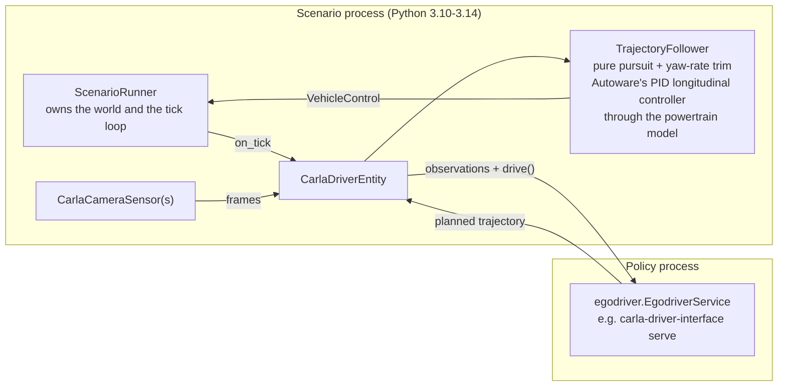

# External Driver Interface

The ego vehicle in a scenario is normally driven by CARLA's TrafficManager. This page
describes the alternative: handing the ego to an **external driving policy** that plans
over gRPC, so a scenario becomes a test of that policy rather than of TrafficManager.

The wire contract is alpasim's `egodriver.EgodriverService`. Its policy side is
[**`carla-driver-interface`**](https://github.com/hakuturu583/carla_driver_interface)
(2.x), a light package (grpcio, protobuf, numpy, Pillow; Python 3.10+) a policy
depends on without pulling in the scenario framework. It is versioned on its own: the
framework accepts any `carla-driver-interface>=2.1,<3`, so a policy and a scenario
package can share an environment whenever their majors agree.

A policy run as a separate process may be on another major. Each side declares the
**contract revision** it speaks (carla-driver-interface's major) in gRPC metadata, and
the framework declares its cameras in the policy's revision:

| Policy on | `rig_to_camera` the framework declares |
| --- | --- |
| carla-driver-interface 2.x (revision 2) | the camera's optical frame in the rig (x right, y down, z along the optical axis), as alpasim declares it |
| carla-driver-interface 1.x (declares no revision) | the camera body in the rig (x along the optical axis, y left, z up), as 1.x reads it |

A 2.x policy is handed the optical frame either way, also by autoware_carla_scenario 4.x,
whose cameras its server translates. A revision the framework does not know fails
`start_session` with `ContractError`, before the scenario starts.

## Architecture

The scenario framework plays the **runtime** role: it owns the world, ticks the
simulation, renders observations, and asks the policy what to do. The policy is a
separate process serving `egodriver.EgodriverService`.



Each simulation tick, `CarlaDriverEntity` tracks the most recent plan and applies a
control. Every `driver.policy_timestep_s` it also submits fresh observations — camera
frames, the ego's pose and dynamic state at every tick since the previous step (the
egomotion history the upstream runtime sends), and a route window rolled forward from
the ego's current position — and asks the policy to re-plan. Between policy steps the cached
plan keeps being tracked, which is how a policy slower than the simulation stays usable.

## Running a scenario against a policy

The scenario can serve the policy itself, in its own process, so one command runs
everything. Name the policy in `driver.policy` (a reference policy, or
`package.module:Class` for your own `BaseDriver`):

```bash
uv run scenario ego.entity=carla_driver driver.policy=route_follower
```

The policy is built once per run and served on a free local port; `driver.address`
is not used. Every scenario of a batch opens its own session on it, so a model is
loaded once. Over the wire nothing changes: by default the scenario still dials it
over gRPC, exactly as it dials a policy in another process, and with
`driver.transport=direct` it exchanges the same messages without a socket (below).

To run the policy as a process of its own (another environment, a GPU host, an
alpasim driver), leave `driver.policy` unset and start the policy first. It is a
server, and the scenario is the client:

```bash
# In the policy's own environment
uv run carla-driver-interface serve --policy route_follower --port 50051
```

Then run any scenario with the `carla_driver` ego entity:

```bash
uv run scenario ego.entity=carla_driver driver.address=localhost:50051
```

### How the run reaches the policy: `driver.transport`

| `driver.transport` | `driver.policy` set (the run serves it) | `driver.policy` unset (another process) |
| --- | --- | --- |
| `tcp` (default) | served on a free local port and dialled there | dials `driver.address` (`host:port`) |
| `unix` | served on a Unix socket in a directory of the run's own (`0700`, under `$TMPDIR`, or `/tmp`) | dials `driver.address`, which must name a socket (`unix:///run/policy.sock`) |
| `direct` | no socket: the run calls the policy's servicer through `carla_driver_interface.inprocess` | refused: a policy in another process has to be dialled |

```bash
uv run scenario ego.entity=carla_driver driver.policy=route_follower driver.transport=direct
# a policy in its own process, on a socket
uv run carla-driver-interface serve --policy route_follower --host unix:///run/policy.sock
uv run scenario ego.entity=carla_driver driver.transport=unix driver.address=unix:///run/policy.sock
```

Whichever it is, the policy sees the same alpasim `egodriver` messages: `direct`
still serializes every request and response to the bytes the wire would carry and
parses them on the other side, and its servicer is the one a server runs, with a
context that behaves as gRPC's (an abort is a `grpc.RpcError` with the same code and
details, the contract revision is negotiated through the same metadata). A policy
that is an alpasim driver therefore drives the same whether it is dialled over TCP
or called in-process; only the transport's cost goes (a sweep's megabytes are not
copied through the loopback twice per step). The one difference is a deadline
(`driver.timeout_s`): the policy runs on the run's own thread, so an overrun is
reported when its call returns rather than cut short.

`unix` with `driver.policy` and `direct` need carla-driver-interface 2.2 or later;
with an older one the run stops as it sets up, naming the installed version, and
`tcp` keeps working. Under the SLURM launcher every task serves its own policy, so
neither uses a port of its slot ([slurm.md](slurm.md)).

`ScenarioRunner` logs `Autopilot skipped for ego (id=…) — external control expected`
when the policy has taken over. Pass and fail conditions, recording, the trajectory log,
and sweeps all behave exactly as they do for a TrafficManager-driven ego.

## Configuration

The `driver` config group (`conf/driver/default.yaml`) holds the settings:

```yaml
driver:
  address: localhost:50051
  policy: null               # e.g. route_follower: served by the run itself
  transport: tcp             # tcp | unix | direct; see "How the run reaches the policy"
  timeout_s: 60.0
  policy_timestep_s: 0.1     # must be a multiple of the 0.05 s simulation step
  image_quality: 90
  warmup_s: 0.0              # run-up onto the spawn pose; see "Warming up a policy"
  route_horizon_m: 80.0
  route_resolution_m: 2.0
  rear_axle_offset_m: null   # null derives it from the wheel physics
  send_ground_truth: false
  send_renderer_data: true       # CARLA ground truth: lights, traffic, speed limit
  send_actor_ground_truth: true
  traffic_light_sight_distance_m: 60.0
  actor_horizon_m: 150.0
  random_seed: null           # null: the run's seed (`seed`)
  cameras:
    - logical_id: camera_front_wide_120fov
      image_width: 960
      image_height: 604
      fov: 120.0
      position_x: 1.5
      position_z: 1.6
  control:
    lookahead_gain_s: 0.6
    wheelbase_m: 2.8
    max_steer_angle_deg: 56.0   # CARLA 0.10: angle = 56 deg * steer**2
    steer_exponent: 2.0
    yaw_rate_ki: 3.0            # integral trim on the measured yaw rate
    longitudinal_controller: pid  # Autoware's autoware_pid_longitudinal_controller
    delay_compensation_time: 0.17 # ... and any of its parameters, by name
    throttle_deadband: 0.3      # vehicle interface: least throttle to pull away
```

### A camera with a lens of its own: `driver.cameras[].lens`

A camera's frames are CARLA's pinhole of its `fov` unless it says otherwise. A
[carla_canvas](usage.md#rendering-sensors-with-carla_canvas) renderer may draw
a camera through another lens: the Cosmos3 world model
([cosmos3-canvas](https://github.com/hakuturu583/cosmos3-canvas)) draws only its
Hyperion 8 cameras, each through its F-theta fisheye lens. Such a camera carries
its `lens`, so the policy and a [T4 dataset](t4_dataset.md) are told what the
frames are:

```yaml
driver:
  cameras:
    # python -m cosmos3_canvas.camera camera_front_wide_120fov
    - logical_id: camera_front_wide_120fov
      image_width: 832
      image_height: 480
      fov: 120.0
      lens:
        model: ftheta
        principal_point: [412.641208, 242.790324]
        pixeldist_to_angle_poly: [0.0, 0.00243165382, -4.05625414e-08, 6.10818843e-10, -9.93181484e-13, 8.73787714e-16]
        angle_to_pixeldist_poly: [0.0, 411.286296, 2.40299018, -16.2530848, 10.3586782, -3.39986006]
        max_angle: 1.226783919
        linear_cde: [1.00234926, 0.0, 0.0]
```

| Field | Meaning |
|---|---|
| `model` | `ftheta`, NVIDIA's F-theta model: the only one |
| `principal_point` | `[x, y]` in pixels (the centre of the top-left pixel is (0, 0)) |
| `pixeldist_to_angle_poly` | Radius from the principal point (pixels) to the angle from the optical axis (radians); coefficients from the constant term up |
| `angle_to_pixeldist_poly` | Its inverse, the angle to the radius |
| `max_angle` | The largest angle the lens sees (radians) |
| `linear_cde` | `[c, d, e]`: `[[c, d], [e, 1]]` maps the radial offset to pixels |
| `reference_poly` | Which polynomial defines the lens: `pixeldist_to_angle` (default) or `angle_to_pixeldist` |

The policy is sent the lens as alpasim's `FthetaCameraParam`, in place of the
pinhole. The CARLA camera is still made with `image_width`, `image_height` and
`fov`: what the renderer reads to know which of its cameras it is.

### How the plan is tracked

`TrajectoryFollower` (`driver/control.py`) does what Autoware's control stack does
behind an end-to-end planner:

- **Speeds on the plan.** A plan is poses and times. The speeds Autoware's controller
  reads off a trajectory are put on it as `autoware_tensorrt_e2e` puts them on its own
  (`autoware_diffusion_planner`'s `get_trajectory_from_poses`): each point's speed is
  its distance from the previous point -- the first point's from where the ego was as
  the plan arrived -- over the plan's time step; then a forward moving average over
  `velocity_smoothing_window` (8) points, the tail keeping the last average. While the
  ego moves, the first average to fall below `stopping_threshold` (0.3 m/s) stops the
  plan there. Each point's acceleration is the change of speed to the next.
- **Longitudinal.** A port of `autoware_pid_longitudinal_controller` with the defaults
  of its `param.yaml`, under its parameter names. The plan is read spatially: the
  stop distance is the arc length from the ego to the plan's first zero-speed point
  (or its end). STOPPED departs once that is over `drive_state_stop_dist` (0.5 m),
  DRIVE stops through STOPPING (smooth stop) once it is under
  `stopping_state_stop_dist`, STOPPED holds `stopped_acc`, and an overshoot of
  `emergency_state_overshoot_stop_dist` brakes at `emergency_acc` (EMERGENCY). DRIVE
  follows the speed at the point the ego will be at after `delay_compensation_time`,
  with Autoware's velocity lookahead feedback (or, with
  `enable_velocity_lookahead_feedback: false`, its PID and feedforward), within the
  acceleration and jerk limits.
- **Lateral.** Pure pursuit on the plan's points, with an integral trim on the
  measured yaw rate.
- **Vehicle interface.** The asked acceleration becomes pedals through the ego's
  powertrain model, read from its CARLA physics control, as Autoware's
  `raw_vehicle_cmd_converter` does with its accel and brake maps. The model lets a
  standing car move at any throttle while CARLA 0.10's MKZ stays put below 0.25.
  A plan pulling away at a crawl asks a standing car for a throttle near 0.23, so
  `throttle_deadband` (0.3) floors the throttle of a standing car asked to speed up:
  it moves as a real car would creep.

What differs from Autoware, because CARLA or the plan has no counterpart:

- The plan carries no pitch, so there is no slope compensation; CARLA's towns are
  flat where the scenarios drive.
- The follower has no steering angle feedback: the steering counts as converged, so
  `enable_keep_stopped_until_steer_convergence` holds only the first tick of a
  departure, as Autoware's first check does.
- The ego is always under Autoware's control (AUTONOMOUS), and always in drive:
  the manual-driving transitions and reverse gear are left out.
- The ego's acceleration is estimated from its speed with
  `autoware_twist2accel`'s low-pass gain (`accel_lowpass_gain`, 0.9).
- The filters run per control step, at the simulation's 20 Hz rather than
  Autoware's 33 Hz.
- A plan's times come from its timestamps rather than the node's fixed 0.1 s, and
  the smoothing window is capped at one less than the plan's points; a 0.1 s plan
  gets Autoware's numbers. carla-driver-interface leads each plan with the ego's
  pose at the planning time; that anchor is the base the first speed is measured
  from (the node's ego position), not a point of the tracked trajectory. A plan
  without one is measured from where the ego is as it arrives. Either is latched
  with the plan.
- A plan of fewer than two points is ignored and the last one tracked on, as
  Autoware's `setTrajectory` does.
- A follower taken over on a moving ego (the warm-up's hand-off, a spawn at
  speed, a new ROS 2 command source) starts in DRIVE rather than STOPPED, which
  would brake for a tick.
- The smooth stop fits the speed history of the delay's control steps: 3 at
  0.05 s, where Autoware keeps 5.

A ROS 2 `autoware_planning_msgs/Trajectory` is tracked on its own
`longitudinal_velocity_mps` and `acceleration_mps2`, every point kept (a stop
included) even when its `time_from_start` is not set.

A plan that dwells on the ego's spot -- the first eight speeds averaging to zero --
stops at its first point, and the ego stays STOPPED until a plan's stop point is
more than 0.5 m away, as Autoware's would. `longitudinal_controller: time_indexed`
selects the tracker this framework had before: the plan read on its own clock, a PI
on the speed it has the ego at *now* and a pull towards where it has it (`speed_kp`,
`speed_ki`, `integral_limit`, `position_gain`, `max_position_correction_mps`,
`speed_preview_s`, `stop_distance_m`); `RoutingAction` in `follow` mode drives timed
trajectories with it. Those keys are ignored, with a warning, for `pid`.

### Warming up a policy

A policy that reads a history -- past LiDAR maps, the ego's past poses -- has
none at the first step and plans as if the ego had stood still: an ego spawned
moving brakes on those first plans. `driver.warmup_s` gives it a run-up instead:
the `warmup_s` before the scenario's first frame are played by rule, so that
everything arrives at its first-frame pose at its initial speed.

- Every vehicle with an initial speed, the ego among them, is put back along its
  lane by its initial speed times `warmup_s`, keeping its offset from the lane
  centre and its heading relative to the lane, and driven onto its pose. One with
  no initial speed stands on its pose.
- Every pedestrian with an initial speed is moved in a straight line along its
  heading; one with none stands where it starts.
- The traffic lights are frozen, so the run-up spends none of their phases, and
  thawed on arrival. A light the scenario (a `TrafficSignalAction` in
  `register_init`, say) or a signal controller already froze stays frozen and is
  not thawed on arrival.

The policy gets every observation and plans all the way, but does not drive; the
scenario's clock starts, and the policy takes over, on arrival. Set `warmup_s` to
the history the policy reads (3 s for ResWorld's ego past).

`ego.entity` selects the entity and accepts four values:

| Value | Behaviour |
| --- | --- |
| `autopilot` (default) | CARLA's TrafficManager drives the ego. |
| `autoware` | Nothing drives the ego; the actor is left for an external stack. |
| `carla_driver` | An external policy drives the ego over the contract described here. |
| `ros2` | ROS 2 nodes drive the ego over DDS ([ROS 2 over DDS](ros2.md)). |

A policy is usually built for one rig, so a preset can choose the vehicle and cameras
along with the rest of the group. `driver=vision_pilot` is
[VisionPilot](https://github.com/autowarefoundation/vision_pilot)'s: a Lincoln MKZ with
one 1920×1280, 50° front camera at 10 Hz (its own CARLA rig), and it hands the ego to the
policy (`ego.entity: carla_driver`):

```bash
uv run vision-pilot-driver --model-dir <weights> --port 50051   # in vision_pilot
uv run scenario driver=vision_pilot
```

A preset extends `driver/default` (`defaults: [default, _self_]`) and may set `ego.*`,
since the `driver` group is composed after `ego`.

`logical_id` is the name the policy looks a camera up by, so it must match what the
policy expects. `carla-driver-interface`'s reference policies use
`camera_front_wide_120fov`.

### A stack serving the policy's world (`driver.bridge`)

A policy can drive in a world something else serves it -- splatsim rendering what
its cameras see, say -- that has to come up before the policy can drive, and has to
know where the run goes. `driver.bridge` gives the ego the same
[`AutowareBridge`](autoware.md) handshake an `ego.entity=autoware` run uses: the
framework hosts the bridge, the stack's interface node dials it, pulls the
scenario's mission (initial pose, goal, waypoints, at its `base_link`) and reports
when it is ready.

```yaml
driver:
  bridge:
    address: 0.0.0.0:50052     # AutowareBridgeConfig's fields
    ready_timeout_ticks: 1200
```

With a bridge the scenario needs a goal (`ego.goal_lanelet_id`, or one the scenario
derives), handed over when the scenario starts. Until the stack reports ready the
policy is not queried and the scenario's clock does not start; the policy then
starts -- its warm-up first, when `warmup_s` is set -- on the tick the stack turns
ready. A stack that is not ready within `ready_timeout_ticks`, or exits, ends the
run. `null` (the default) runs the policy alone, from the first tick.

From Python the same is `CarlaDriverEntity(config, bridge=..., bridge_config=...,
launcher=...)`; a `launcher` starts and stops the stack per scenario, as it does for
Autoware.

## Using it from Python

Scenarios that build their ego themselves can attach the entity directly:

```python
from autoware_carla_scenario import CarlaDriverEntity, DriverClientConfig

scenario.ego_entity = CarlaDriverEntity(
    DriverClientConfig(address="localhost:50051", policy_timestep_s=0.1)
)
```

`ScenarioRunner` calls `BaseScenario.create_ego()`, which returns `ego_entity` when one
is set and otherwise instantiates `ego_type`. Assigning `ego_entity` is the supported
way to supply an entity that needs constructor arguments.

To test against a fake policy, pass a `BaseEgoDriverClient` implementation:

```python
CarlaDriverEntity(config, client=MyFakeDriverClient(config))
```

## CARLA ground truth

The alpasim contract has no field for a traffic light and none for other vehicles.
Both ride inside `DriveRequest.renderer_data`, an upstream-sanctioned `bytes` extension
point, as a serialized `carla_driver.v0.CarlaRendererData`:

| Field | Contents |
| --- | --- |
| `ego_traffic_light` | State of the light governing the ego lane |
| `ego_traffic_light_distance_m` | Distance to its stop line **along the ego's heading**; negative once crossed or when no line applies |
| `speed_limit_mps` | Posted limit for the ego lane, 0 when unknown |
| `actors[]` | Other vehicles: pose, bounding box, and velocity, all in the local frame |
| `weather`, `map_name`, `frame_id` | Scene context |
| `lidar[]` | One sweep per `driver.lidars` entry, packed `[N, 4]` float32 (x, y, z, intensity) in the rig frame |
| `map_id`, `traffic_lights[]` | With `driver.map_dir`: which map file set describes the world, and every light with its state and stop points |

!!! warning "Turning this off is not a no-op"
    A policy reads the payload defensively — a missing one means "no light applies" and
    "no other vehicles" rather than an error. So `send_renderer_data: false` does not
    fail loudly. It silently disables every rule that depends on the world outside the
    ego. For a specification-driven policy such as
    [stl_driver](https://github.com/hakuturu583/stl_driver), that is `stop_on_red`,
    `collision_free` and `safe_headway` — the car keeps driving and the rules simply
    stop applying.

### Finding the light that governs us

CARLA's `is_at_traffic_light()` answers a different question: whether the ego is inside
the light's *trigger volume*, which is about a metre thick along the road. A policy
asking CARLA therefore learns of a red light at the moment it arrives at it, when
stopping from any ordinary speed is already impossible.

So the lane graph is walked forward instead — up to `traffic_light_sight_distance_m` —
and any light whose stop line lies on one of those lanes governs us. Inside a junction
nothing governs us: having crossed the line, the thing to do is clear the box.

The point reported is not the stop waypoint itself but the **mouth of the junction it
governs**, reached by walking forward from the waypoint. Upstream measured stop
waypoints a median of 5.5 m short of their junction on `Town10HD_Opt`; a policy told to
stop there hesitates most of a car-and-a-half before the line a driver aims at.

This logic is ported from `carla_driver_interface`'s reference runtime
(`runtime/carla_world.py` at `af1dcd3`) so that a policy tuned against that runtime sees
the same numbers here.

### LiDAR

The contract has no LiDAR submission RPC, so sweeps ride in `renderer_data` too. Each
`driver.lidars` entry mounts a `sensor.lidar.ray_cast` (mount in CARLA's convention, like
a camera) spinning one full revolution per simulation tick, and each policy step sends
that tick's sweep, already converted into the rig frame. A sweep that does not arrive
within a second is left out rather than replaced by an older one.

A policy does not see that transport: the servicer records each sweep before `drive` as
a `LidarFrame` in `session.frame_history`, beside the camera frames, and announces it
through `on_frame` -- the one path every sensor takes. `frame_history_length` applies to
both, and `session.latest_frame("lidar_top").as_array()` unpacks the `[N, 4]` points as
`latest_frame("camera_front").as_array()` decodes an image.

```yaml
driver:
  lidars:
    - {logical_id: lidar_top, channels: 64, range_m: 100.0, position_z: 2.0}
```

CARLA's ray-cast LiDAR ignores the weather, so the sweep sent has the world's rain
(`precipitation`) and fog (`fog_density`, beyond `fog_distance`) put on it, read when the
sweep is taken -- the ODD's `rain` and `fog` knobs (`environment.rain`,
`environment.fog_density`) and an `EnvironmentAction` mid-run set it alike
(`sensor/lidar_weather.py`):

* **attenuation**: a return at range `r` keeps `exp(-2 alpha r)` of its intensity and
  survives with that probability, so far returns thin out first;
* **range noise**: a normal error along the ray, growing with the distance travelled
  through the weather;
* **early returns**: a few beams come back off a drop or the fog a few metres out, at
  low intensity.

Each grows with its intensity (0-100). Clear weather leaves a sweep as CARLA cast it.

| Field | Default | |
|---|---|---|
| `weather_noise` | `1.0` | Scale of the weather noise: 0 off, 1 as tuned, more exaggerates it |
| `noise_seed` | `null` | Seed of the noise (the run's `seed` when null); with the sweep's frame, it repeats a run's sweeps |
| `fog_density_scale` | `server.fog_density_scale`, else `0.001` | The server's `carla.Weather.FogDensityScale`; normally left to `server` |

How thick a `fog_density` looks is the server's `carla.Weather.FogDensityScale`, and the
LiDAR's fog follows it so that it matches the cameras': the model is tuned at `0.01`, the
scale that draws fog a camera sees, and CARLA's default `0.001` gives a tenth of its fog.
`server.fog_density_scale` sets both: a server the run starts is started with
`-ExecCmds="carla.Weather.FogDensityScale <scale>"`, and every LiDAR that sets no scale of
its own takes it. A server already running keeps the scale it was started with (the run
warns), so start it with the same one. Built without the runner, pass
`fog_density_scale_args(scale)` (`autoware_carla_scenario.server`) as the server's
`extra_args` and the same scale to each LiDAR.

```yaml
driver:
  lidars:
    - {logical_id: lidar_top, weather_noise: 1.5}
environment:
  rain: 80        # heavy rain: sparser, noisier sweeps
server:
  fog_density_scale: 0.01   # fog the cameras and the LiDARs both see
```

### The map, as files

alpasim's services read a scene's map from its artifact, never off the wire; this is the
CARLA counterpart. With `driver.map_dir` set (and the `map` extra installed), the world's
OpenDRIVE is converted by [roadgen](https://pypi.org/project/roadgen/) at scenario start
and written to `<map_dir>/<map_id>/`, in the formats `driver.map_formats` names
(Lanelet2 by default), beside the OpenDRIVE source, roadgen's IR and its traces. `map_id`
is `<map name>-<first 12 hex digits of the OpenDRIVE's SHA-256>`, so a set is written
once per map and a changed map gets a new id.

Each step then carries only what changes: every light's state, named by its OpenDRIVE
signal id, with its stop points on OpenDRIVE lanes. A policy that sets `map_dir` (its
own copy of the directory) gets the set opened as `ctx.map`, and `ctx.stop_lines()`
resolves the lights through roadgen's traces into its format's own elements -- for
Lanelet2, the approach lanelet, the traffic-light regulatory element and the light's
line strings:

```python
class MyPolicy(BaseDriver):
    map_dir = "/shared/maps"   # the runtime's driver.map_dir, as this process sees it

    def drive(self, ctx):
        for stop in ctx.stop_lines():
            stop.state, stop.lane_ids, stop.position_local
```

To hand the policy a Lanelet2 map of your own instead of roadgen's conversion, name it
with `driver.lanelet2_path`:

```yaml
driver:
  map_dir: /shared/maps
  lanelet2_path: /path/to/lanelet2_map.osm
```

The file is copied into the set as `lanelet2_map.osm`, as it is (with the
`map_projector_info.yaml` beside it, if any), and its content is part
of `map_id`, so another file gets another set. roadgen is not needed unless
`driver.map_formats` names other formats too. The file carries no roadgen trace (the
manifest marks the format `"provided": true`, its trace empty), so `ctx.stop_lines()`
finds each light on the map instead (carla-driver-interface 2.3 and later):

- `lane_ids` are the lanelets the stop point lies on;
- `rule_ids` are the traffic-light regulatory elements of the first lanelets on or ahead
  of it that carry one, up to 50 m past its own lanelet, so a map may hang its lights
  off the approach or off the junction lanes past the line;
- `light_ids` are the line strings those elements refer to.

The map's `local_x` / `local_y` must be the `local` frame (CARLA's world with y
mirrored, as carla-ue5-maps' are). Nothing checks that the file and the world's
OpenDRIVE describe the same roads in the same frame.

### Diagnostics coming back

`DriveResponse.debug_info.unstructured_debug_info` is decoded as
`carla_driver.v0.CarlaDriveDebugInfo` when it parses as one, surfacing the policy's name,
its inference time, and whatever scalars it chose to publish. They are logged every ten
policy steps. Anything that does not parse is left as raw bytes — the field is
deliberately unstructured, and a policy is free to use its own encoding.

## Turn indicators

A policy commands the ego's turn indicators as well as its plan
(`DriveResult.turn_indicator` on the policy side, carla-driver-interface 2.1+). The
egodriver contract carries only the plan, so the command does not ride in the response:
after each `drive` the client asks for it with `carla_driver.v0.CarlaVehicleService`'s
`get_vehicle_command`, which the policy's server serves on the same port. A server that
predates it answers UNIMPLEMENTED, and the policy is then taken to command nothing.

The entity lights the ego's `LeftBlinker` / `RightBlinker` with the command, leaving its
other lights as they are, and holds them until the policy asks for others: `DISABLE`
turns both off, and `NO_COMMAND` -- the default, and what a policy that never sets it
sends -- changes nothing. The numbers are Autoware's `TurnIndicatorsCommand` ones, so a
planner that classifies Autoware's recorded signal (DISABLE / LEFT / RIGHT) passes its
class plus one. `CarlaDriverEntity.turn_indicator` is what is lit now; a value the
runtime does not know is logged and ignored.

Because the indicators are the CARLA vehicle's own lights, a scenario checks them with
`TurnIndicatorCondition` -- the policy signals left before it turns, say -- and sets
another vehicle's with `TurnIndicatorAction` (a car ahead signalling that it pulls
out). An action aimed at the policy's ego holds only until the policy's next command.

```python
from autoware_carla_scenario import (
    EntityRole,
    TurnIndicatorAction,
    TurnIndicatorCondition,
    TurnIndicatorState,
)

signals_left = TurnIndicatorCondition(
    EntityRole.ego(), TurnIndicatorState.LEFT, label="ego_signals_left"
)
npc_signals_right = TurnIndicatorAction(EntityRole.npc(1), TurnIndicatorState.RIGHT)
```

## Coordinate frames

Two conversions sit between CARLA and the contract, both handled in
`autoware_carla_scenario.driver.observation`:

* **Handedness.** CARLA's world is left-handed (x=East, y=South, z=Up, yaw clockwise);
  the contract is right-handed (x forward, y left, z up). Positions flip `y`, yaw is
  negated, and angular velocity — a pseudovector — picks up an extra sign flip.
* **Rig origin.** alpasim puts the rig origin at the rear-axle centre projected to the
  ground, while a CARLA actor's origin is at the vehicle centre. The offset is derived
  from the vehicle's wheel physics and logged at session start.

!!! warning "Rear-axle offset on CARLA 0.9.x"
    CARLA 0.9.x reports wheel positions in world coordinates and centimetres, so the
    derived offset can land far outside a plausible range. When that happens the value
    falls back to half the bounding-box length and a warning is logged. Set
    `driver.rear_axle_offset_m` (e.g. `-1.4`) to pin it explicitly.

Observations are submitted with the ego pose in the **local** frame and velocities in
the **rig** frame; the route is submitted in the rig frame. The plan comes back in the
local frame and is converted to the rig frame before the controller tracks it.

## Early termination

A policy can set `terminate_session` on its response. The entity records it, and
`ScenarioRunner` ends the tick loop — but only after evaluating the scenario's own pass
and fail conditions, so a condition firing on the same tick still decides the outcome.
On its own, an early stop is reported as a failure with the message
`Ego entity requested session termination: The driver policy requested session
termination`, because the scenario never satisfied its pass condition.

## Writing a policy

A policy subclasses `BaseDriver` and returns a plan in the rig frame (x forward, y left,
origin on the ground below the rear axle); the servicer handles sessions, frame
retention, ego history and the rig/local conversion:

```python
from carla_driver_interface.driver import BaseDriver, DriveContext, DriveResult
from carla_driver_interface.server import run_server


class MyPolicy(BaseDriver):
    name = "my_policy"

    def drive(self, ctx: DriveContext) -> DriveResult:
        ...


run_server(MyPolicy(), port=50051)
```

Without CARLA, `carla_driver_interface.testing.FakeLoop` drives a policy server over
real gRPC on a straight road, rendering each declared pinhole camera, which is what a
policy's CI runs (`carla-driver-interface demo --driver localhost:50051` from the
command line). The scenario framework is then the CARLA-backed runtime for the same
server.

## Protobuf definitions

The protobuf definitions are **vendored**, not installed, in `carla_driver_interface`.
alpasim's published `alpasim-grpc` requires Python ≥ 3.11, while this workspace supports
3.10 onwards -- Autoware's own environment is 3.10 -- so depending on it would drop 3.10
support. Instead the `.proto` files are copied verbatim from two upstreams (both
Apache-2.0) and compiled locally:

| Proto | Source | Carries |
| --- | --- | --- |
| `alpasim_grpc/v0/*` | `NVlabs/alpasim@6870924` | The `egodriver` service and its messages |
| `carla_driver/v0/*` | `hakuturu583/carla_driver_interface@af1dcd3` | The CARLA extension payloads |

Field numbers, package names, and import paths are preserved exactly, which is what
keeps the messages wire compatible.

Regenerate the committed modules after updating the vendored protos:

```bash
uv run python autoware_carla_scenario/scripts/compile_protos.py
```

`test_proto_generated.py` fails if the committed output drifts from the `.proto` files.
See `carla_driver_interface/proto/README.md` for the full provenance.

## Limitations

* Only RGB cameras and ray-cast LiDARs are streamed.
* CARLA has no recorded drive, so with `send_ground_truth: true` the reference sent
  through `submit_recording_ground_truth` is the route itself: its waypoints, headed
  along the path and spaced `policy_timestep_s` apart. This is the *recorded*
  trajectory channel, unrelated to the CARLA ground truth in `renderer_data`.
* The route is a lane-following walk of CARLA's road graph, taking the first
  continuation at each fork. It is a rolling window, re-sent on every policy step so the
  horizon stays ahead of the vehicle, but it is not a global plan: the ego will not turn
  toward a goal. Scenarios needing a specific route should submit their own waypoints
  through the client.
* Actor reporting covers vehicles only — pedestrians are not included.
* Actor `dynamic_state` carries linear velocity; angular velocity and acceleration are
  left zero, matching the reference runtime.
