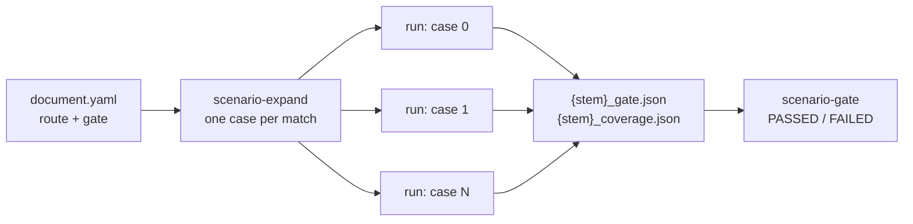

# Gates for Logical Scenarios

A concrete scenario -- one match of a [logical scenario](logical_scenarios.md)'s
route search, one run -- passes or fails on its own pass and fail conditions.
That says how the ego did *there*. Whether the logical scenario as a whole is
done is another question: were there enough runs, did enough of them pass,
did they cover the scenario's space, and did the ego drive the pattern the
same way each time? A logical scenario's **gate** answers it with a pass or a
fail, apart from every run's own verdict.

The gate is written in the logical scenario's document, but judged **after
the runs, from what they recorded**: each run of a logical scenario with a gate
writes `{stem}_gate.json` beside its result, and `scenario-gate` judges the
gate from those records. Nothing is run again, so a gate can be re-judged at
any time -- with thresholds edited since, too -- and two sets of runs (a
baseline and a candidate) can be compared for regressions.



## The gate in the document

```yaml
route:
  segments:
    - {kind: lane, length: {min: 30, max: 60}}
    - {kind: junction, turn: left, traffic_light: "yes"}
    - {kind: lane, length: {max: 40}}

gate:
  min_runs: 10                  # at least this many runs
  min_success_rate: 0.95        # passed runs / runs
  min_case_coverage: 0.8        # route matches run at least once / matches
  min_scenario_coverage: 0.7    # grade of the merged scenario cover items
  min_odd_coverage: 0.5         # grade of the merged ODD cover items
  coverage_items:               # grades of single cover items
    - {item: speed_at_junction, min: 1.0}
  max_lateral_spread_m: 0.4     # trajectory consistency: lateral offset
  max_speed_spread_mps: 1.5     # trajectory consistency: speed
  consistency_stations: 20      # stations per segment of the pattern
  consistency_min_runs: 2       # runs a station needs to be measured
```

| Key | Type | Default | Judged |
|-----|------|---------|--------|
| `min_runs` | int >= 1 | `1` | Always: how many runs there were. A gate with no run behind it passes nothing. |
| `min_success_rate` | 0..1 or null | `null` | The share of runs that passed. A case run more than once counts every time. |
| `min_case_coverage` | 0..1 or null | `null` | The share of the logical scenario's cases -- the route search's matches, on each map the runs were on -- that ran at least once. |
| `min_scenario_coverage` | 0..1 or null | `null` | The grade of the **scenario** coverage group of the runs' coverage files merged (`register_cover`, [Coverage](coverage.md)). |
| `min_odd_coverage` | 0..1 or null | `null` | The grade of the **ODD** coverage group. |
| `coverage_items` | list of `{item, min}` | `[]` | The grade of each named cover item (or cross), as `scenario-coverage` names it. |
| `max_lateral_spread_m` | > 0 or null | `null` | Trajectory consistency: the largest standard deviation across runs of the ego's lateral offset from the route, over the stations. |
| `max_speed_spread_mps` | > 0 or null | `null` | The same, of the ego's speed. |
| `consistency_stations` | int 1..200 | `20` | How many stations each segment is measured at. |
| `consistency_min_runs` | int >= 2 | `2` | How many runs must have passed a station for it to count. |

A threshold left out (`null`, an empty `coverage_items`) is not judged. Unknown
keys are refused, as everywhere in the document. A gate needs a route search:
its cases are the search's matches and its trajectories are measured along
the route, so the validator refuses a gate on a document without one. It
warns about a gate that judges nothing but `min_runs`, and about a trajectory
spread whose `consistency_min_runs` is more than `min_runs`.

### Trajectory consistency

Each run records the ego's drive in the route's frame, a row per tick: the
route s (metres along the route, as a [`route_progress`](logical_scenarios.md#route_progress-condition)
condition measures it), the **signed lateral offset** from the route's
reference line (left of the way the route runs is positive) and the speed.

The routes of different matches have different lengths -- a lane segment is a
range of lengths -- so runs are compared at **stations of the pattern**, not at
metres: each segment gets `consistency_stations` stations, each in the middle
of an equal share of it, at the same fraction of the segment on every match.
A run passes a station the first time its route s goes from below the station
to it or beyond; its offset and speed there are interpolated between the two
rows. A station behind the ego's spawn, or past where it stopped, is not
passed.

At every station `consistency_min_runs` runs or more passed, the spread is the
population standard deviation of their offsets and of their speeds; the
largest of each is judged against `max_lateral_spread_m` and
`max_speed_spread_mps`, and the report says where it was (`segment 1 at
45%`). When no station was passed by enough runs, the spread is not measured,
and the criterion fails.

### Case coverage

`scenario-expand` (and the sweeper) write how many cases the route search
expanded to on the map (`scenario.route.case_count`) into every case, and each
run records it with its case: the map, the route's lanelets and where its
segments split (`segment_lanelets`, how many of the lanelets each segment
holds). The route search keeps two matches over the same lanelets that split
differently apart (two lane segments over three lanelets, split after the
first or after the second), so the gate does too: they are two cases. The case
coverage is the number of distinct cases that ran over the sum of the counts,
over every map the runs were on. A record written before the split was
recorded (no `segment_lanelets`) is told apart by its map and lanelets alone,
and is the same case as a record of those lanelets with a split. A run that
was not expanded counts the matches it searched itself (those the ego cannot
be placed on included, which an expansion skips). A record with no count (a run told nothing) makes the
criterion fail: the share cannot be known.

## What a run records

A run of a logical scenario with a gate writes `{stem}_gate.json` beside
`{stem}_result.json` (best effort, as the coverage file). The coverage file
and the record are written before the result, so a run whose result is on
disk has its record there too, unless writing the record failed (which is
logged):

```json
{
  "schema": "autoware_carla_scenario.gate_record/1",
  "scenario": "logical_left_turn",
  "title": "Left turn with an oncoming car and a pedestrian",
  "digest": "5d0c...",
  "gate": {"min_runs": 10, "min_success_rate": 0.95, "coverage_items": [], "...": "..."},
  "case": {
    "map": "Nishishinjuku",
    "index": 3,
    "lanelet_ids": [101, 102, 602, 301],
    "case_count": 12,
    "segment_kinds": ["lane", "junction", "lane"],
    "segment_ends": [60.0, 78.5, 118.5],
    "segment_lanelets": [2, 1, 1]
  },
  "outcome": {"passed": true, "message": "...", "elapsed_seconds": 21.4, "failure_category": null},
  "files": {
    "result": "logical_left_turn-3_result.json",
    "coverage": "logical_left_turn-3_coverage.json",
    "trajectory": "logical_left_turn-3.trajectory.jsonl"
  },
  "ego": {
    "columns": ["t", "s", "lateral_m", "speed_mps"],
    "rows": [[0.0, 5.0, 0.02, 0.0], [0.05, 5.0, 0.02, 0.1], "..."]
  }
}
```

- `digest` is the SHA-256 of the document the run ran, its `ui` layout left
  out, taken before a case's overrides are folded in: every case of one
  version of the document has the same digest.
- `gate` is the gate the document stated when the run ran. A record without
  one is refused, as is one whose gate is not a valid gate (a field a gate
  does not have, a value of the wrong type or out of range), or whose
  `case`, `outcome`, `files` or `ego` is not a JSON object, whose lists
  are not JSON arrays, whose `outcome.passed` is not a JSON boolean
  (missing, or `"false"`, `0`, `[0]`: a truthy value is never read as a
  pass), whose ego rows hold a route s, lateral offset or
  speed beyond 1e7, or whose text cannot be written back as UTF-8 (a lone
  surrogate): `scenario-gate` reports it as unreadable (exit code 2)
  and judges the other records. A malformed gate is refused with
  `--document` too, though the document's gate replaces it: the record is
  corrupt all the same.
- `files` names the run's other outputs the runner wrote beside the record
  (one it did not write is left out, except the result, written just after
  the record and named even if that write then fails); the coverage
  criteria merge the
  `coverage` files of the runs judged.
- The record is compact JSON: a row a tick adds up over a long run.

## Judging: `scenario-gate`

`scenario-gate` takes **one set of runs, or two**: a set is a directory
searched for `*_gate.json` (or one gate record). One set is judged; two are a
**baseline** and a **candidate**, compared for regressions (below). More than
two are refused.

```bash
# Every *_gate.json under outputs/, one verdict per scenario id
scenario-gate outputs/

# Re-judge against the document's gate (edited since the runs), its runs only
scenario-gate outputs/ --document my_package/document.yaml

# Only one scenario; the verdicts as JSON; the report to a file
scenario-gate outputs/ --scenario logical_left_turn --json gate.json --markdown gate.md

# Regression: the candidate's runs against the baseline's
scenario-gate runs/v1.4/ runs/v1.5/
```

### Cases that raised: no record, so the set is refused

A run that raises (a spawn that fails on every attempt, a lost CARLA
connection) writes no result and so no gate record. The batch still lists the
case -- `ERROR` in its summary, `"error": true` in `batch_results.json` -- but
judged over the records alone, `min_success_rate` would be the share of the
runs that **survived** that passed: 7 cases that raised and 3 that passed
judge as 3 of 3.

So before judging, `scenario-gate` looks for the batches in each set of runs
(every directory under it that holds a `batch_results.json` or a SLURM
batch's `slurm/manifest.json`), the `--multirun` jobs given up or killed
(every `case_errored.json` under it) and the lanelet sweeps' plans (every
`sweep_plan.json` under it), and **refuses the set**, with exit code `2`
and one line per batch or sweep on stderr, when one lists cases that left no
record:

```text
scenario-gate: outputs/2026-11-06/12-00-00: 7 of 10 case(s) raised or have no outcome, and left no gate record (left_turn-3, left_turn-4, left_turn-5, left_turn-6, left_turn-7, and 2 more); the gate would be judged over the runs that survived. Run them again, or pass --allow-unrecorded to judge the records there are
```

- A **local batch** is read from its `batch_results.json`: each entry with
  `"error": true` raised on every attempt, and each with `"pending": true`
  was never finished -- the batch writes the file before its first case
  runs, every case pending, and rewrites it as each case ends, listing the
  cases it has not run yet as pending, so a batch that died mid-run (a
  segfault, the OOM killer, `SIGKILL`, a node reboot), in its first case
  too, still lists the case it was running and the ones after it. Both
  count. A batch refused before any case runs (its pre-run checks: a backend
  the host has no room for, an Autoware workspace that cannot run, CARLA not
  coming up) writes no summary: it ran nothing. Each entry names its case's
  file stem (`stem`), and an errored case with a gate record at its stem is
  not counted -- its last attempt raised only once the run had ended
  (resetting the world), and that record is judged, as a SLURM batch's is. A
  pending case counts whatever is at its stem, and so does every errored
  case of a summary written before batches recorded their stems: the
  refusal errs on the side of the runs that survived.

  A batch resumed with `--resume-from` alone runs its remaining cases in a
  new directory, and the directory of the batch it resumes keeps them
  pending, so the two are refused as a set -- and with `--allow-unrecorded`
  the case that was running when the batch was killed would be judged twice
  if it had written its gate record. To gate a resumed batch as a whole,
  resume it into the same directory with `--resume-into DIR`: its summary is
  rewritten from the entries of the cases it keeps and the cases it runs,
  and before those run, the outputs they left there (result, gate record,
  coverage file, ...) are removed by the stems the summary records for them,
  so each case is judged once, on its new run
  ([Resume from a Specific Scenario](usage.md#resume-from-a-specific-scenario)).
- A **SLURM batch** is read from its tasks' outcomes (`slurm/results/`),
  collected or not: a case that errored, has no outcome (its task was killed,
  or is still running) or one with no verdict counts, unless a gate record is
  at its stem -- its run wrote one before the task failed, and that record is
  judged.
- A **`--multirun` sweep** has no summary, so each job given up -- the
  lanelet sweeper's, once it raised, timed out, crashed or was refused on every attempt
  (`server.cooldown_max_retries`), and Hydra's basic sweeper's, once its run
  raised -- leaves `case_errored.json` in its job directory, with its
  overrides, last exit code, attempts and why. Each counts, unless the job's
  directory holds a gate record (its run wrote one before the job failed).
  A job that ran and failed leaves no marker (its record is judged), nor does
  one a retry passed.

  The marker is also written **before each attempt**, saying the job did not
  finish (`"unfinished": true`, reason `did not finish ...`), and removed
  once the job ends with a verdict (passed or failed) or replaced by the
  marker of a job given up. So a job whose sweep died with it -- CARLA
  segfaulting it, the OOM killer, `SIGKILL`, Ctrl-C -- leaves the marker
  too, and counts. A job run again in the same directory replaces its old
  marker as it starts.

  An unfinished marker beside a run's result (`*_result.json`) written no
  earlier than the marker, and no gate record, does not count. A run writes
  its gate record before its result, so this job ran a scenario without a
  gate, which writes a result and no record, and was killed after writing
  it -- in the world reset or while its Rerun recordings were converted --
  before the marker was removed. A result older than the marker is an
  earlier run's in the same directory, and the marker counts. A marker of a
  job given up still counts beside a result, which may be an earlier
  attempt's, and so does a marker that cannot be read.

  ```text
  scenario-gate: multirun/2026-11-06/12-00-00: 7 job(s) of the sweep raised, timed out, crashed or did not finish, and left no gate record (3 (timed out after 900s), 4 (crashed (SIGSEGV)), 5 (exit code 1), 6 (exit code 1), 7 (did not finish (its process died, or the sweep was stopped)), and 2 more); the gate would be judged over the runs that survived. Run them again, or pass --allow-unrecorded to judge the records there are
  ```

- A **lanelet sweep** (`hydra/sweeper=lanelet_constraint`) writes its plan,
  `sweep_plan.json`, into its sweep directory before it launches the first
  job: the directory and the overrides of every job it is about to run. A
  planned job whose directory holds no gate record, no marker and no result
  never ran -- the sweep was killed before it got there -- and counts. (A job
  with a result and no record ran a scenario without a gate.) A sweep that
  is refused before it runs writes no plan; a sweep planned again into the
  same directory (`hydra.sweep.dir=` naming it again, a `--resume-from`
  rerun) replaces the entries of the jobs it runs and keeps the others, whose
  outputs are still there. A job it runs replaces the earlier run's outputs
  too: before the job's first attempt the sweeper removes the run outputs
  (result, gate record, coverage file, ...) the earlier sweep left in its job
  directory, so each job is judged on its new run alone, not counted twice
  ([Lanelet Constraint Sweeping](usage.md#lanelet-constraint-sweeping)).
  Only in a directory that no other job of the sweep maps to: in one several
  jobs share (one `hydra.sweep.subdir` for all) nothing is removed, so the
  runs of the jobs the rerun skips stay -- and so does the earlier run of a
  job it runs again, which is then judged beside the new one. Give each job a
  directory of its own (the default, `${hydra.job.num}`) to gate a rerun. A
  plan lists only the jobs its own run launches, so a sweep resumed into a
  new directory plans only the jobs from the resume point; the directory of
  the run it resumes keeps its plan and the marker of the job it was killed
  in, and is refused on its own. To gate a resumed sweep as a whole, resume
  it into the same `hydra.sweep.dir`.

  ```text
  scenario-gate: multirun/2026-11-06/12-00-00: 12 of 20 planned job(s) of the sweep never ran, and left no gate record (8, 9, 10, 11, 12, and 7 more); the gate would be judged over the runs that survived. Run them again, or pass --allow-unrecorded to judge the records there are
  ```

  **Hydra's basic sweeper** (a `--multirun` without
  `hydra/sweeper=lanelet_constraint`) creates each job's directory only as it
  reaches the job and writes no plan, so a basic sweep killed mid-run leaves
  the marker of the job it was running and **no trace of the jobs after
  it**: `scenario-gate` judges the jobs that ran as the whole sweep. Use the
  lanelet sweeper, or a batch, for runs a gate is to judge.

- A summary, manifest or sweep plan that cannot be read refuses the set too, and
  `--allow-unrecorded` does not change that: what it left without a record
  cannot be told. Its line says so:

  ```text
  scenario-gate: outputs/2026-11-06/12-00-00/batch_results.json: the batch summary cannot be read (...); the cases it left without a record cannot be told, so the runs are not judged (--allow-unrecorded does not apply). Repair the file, or run the batch or sweep again
  ```

- A gate record named on its own (not a directory) is judged as it is.

The refusal does not tell the cases apart by logical scenario (a case that
raised may have raised before it knew its route, and wrote nothing to say
which it was), so one errored case of any scenario in the batch refuses the
set, with `--scenario` too. Run the cases again (`scenario-slurm resubmit`
for a SLURM batch), or pass `--allow-unrecorded` to judge the records there
are, the lines printed as warnings.

The runs are not given a failed record in their place: a run that raised
before its route was chosen has no case to record, a made-up one would skew
the case coverage and the cases a regression compares, and an attempt the
batch retried would leave a failure beside the retry that passed. The
batch's own list of what did not run is the one that is complete -- it holds
too the SLURM tasks killed before Python could write anything.

Records are grouped by the scenario id. Without `--document`, the gate a group
is judged against is the one its latest record (by file time) states; when
its records state different gates, or ran different versions of the document,
the report warns. The report lists each criterion with what the runs measured
and what the gate asks:

```markdown
## Left turn (`logical_left_turn`): FAILED

11 of 12 run(s) passed.

| Criterion | Measured | Required | Result |
|---|---|---|---|
| min_runs | 12 (12 run(s)) | >= 10 | pass |
| min_success_rate | 0.9167 (11 of 12 passed) | >= 0.95 | **FAIL** |
| min_case_coverage | 1 (12 of 12 case(s) on 1 map(s)) | >= 0.8 | pass |
| max_lateral_spread_m | 0.2213 (segment 1 at 45%, 60 station(s)) | <= 0.4 | pass |
```

### Regression: a baseline against a candidate

Given two sets -- the runs of one version of the driver (the baseline) and of
the next (the candidate) -- each logical scenario either ran is judged on
both, **against one gate**: `--document`'s, else the one the candidate's
latest record states. What moved is then the runs, not the thresholds; a
baseline whose runs stated another gate is re-judged, with a warning.

Each criterion is compared:

| Change | Meaning |
|--------|---------|
| `regressed` | It passed on the baseline and fails on the candidate |
| `improved` | It failed and passes now |
| `worse` / `better` | Its verdict held and its value moved the wrong / right way (`>=` criteria: up is better; `<=`: down) |
| `same` | Neither moved |
| `new` / `dropped` | Only the candidate / only the baseline judged it |

and so is each case (the map, the route's lanelets and where its segments
split, as in the case coverage) both ran: a case every baseline run of passed
and a candidate run of failed is **newly failing**, one a baseline run of
failed and every candidate run of passed is **fixed**. Two cases over the same
lanelets are labelled with their split, a `|` where one segment ends and the
next begins (`Nishishinjuku [101|102,602]` and `Nishishinjuku [101,102|602]`).
When either side has a record without a split (a baseline recorded before it
was), the cases of those lanelets are compared by map and lanelets alone: each
side's runs of every split of them are summed into one case, labelled without
a split.

The candidate **regressed** when a criterion regressed, a case is newly
failing, or it did not run the scenario at all. The report always says so,
but by default only the **candidate's gate** decides the exit code: a case
that broke while the success rate still clears the gate is reported, and the
comparison passes. `--fail-on-regression` makes any regression fail it too,
for a release that must not lose a case it had. A scenario the candidate did
not run fails either way; one only the candidate ran is judged on its own.

```bash
# Strict: exit 1 on any regression, even inside the gate
scenario-gate runs/v1.4/ runs/v1.5/ --fail-on-regression
```

```markdown
## Left turn (`logical_left_turn`): PASSED, REGRESSED

- Baseline: 12 of 12 run(s) passed; gate passed
- Candidate: 11 of 12 run(s) passed; gate passed

| Criterion | Required | Baseline | Candidate | Change |
|---|---|---|---|---|
| min_runs | >= 10 | 12 | 12 | same |
| min_success_rate | >= 0.9 | 1 | 0.9167 | worse |
| max_lateral_spread_m | <= 0.4 | 0.1804 | 0.2213 | worse |

Newly failing cases:

- Nishishinjuku [101,102,602,301]: baseline 1/1 passed, candidate 0/1
```

| Exit code | Meaning |
|-----------|---------|
| `0` | Every gate judged passed (two sets: on the candidate; with `--fail-on-regression`, and nothing regressed) |
| `1` | A gate failed, or (two sets, `--fail-on-regression`) something regressed |
| `2` | Nothing to judge, a batch among the runs lists cases that raised, were never finished or have no outcome, or a `--multirun` job among them was given up, did not finish or (planned) never ran, and left no record (unless `--allow-unrecorded`; above), a batch summary, SLURM manifest or sweep plan could not be read (even with `--allow-unrecorded`), a record could not be read (not JSON, or malformed), a coverage file a record names could not be read, more than two sets, `--fail-on-regression` with one set, `--document` has no gate, or the `--markdown` or `--json` file could not be written (each such path is named on stderr; the verdict printed to stdout is unchanged) |

The JSON (`--json`) of one set holds a verdict per scenario (`verdicts`):
`passed`, `runs`, `passed_runs`, the `gate` judged, each criterion (`name`,
`passed`, `value`, `threshold`, `comparison`, `detail`), the `warnings`, the
`errors` (coverage files that could not be read; the run then exits `2` even
if `passed`) and the records' paths. Of two sets, it holds the `baseline` and `candidate`
paths and a comparison per scenario (`comparisons`): `passed` (the candidate's gate), `regressed`,
both verdicts, each criterion's `change` and `delta` (candidate less
baseline), the `newly_failing` and `fixed` cases, and the `warnings`.

## In the Scenario Editor

The scenario inspector's **Gate** section, below the route search, turns the
gate on (**Judge the logical scenario**) and lists one row per threshold: a
**checkbox** says whether it is judged, a **bar** and a number beside it what
it asks. The shares -- success rate and the coverages -- are edited in
**percent** (`95` is `0.95` in the document); the spreads in metres and
metres per second. Ticking a threshold judges it at a default (success rate
90 %, case and scenario coverage 80 %, ODD coverage 50 %, lateral spread
0.5 m, speed spread 1.0 m/s) until it is set; an unticked one is greyed out
and not judged. While a spread is judged, how it is measured (stations per
segment, runs per station) is listed under it. Each cover item is a row of its
own, added by name (at 100 %) and dropped by unticking it. A value out of
range -- a share over 100 % -- is refused with the reason, and the draft is
left as it was.

## Python API

```python
from pathlib import Path

from autoware_carla_scenario.authoring.models import GateSpec
from autoware_carla_scenario.gate import read_gate_record
from autoware_carla_scenario.gate.evaluate import (
    compare_all,
    find_gate_records,
    judge_all,
    load_gate_records,
)

records, errors = load_gate_records(find_gate_records([Path("outputs")]))
for verdict in judge_all(records, GateSpec(min_success_rate=0.9)):
    print(verdict.scenario, verdict.passed)
    print(verdict.to_markdown())

# Regression: a baseline's runs against a candidate's, under one gate
baseline, _ = load_gate_records(find_gate_records([Path("runs/v1.4")]))
for comparison in compare_all(baseline, records):
    print(comparison.scenario, comparison.regressed, comparison.newly_failing)
```

A hand-written scenario can leave a gate record too: the runner writes
whatever its `gate_record(result, file_stem)` method returns (a
`GateRecord`, or `None` for none); `DeclarativeScenario` is the one that does.
