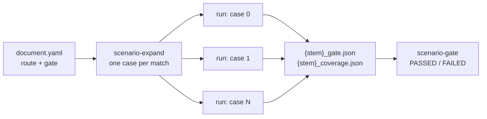

# Gates for Logical Scenarios

A concrete scenario -- one match of a [logical scenario](logical_scenarios.md)'s
route search, one run -- passes or fails on its own pass and fail conditions.
That says how the ego did *there*. Whether the logical scenario as a whole is
done is another question: were there enough runs, did enough of them pass,
did they cover the scenario's space, and did the ego drive the pattern the
same way each time? A logical scenario's **gate** answers it with a pass or a
fail, apart from every run's own verdict.

The gate is written in the logical scenario's document, but judged **after
the runs, from what they recorded**: each run of a logical scenario with a gate
writes `{stem}_gate.json` beside its result, and `scenario-gate` judges the
gate from those records. Nothing is run again, so a gate can be re-judged at
any time -- with thresholds edited since, too -- and two sets of runs (a
baseline and a candidate) can be compared for regressions.



## The gate in the document

```yaml
route:
  segments:
    - {kind: lane, length: {min: 30, max: 60}}
    - {kind: junction, turn: left, traffic_light: "yes"}
    - {kind: lane, length: {max: 40}}

gate:
  min_runs: 10                  # at least this many runs
  min_success_rate: 0.95        # passed runs / runs
  min_case_coverage: 0.8        # route matches run at least once / matches
  min_scenario_coverage: 0.7    # grade of the merged scenario cover items
  min_odd_coverage: 0.5         # grade of the merged ODD cover items
  coverage_items:               # grades of single cover items
    - {item: speed_at_junction, min: 1.0}
  max_lateral_spread_m: 0.4     # trajectory consistency: lateral offset
  max_speed_spread_mps: 1.5     # trajectory consistency: speed
  consistency_stations: 20      # stations per segment of the pattern
  consistency_min_runs: 2       # runs a station needs to be measured
```

| Key | Type | Default | Judged |
|-----|------|---------|--------|
| `min_runs` | int >= 1 | `1` | Always: how many runs there were. A gate with no run behind it passes nothing. |
| `min_success_rate` | 0..1 or null | `null` | The share of runs that passed. A case run more than once counts every time. |
| `min_case_coverage` | 0..1 or null | `null` | The share of the logical scenario's cases -- the route search's matches, on each map the runs were on -- that ran at least once. |
| `min_scenario_coverage` | 0..1 or null | `null` | The grade of the **scenario** coverage group of the runs' coverage files merged (`register_cover`, [Coverage](coverage.md)). |
| `min_odd_coverage` | 0..1 or null | `null` | The grade of the **ODD** coverage group. |
| `coverage_items` | list of `{item, min}` | `[]` | The grade of each named cover item (or cross), as `scenario-coverage` names it. |
| `max_lateral_spread_m` | > 0 or null | `null` | Trajectory consistency: the largest standard deviation across runs of the ego's lateral offset from the route, over the stations. |
| `max_speed_spread_mps` | > 0 or null | `null` | The same, of the ego's speed. |
| `consistency_stations` | int 1..200 | `20` | How many stations each segment is measured at. |
| `consistency_min_runs` | int >= 2 | `2` | How many runs must have passed a station for it to count. |

A threshold left out (`null`, an empty `coverage_items`) is not judged. Unknown
keys are refused, as everywhere in the document. A gate needs a route search:
its cases are the search's matches and its trajectories are measured along
the route, so the validator refuses a gate on a document without one. It
warns about a gate that judges nothing but `min_runs`, and about a trajectory
spread whose `consistency_min_runs` is more than `min_runs`.

### Trajectory consistency

Each run records the ego's drive in the route's frame, a row per tick: the
route s (metres along the route, as a [`route_progress`](logical_scenarios.md#route_progress-condition)
condition measures it), the **signed lateral offset** from the route's
reference line (left of the way the route runs is positive) and the speed.

The routes of different matches have different lengths -- a lane segment is a
range of lengths -- so runs are compared at **stations of the pattern**, not at
metres: each segment gets `consistency_stations` stations, each in the middle
of an equal share of it, at the same fraction of the segment on every match.
A run passes a station the first time its route s goes from below the station
to it or beyond; its offset and speed there are interpolated between the two
rows. A station behind the ego's spawn, or past where it stopped, is not
passed.

At every station `consistency_min_runs` runs or more passed, the spread is the
population standard deviation of their offsets and of their speeds; the
largest of each is judged against `max_lateral_spread_m` and
`max_speed_spread_mps`, and the report says where it was (`segment 1 at
45%`). When no station was passed by enough runs, the spread is not measured,
and the criterion fails.

### Case coverage

`scenario-expand` (and the sweeper) write how many cases the route search
expanded to on the map (`scenario.route.case_count`) into every case, and each
run records it with its case: the map and the route's lanelets. The case
coverage is the number of distinct cases that ran over the sum of the counts,
over every map the runs were on. A run that was not expanded counts the
matches it searched itself (those the ego cannot be placed on included, which
an expansion skips). A record with no count (a run told nothing) makes the
criterion fail: the share cannot be known.

## What a run records

A run of a logical scenario with a gate writes `{stem}_gate.json` beside
`{stem}_result.json` (best effort, as the coverage file):

```json
{
  "schema": "autoware_carla_scenario.gate_record/1",
  "scenario": "logical_left_turn",
  "title": "Left turn with an oncoming car and a pedestrian",
  "digest": "5d0c...",
  "gate": {"min_runs": 10, "min_success_rate": 0.95, "coverage_items": [], "...": "..."},
  "case": {
    "map": "Nishishinjuku",
    "index": 3,
    "lanelet_ids": [101, 102, 602, 301],
    "case_count": 12,
    "segment_kinds": ["lane", "junction", "lane"],
    "segment_ends": [60.0, 78.5, 118.5]
  },
  "outcome": {"passed": true, "message": "...", "elapsed_seconds": 21.4, "failure_category": null},
  "files": {
    "result": "logical_left_turn-3_result.json",
    "coverage": "logical_left_turn-3_coverage.json",
    "trajectory": "logical_left_turn-3.trajectory.jsonl"
  },
  "ego": {
    "columns": ["t", "s", "lateral_m", "speed_mps"],
    "rows": [[0.0, 5.0, 0.02, 0.0], [0.05, 5.0, 0.02, 0.1], "..."]
  }
}
```

- `digest` is the SHA-256 of the document the run ran, its `ui` layout left
  out, taken before a case's overrides are folded in: every case of one
  version of the document has the same digest.
- `gate` is the gate the document stated when the run ran. A record without
  one is refused, as is one whose `case`, `outcome`, `files` or `ego` is not
  a JSON object, or whose lists are not JSON arrays: `scenario-gate` reports
  it as unreadable (exit code 2) and judges the other records.
- `files` names the run's other outputs the runner wrote beside the record
  (one it did not write is left out); the coverage criteria merge the
  `coverage` files of the runs judged.
- The record is compact JSON: a row a tick adds up over a long run.

## Judging: `scenario-gate`

`scenario-gate` takes **one set of runs, or two**: a set is a directory
searched for `*_gate.json` (or one gate record). One set is judged; two are a
**baseline** and a **candidate**, compared for regressions (below). More than
two are refused.

```bash
# Every *_gate.json under outputs/, one verdict per scenario id
scenario-gate outputs/

# Re-judge against the document's gate (edited since the runs), its runs only
scenario-gate outputs/ --document my_package/document.yaml

# Only one scenario; the verdicts as JSON; the report to a file
scenario-gate outputs/ --scenario logical_left_turn --json gate.json --markdown gate.md

# Regression: the candidate's runs against the baseline's
scenario-gate runs/v1.4/ runs/v1.5/
```

Records are grouped by the scenario id. Without `--document`, the gate a group
is judged against is the one its latest record (by file time) states; when
its records state different gates, or ran different versions of the document,
the report warns. The report lists each criterion with what the runs measured
and what the gate asks:

```markdown
## Left turn (`logical_left_turn`): FAILED

11 of 12 run(s) passed.

| Criterion | Measured | Required | Result |
|---|---|---|---|
| min_runs | 12 (12 run(s)) | >= 10 | pass |
| min_success_rate | 0.9167 (11 of 12 passed) | >= 0.95 | **FAIL** |
| min_case_coverage | 1 (12 of 12 case(s) on 1 map(s)) | >= 0.8 | pass |
| max_lateral_spread_m | 0.2213 (segment 1 at 45%, 60 station(s)) | <= 0.4 | pass |
```

### Regression: a baseline against a candidate

Given two sets -- the runs of one version of the driver (the baseline) and of
the next (the candidate) -- each logical scenario either ran is judged on
both, **against one gate**: `--document`'s, else the one the candidate's
latest record states. What moved is then the runs, not the thresholds; a
baseline whose runs stated another gate is re-judged, with a warning.

Each criterion is compared:

| Change | Meaning |
|--------|---------|
| `regressed` | It passed on the baseline and fails on the candidate |
| `improved` | It failed and passes now |
| `worse` / `better` | Its verdict held and its value moved the wrong / right way (`>=` criteria: up is better; `<=`: down) |
| `same` | Neither moved |
| `new` / `dropped` | Only the candidate / only the baseline judged it |

and so is each case (the map and the route's lanelets) both ran: a case every
baseline run of passed and a candidate run of failed is **newly failing**, one
a baseline run of failed and every candidate run of passed is **fixed**.

The candidate **regressed** when a criterion regressed, a case is newly
failing, or it did not run the scenario at all. The report always says so,
but by default only the **candidate's gate** decides the exit code: a case
that broke while the success rate still clears the gate is reported, and the
comparison passes. `--fail-on-regression` makes any regression fail it too,
for a release that must not lose a case it had. A scenario the candidate did
not run fails either way; one only the candidate ran is judged on its own.

```bash
# Strict: exit 1 on any regression, even inside the gate
scenario-gate runs/v1.4/ runs/v1.5/ --fail-on-regression
```

```markdown
## Left turn (`logical_left_turn`): PASSED, REGRESSED

- Baseline: 12 of 12 run(s) passed; gate passed
- Candidate: 11 of 12 run(s) passed; gate passed

| Criterion | Required | Baseline | Candidate | Change |
|---|---|---|---|---|
| min_runs | >= 10 | 12 | 12 | same |
| min_success_rate | >= 0.9 | 1 | 0.9167 | worse |
| max_lateral_spread_m | <= 0.4 | 0.1804 | 0.2213 | worse |

Newly failing cases:

- Nishishinjuku [101,102,602,301]: baseline 1/1 passed, candidate 0/1
```

| Exit code | Meaning |
|-----------|---------|
| `0` | Every gate judged passed (two sets: on the candidate; with `--fail-on-regression`, and nothing regressed) |
| `1` | A gate failed, or (two sets, `--fail-on-regression`) something regressed |
| `2` | Nothing to judge, a record could not be read (not JSON, or malformed), more than two sets, `--fail-on-regression` with one set, or `--document` has no gate |

The JSON (`--json`) of one set holds a verdict per scenario (`verdicts`):
`passed`, `runs`, `passed_runs`, the `gate` judged, each criterion (`name`,
`passed`, `value`, `threshold`, `comparison`, `detail`), the `warnings` and
the records' paths. Of two sets, it holds the `baseline` and `candidate`
paths and a comparison per scenario (`comparisons`): `passed` (the candidate's gate), `regressed`,
both verdicts, each criterion's `change` and `delta` (candidate less
baseline), the `newly_failing` and `fixed` cases, and the `warnings`.

## In the Scenario Editor

The scenario inspector's **Gate** section, below the route search, turns the
gate on (**Judge the logical scenario**) and lists one row per threshold: a
**checkbox** says whether it is judged, a **bar** and a number beside it what
it asks. The shares -- success rate and the coverages -- are edited in
**percent** (`95` is `0.95` in the document); the spreads in metres and
metres per second. Ticking a threshold judges it at a default (success rate
90 %, case and scenario coverage 80 %, ODD coverage 50 %, lateral spread
0.5 m, speed spread 1.0 m/s) until it is set; an unticked one is greyed out
and not judged. While a spread is judged, how it is measured (stations per
segment, runs per station) is listed under it. Each cover item is a row of its
own, added by name (at 100 %) and dropped by unticking it. A value out of
range -- a share over 100 % -- is refused with the reason, and the draft is
left as it was.

## Python API

```python
from pathlib import Path

from autoware_carla_scenario.authoring.models import GateSpec
from autoware_carla_scenario.gate import read_gate_record
from autoware_carla_scenario.gate.evaluate import (
    compare_all,
    find_gate_records,
    judge_all,
    load_gate_records,
)

records, errors = load_gate_records(find_gate_records([Path("outputs")]))
for verdict in judge_all(records, GateSpec(min_success_rate=0.9)):
    print(verdict.scenario, verdict.passed)
    print(verdict.to_markdown())

# Regression: a baseline's runs against a candidate's, under one gate
baseline, _ = load_gate_records(find_gate_records([Path("runs/v1.4")]))
for comparison in compare_all(baseline, records):
    print(comparison.scenario, comparison.regressed, comparison.newly_failing)
```

A hand-written scenario can leave a gate record too: the runner writes
whatever its `gate_record(result, file_stem)` method returns (a
`GateRecord`, or `None` for none); `DeclarativeScenario` is the one that does.
