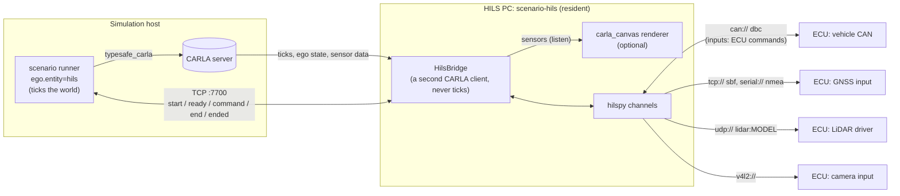

# HILS: ECUs in the Loop

`scenario-hils` is a hardware-in-the-loop bridge. It is **a resident process**
on the HILS PC wired to the ECUs under test, independent of the scenario
runner. It follows the ego of a scenario run in CARLA and sends the ECUs what
their real sensors and buses would deliver: CAN frames, a GNSS receiver's
output, a LiDAR's UDP packets, camera frames. It initializes and finalizes the
ECUs around each scenario, and hands what they command back to the run, which
drives the ego with it. The ECU traffic goes through
[hilspy](https://github.com/hakuturu583/hilspy) (a Rust core with a thin
Python layer).



The bridge is a CARLA client of its own: it waits for the runner's ticks
(`World.wait_for_tick`), so it works with the runner's synchronous mode, and
it never ticks the world itself. One `scenario-hils` serves scenario after
scenario, a whole batch, for as long as it runs.

A scenario's life, with `ego.entity=hils`:

1. The runner spawns the ego and connects to the bridge (`hils.host`,
   `hils.port`): `start`, with the ego's actor id.
2. The bridge starts the devices' periodic messages, attaches its sensors to
   the ego and runs the `scenario_start` steps (wake the ECUs, wait until they
   say they are ready). The runner ticks the world meanwhile, holding every
   vehicle still, until the bridge answers `ready` -- or fails the run when a
   step fails or nothing comes within `hils.ready_timeout_s`.
3. Every tick the ego's state goes to the ECUs; whenever an ECU sends a
   command message (`inputs`), the bridge forwards the command and the runner
   applies it to the ego.
4. When the scenario ends the runner sends `end`; the bridge runs the
   `scenario_end` steps, stops the periodic messages, removes its sensors and
   answers `ended`. A run that goes away mid-scenario ends it as well.

Without a run connected (any other `ego.entity`), the bridge streams the ego to
the ECUs all the same, and the ego appearing and disappearing start and end the
scenario; the ECUs' commands then go nowhere.

## Running it

The bridge is the `hils` extra. With [uv](https://docs.astral.sh/uv/), one
command installs it in a cached environment and runs it:

```bash
# Write a commented example configuration and edit it.
uvx --from 'autoware-carla-scenario[hils]' scenario-hils --example > hils.yaml

# Check it: what each device sends, nothing opened.
uvx --from 'autoware-carla-scenario[hils]' scenario-hils hils.yaml --check

# Run it, until Ctrl-C or SIGTERM.
uvx --from 'autoware-carla-scenario[hils]' scenario-hils hils.yaml

# Sensors rendered by carla_canvas (`canvas:` in hils.yaml).
uvx --from 'autoware-carla-scenario[hils]' --with 'carla-canvas[client]>=0.2' \
    scenario-hils hils.yaml
```

`--host`, `--port`, `--role-name` and `--listen` override the file's CARLA
address, ego and run link. In a checkout, `uv sync --dev` installs hilspy and
`uv run scenario-hils hils.yaml` runs it.

Then run scenarios with the ego driven by the ECUs, on the same CARLA server:

```bash
uv run scenario ego.entity=hils hils.host=hils-pc
```

| `hils.` setting | Default | |
| --- | --- | --- |
| `host`, `port` | `localhost`, `7700` | the bridge's `runner.listen` |
| `connect_timeout_s` | `10.0` | reaching the bridge |
| `ready_timeout_s` | `60.0` | its `scenario_start` steps (wall clock) |
| `end_timeout_s` | `30.0` | its `scenario_end` steps (wall clock) |
| `stale_s` | `0.5` | a command older than this (wall clock) is stale |
| `on_stale` | `brake` | `brake`, or `hold` the last command, once stale; before any command the ego brakes |

### Keeping it resident

The bridge waits for a CARLA server that is not up yet, and for runs, for as
long as it runs; Ctrl-C or SIGTERM end a running scenario (its `scenario_end`
steps), run the `shutdown` steps and close the devices. A systemd unit keeps it
up across reboots:

```ini
# /etc/systemd/system/scenario-hils.service
[Unit]
Description=scenario-hils (HILS bridge)
After=network-online.target

[Service]
User=hils
ExecStart=/home/hils/.local/bin/uvx --from 'autoware-carla-scenario[hils]' scenario-hils /etc/scenario-hils/hils.yaml
Restart=on-failure
KillSignal=SIGTERM
TimeoutStopSec=60

[Install]
WantedBy=multi-user.target
```

A failing `startup` step stops the bridge with status 1 (systemd restarts it).

## Configuration

One YAML file describes everything. Relative paths in it (the `canvas` file,
a codec's file, a `profiles` option) are relative to the file. Unknown keys
are refused, so a typo fails at start-up instead of being ignored.

```yaml
carla: {host: sim-host, port: 2000, timeout: 10.0}
ego: {role_name: Ego, wait: 120.0}
canvas: canvas.yaml        # optional
clock: simulation          # or wall
devices:
  vehicle_can: {...}
  lidar_top: {...}
```

| Key | Default | |
| --- | --- | --- |
| `carla.host`, `carla.port` | `localhost`, `2000` | the CARLA server the scenario runs on |
| `carla.timeout` | `10.0` | seconds, for RPCs and for each tick |
| `ego.role_name` | `Ego` | the runner's ego |
| `ego.wait` | `120.0` | seconds without an ego before a warning (it keeps waiting) |
| `canvas` | none | a carla_canvas configuration: see [carla_canvas](#sensors-rendered-by-carla_canvas) |
| `clock` | `simulation` | the devices' time: see [Time](#time) |
| `runner.listen` | `0.0.0.0:7700` | where runs with `ego.entity=hils` reach the bridge; `null`: no run link |
| `commands.mode` | `control` | how the ECUs' command drives the ego: see [ECU to simulation](#ecu-to-simulation) |
| `devices` | | one entry per device, by name |
| `lifecycle` | none | steps around the bridge and each scenario: see [Lifecycle](#lifecycle) |

A device is one hilspy channel: `url` (the transport), `codec` (`raw` when
omitted) and `options` (codec options), exactly what `hilspy.open(url, codec,
**options)` takes. It has `messages` (periodic messages filled from the ego's
signals, sent while a scenario runs) and `inputs` (messages the ECU sends that
carry its command), **or** a `sensor` (a CARLA sensor on the ego whose
measurements it is sent). A device with neither still serves the lifecycle
steps (a power supply on a serial port, say).

### Message devices

Each message is sent periodically through the codec, and its fields are
updated from the ego on every tick:

```yaml
vehicle_can:
  url: can://vcan0
  codec: dbc:vehicle.dbc
  options: {ecu: VCU}          # send only what the VCU transmits
  messages:
    - name: VehicleSpeed
      period: 0.01             # seconds; omitted: the DBC's GenMsgCycleTime
      fields:
        Speed: $speed_kmh
        YawRate: {signal: yaw_rate, scale: 1.0, offset: 0.0}
        Gear: D
```

A field is

- a constant (`D`, `4`, `true`),
- `$name`: a signal (below), or
- `{signal: name, scale: k, offset: c}`: `signal * k + c`.

`$$` starts a constant that begins with `$`. `scenario-hils --signals` lists
the signals:

| Signal | Unit | |
| --- | --- | --- |
| `time`, `frame` | s, - | the world's elapsed seconds and frame |
| `x`, `y`, `z` | m | world position (CARLA's frame) |
| `roll`, `pitch`, `yaw` | deg | CARLA rotation |
| `heading` | deg | clockwise from north, `[0, 360)` |
| `latitude`, `longitude`, `altitude` | deg, deg, m | from the map's geo-reference |
| `latitude_rad`, `longitude_rad` | rad | as SBF's `PVTGeodetic` takes them |
| `velocity_north`, `velocity_east`, `velocity_up` | m/s | |
| `course` | deg | course over ground, clockwise from north |
| `speed`, `speed_kmh` | m/s, km/h | magnitude of the velocity |
| `longitudinal_velocity`, `lateral_velocity`, `vertical_velocity` | m/s | vehicle frame: x forward, y left, z up |
| `longitudinal_acceleration`, `lateral_acceleration`, `vertical_acceleration` | m/s² | vehicle frame |
| `roll_rate`, `pitch_rate`, `yaw_rate` | deg/s | right-handed: `yaw_rate` positive turning left |
| `yaw_rate_rad` | rad/s | |
| `throttle`, `brake`, `steer` | - | the control last applied (`steer` positive right, as CARLA) |
| `hand_brake`, `reverse`, `gear` | - | 0 or 1, 0 or 1, CARLA's gear |

Any codec hilspy encodes with works. A GNSS receiver over TCP, as a
Septentrio receiver streams SBF:

```yaml
gnss:
  url: tcp://0.0.0.0:28784?listen
  codec: sbf
  messages:
    - name: PVTGeodetic
      period: 0.1
      fields: {mode: 4, latitude: $latitude_rad, longitude: $longitude_rad,
               height: $altitude, vn: $velocity_north, ve: $velocity_east,
               vu: $velocity_up}
    - name: AttEuler
      period: 0.1
      fields: {heading: $heading, pitch: $pitch, roll: $roll}
```

or NMEA on a serial port:

```yaml
gps:
  url: serial:///dev/ttyUSB0?baud=115200
  codec: nmea
  options: {talker: GN}
  messages:
    - name: GGA
      period: 0.1
      fields: {latitude: $latitude, longitude: $longitude, altitude: $altitude,
               fix_type: Rtk, fix_satellites: 14}
    - name: RMC
      period: 0.1
      fields: {lat: $latitude, lon: $longitude, speed_over_ground: {signal: speed, scale: 1.943844},
               true_course: $course, status_of_fix: Autonomous}
```

hilspy's README lists the codecs and their message fields (DBC and FIBEX
networks, SOME/IP, SBF, NMEA, UBX, RTCM).

### Sensor devices

The bridge spawns the sensor on the ego (its `role_name` is the device's
name), listens to it, and sends each measurement:

```yaml
lidar_top:
  url: udp://192.168.1.201:2368          # the ECU's LiDAR driver
  codec: lidar:pandar_xt32
  sensor:
    blueprint: sensor.lidar.ray_cast
    transform: {x: 0.0, y: 0.0, z: 2.0, roll: 0.0, pitch: 0.0, yaw: 0.0}
    attributes: {channels: 32, range: 120, points_per_second: 640000,
                 rotation_frequency: 10, upper_fov: 15, lower_fov: -16}
    intensity_scale: 255                  # CARLA's 0-1 intensity -> a byte

front_camera:
  url: v4l2:///dev/video10?format=BGRA&width=1280&height=720&fps=20
  sensor:
    blueprint: sensor.camera.rgb
    transform: {x: 1.5, z: 1.6}
    attributes: {image_size_x: 1280, image_size_y: 720, fov: 90}
    encoding: bgra
```

- **LiDAR** (`sensor.lidar.ray_cast`, with a `lidar:MODEL` codec: Hesai
  Pandar and Velodyne models). CARLA measures the arc a LiDAR sweeps in one
  tick; the bridge gathers the arcs into whole revolutions (by
  `rotation_frequency` and the time between measurements) and hilspy encodes
  each revolution into the model's UDP packets, paced over the revolution as
  the sensor streams them. Points go from CARLA's sensor frame (y right) to
  the sensor's (y left). Match `channels`, the field of view and
  `rotation_frequency` to the model.
- **Cameras** (`sensor.camera.*`, codec `raw`). Each image is one frame,
  in `encoding`: `bgra` (CARLA's raw image), `bgr`, `rgb`, `jpeg` or `png`.
  `v4l2://` makes it a V4L2 camera any client on the PC sees (hilspy built
  with its `v4l2` feature, and v4l2loopback: hilspy's README, "Cameras");
  `udp://` or `tcp://` send the bytes.

### ECU to simulation

A device's `inputs` name the messages an ECU sends that carry the command
driving the ego, and which message field fills which command field:

```yaml
commands:
  mode: control                  # or ackermann
devices:
  vehicle_can:
    url: can://can0
    codec: dbc:vehicle.dbc
    inputs:
      - name: ControlCmd         # as the codec decodes it
        command:
          throttle: {field: AccelPedal, scale: 0.01}   # % -> [0, 1]
          brake: {field: BrakePedal, scale: 0.01}
          steer: {field: SteeringCmd, scale: -1.0}     # left-positive -> CARLA's right
      - name: GearCmd
        command: {reverse: {field: Reverse}}
```

A command field is a message field (`AccelPedal`), a scaled one
(`{field: ..., scale: k, offset: c}`), or a constant. Several messages can each
fill part of the command; the bridge merges the newest values into one command
and forwards it to the run whenever an input arrives. The fields:

| `commands.mode` | Fields | CARLA |
| --- | --- | --- |
| `control` | `throttle`, `brake` (0-1), `steer` (-1-1, positive right), `hand_brake`, `reverse`, `manual_gear_shift` (0/1), `gear` | `VehicleControl` |
| `ackermann` | `steer` (rad, positive right), `steer_speed` (rad/s), `speed` (m/s), `acceleration` (m/s²), `jerk` (m/s³) | `VehicleAckermannControl` |

The run applies the newest command every tick. One older than `hils.stale_s`
(the ECUs stopped sending) is stale: the ego brakes, or with
`hils.on_stale=hold` keeps the last command.

### Lifecycle

`lifecycle` lists steps for four moments:

| Phase | When | If a step fails |
| --- | --- | --- |
| `startup` | once, when the bridge starts (devices just opened, before CARLA is reached) | the bridge stops (status 1) |
| `scenario_start` | a scenario starts (the run's `start`, or the ego appearing); the periodic messages and sensors are already running, and the run waits for the steps | the run fails, with the step's error |
| `scenario_end` | the scenario ends (the run's `end`, the run going away, or the ego disappearing); then the periodic messages stop and the sensors go | logged; the other steps still run |
| `shutdown` | once, when the bridge stops (Ctrl-C, SIGTERM) | logged; the other steps still run |

```yaml
lifecycle:
  startup:
    - send: vehicle_can                    # a message through the codec
      name: PowerMode
      fields: {Ignition: 0}
  scenario_start:
    - send: vehicle_can
      name: PowerMode
      fields: {Ignition: 1, Odometer: $x}  # signals are the ego's, at the start
    - wait: vehicle_can                    # for an ECU's message with these fields
      name: EcuStatus
      fields: {Ready: 1}
      timeout: 10.0
  scenario_end:
    - send: diag_can                       # a raw frame: id and hex bytes
      id: 0x7DF
      data: "02 11 01"
    - sleep: 0.5
  shutdown:
    - send: power
      data: "4F 55 54 30 0A"
```

A `wait` is satisfied by a matching message received since its phase began, so
an ECU that answers a `send` at once is not missed. While steps run the bridge
does not follow the world, and with `clock: simulation` its clock follows the
wall clock instead, so periodic messages keep flowing to an ECU that is being
waited on. `startup` and `shutdown` steps have no ego, so their fields are
constants.

### Time

With `clock: simulation` (the default) every device runs on simulated time: a
`hilspy.Clock` that the world's ticks advance by the simulated time that
passed. Periodic messages go out as the clock passes their periods and a
LiDAR revolution's packets as it reaches their times, so the ECU sees the
traffic the simulation implies even when CARLA runs slower or faster than
real time; the clock starts at the wall-clock time the bridge starts, so GNSS
time stamps are plausible.

With `clock: wall` the devices run on real time: periodic messages from
hilspy's threads, sensor data sent from a thread per device as it arrives
(the newest data wins when a device falls behind). Use it when the
simulation runs in real time and the ECUs check timing against their own
clocks.

### Sensors rendered by carla_canvas

`canvas: canvas.yaml` has
[carla_canvas](https://github.com/hakuturu583/carla_canvas) render the
bridge's cameras and LiDARs (3D Gaussian splatting, or any renderer behind its
gRPC protocol) instead of the CARLA server. The bridge points typesafe_carla's
sensor plugin at carla_canvas before anything listens, as `canvas.config`
does for a run (`autoware_carla_scenario.canvas.use_canvas`). Its `sensors`
rules can select the bridge's sensors by `role_name`, which is the device's
name. Keep carla_canvas's asynchronous rendering (`renderer.async`, its
default): the bridge does not tick the world, and the asynchronous path renders
each frame the runner ticks. carla_canvas's client is installed with
`--with 'carla-canvas[client]>=0.2'`.

## Limitations

- One run at a time: a second run that connects while one is served waits for
  it (and fails its own `hils.connect_timeout_s` meanwhile).
- One ego. Run one `scenario-hils` per ego role (and `runner.listen` port) for
  more.
- Sensors are the ray-cast LiDAR and the cameras; GNSS and IMU are signals of
  the ego's state, without CARLA's sensor noise.
- A sensor's data reaches the devices on the tick after the one it was
  measured on when it arrives after that tick; an ECU command reaches the ego
  on the run's next tick after it arrives.
