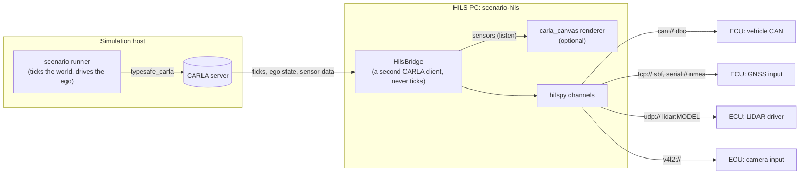

# HILS: Streaming the Ego to ECUs

`scenario-hils` is a hardware-in-the-loop bridge. It runs as **a separate
process**, typically on the HILS PC wired to the ECUs under test. It follows
the ego of a scenario run in CARLA and sends the ECUs what their real sensors
and buses would deliver: CAN frames, a GNSS receiver's output, a LiDAR's UDP
packets, camera frames. The sending is done by
[hilspy](https://github.com/hakuturu583/hilspy) (a Rust core with a thin
Python layer).



The scenario does not change and does not know about the bridge. The bridge
is a CARLA client of its own: it waits for the runner's ticks
(`World.wait_for_tick`), so it works with the runner's synchronous mode, and
it never ticks the world itself. When a run ends and the ego is destroyed, it
waits for the next ego and attaches its sensors to that one, so a single
`scenario-hils` serves a whole batch.

## Running it

The bridge is the `hils` extra. With [uv](https://docs.astral.sh/uv/), one
command installs it in a cached environment and runs it:

```bash
# Write a commented example configuration and edit it.
uvx --from 'autoware-carla-scenario[hils]' scenario-hils --example > hils.yaml

# Check it: what each device sends, nothing opened.
uvx --from 'autoware-carla-scenario[hils]' scenario-hils hils.yaml --check

# Run it, until Ctrl-C or SIGTERM.
uvx --from 'autoware-carla-scenario[hils]' scenario-hils hils.yaml

# Sensors rendered by carla_canvas (`canvas:` in hils.yaml).
uvx --from 'autoware-carla-scenario[hils]' --with 'carla-canvas[client]>=0.2' \
    scenario-hils hils.yaml
```

`--host`, `--port` and `--role-name` override the file's CARLA address and
ego. In a checkout, `uv sync --dev` installs hilspy and
`uv run scenario-hils hils.yaml` runs it. Then start the scenario runner as
usual, on the same CARLA server.

## Configuration

One YAML file describes everything. Relative paths in it (the `canvas` file,
a codec's file, a `profiles` option) are relative to the file. Unknown keys
are refused, so a typo fails at start-up instead of being ignored.

```yaml
carla: {host: sim-host, port: 2000, timeout: 10.0}
ego: {role_name: Ego, wait: 120.0}
canvas: canvas.yaml        # optional
clock: simulation          # or wall
devices:
  vehicle_can: {...}
  lidar_top: {...}
```

| Key | Default | |
| --- | --- | --- |
| `carla.host`, `carla.port` | `localhost`, `2000` | the CARLA server the scenario runs on |
| `carla.timeout` | `10.0` | seconds, for RPCs and for each tick |
| `ego.role_name` | `Ego` | the runner's ego |
| `ego.wait` | `120.0` | seconds without an ego before a warning (it keeps waiting) |
| `canvas` | none | a carla_canvas configuration: see [carla_canvas](#sensors-rendered-by-carla_canvas) |
| `clock` | `simulation` | the devices' time: see [Time](#time) |
| `devices` | | one entry per device, by name |

A device is one hilspy channel: `url` (the transport), `codec` (`raw` when
omitted) and `options` (codec options), exactly what `hilspy.open(url, codec,
**options)` takes. It has **either** `messages` (periodic messages filled from
the ego's signals) **or** a `sensor` (a CARLA sensor on the ego whose
measurements it is sent).

### Message devices

Each message is sent periodically through the codec, and its fields are
updated from the ego on every tick:

```yaml
vehicle_can:
  url: can://vcan0
  codec: dbc:vehicle.dbc
  options: {ecu: VCU}          # send only what the VCU transmits
  messages:
    - name: VehicleSpeed
      period: 0.01             # seconds; omitted: the DBC's GenMsgCycleTime
      fields:
        Speed: $speed_kmh
        YawRate: {signal: yaw_rate, scale: 1.0, offset: 0.0}
        Gear: D
```

A field is

- a constant (`D`, `4`, `true`),
- `$name`: a signal (below), or
- `{signal: name, scale: k, offset: c}`: `signal * k + c`.

`$$` starts a constant that begins with `$`. `scenario-hils --signals` lists
the signals:

| Signal | Unit | |
| --- | --- | --- |
| `time`, `frame` | s, - | the world's elapsed seconds and frame |
| `x`, `y`, `z` | m | world position (CARLA's frame) |
| `roll`, `pitch`, `yaw` | deg | CARLA rotation |
| `heading` | deg | clockwise from north, `[0, 360)` |
| `latitude`, `longitude`, `altitude` | deg, deg, m | from the map's geo-reference |
| `latitude_rad`, `longitude_rad` | rad | as SBF's `PVTGeodetic` takes them |
| `velocity_north`, `velocity_east`, `velocity_up` | m/s | |
| `course` | deg | course over ground, clockwise from north |
| `speed`, `speed_kmh` | m/s, km/h | magnitude of the velocity |
| `longitudinal_velocity`, `lateral_velocity`, `vertical_velocity` | m/s | vehicle frame: x forward, y left, z up |
| `longitudinal_acceleration`, `lateral_acceleration`, `vertical_acceleration` | m/s² | vehicle frame |
| `roll_rate`, `pitch_rate`, `yaw_rate` | deg/s | right-handed: `yaw_rate` positive turning left |
| `yaw_rate_rad` | rad/s | |
| `throttle`, `brake`, `steer` | - | the control last applied (`steer` positive right, as CARLA) |
| `hand_brake`, `reverse`, `gear` | - | 0 or 1, 0 or 1, CARLA's gear |

Any codec hilspy encodes with works. A GNSS receiver over TCP, as a
Septentrio receiver streams SBF:

```yaml
gnss:
  url: tcp://0.0.0.0:28784?listen
  codec: sbf
  messages:
    - name: PVTGeodetic
      period: 0.1
      fields: {mode: 4, latitude: $latitude_rad, longitude: $longitude_rad,
               height: $altitude, vn: $velocity_north, ve: $velocity_east,
               vu: $velocity_up}
    - name: AttEuler
      period: 0.1
      fields: {heading: $heading, pitch: $pitch, roll: $roll}
```

or NMEA on a serial port:

```yaml
gps:
  url: serial:///dev/ttyUSB0?baud=115200
  codec: nmea
  options: {talker: GN}
  messages:
    - name: GGA
      period: 0.1
      fields: {latitude: $latitude, longitude: $longitude, altitude: $altitude,
               fix_type: Rtk, fix_satellites: 14}
    - name: RMC
      period: 0.1
      fields: {lat: $latitude, lon: $longitude, speed_over_ground: {signal: speed, scale: 1.943844},
               true_course: $course, status_of_fix: Autonomous}
```

hilspy's README lists the codecs and their message fields (DBC and FIBEX
networks, SOME/IP, SBF, NMEA, UBX, RTCM).

### Sensor devices

The bridge spawns the sensor on the ego (its `role_name` is the device's
name), listens to it, and sends each measurement:

```yaml
lidar_top:
  url: udp://192.168.1.201:2368          # the ECU's LiDAR driver
  codec: lidar:pandar_xt32
  sensor:
    blueprint: sensor.lidar.ray_cast
    transform: {x: 0.0, y: 0.0, z: 2.0, roll: 0.0, pitch: 0.0, yaw: 0.0}
    attributes: {channels: 32, range: 120, points_per_second: 640000,
                 rotation_frequency: 10, upper_fov: 15, lower_fov: -16}
    intensity_scale: 255                  # CARLA's 0-1 intensity -> a byte

front_camera:
  url: v4l2:///dev/video10?format=BGRA&width=1280&height=720&fps=20
  sensor:
    blueprint: sensor.camera.rgb
    transform: {x: 1.5, z: 1.6}
    attributes: {image_size_x: 1280, image_size_y: 720, fov: 90}
    encoding: bgra
```

- **LiDAR** (`sensor.lidar.ray_cast`, with a `lidar:MODEL` codec: Hesai
  Pandar and Velodyne models). CARLA measures the arc a LiDAR sweeps in one
  tick; the bridge gathers the arcs into whole revolutions (by
  `rotation_frequency` and the time between measurements) and hilspy encodes
  each revolution into the model's UDP packets, paced over the revolution as
  the sensor streams them. Points go from CARLA's sensor frame (y right) to
  the sensor's (y left). Match `channels`, the field of view and
  `rotation_frequency` to the model.
- **Cameras** (`sensor.camera.*`, codec `raw`). Each image is one frame,
  in `encoding`: `bgra` (CARLA's raw image), `bgr`, `rgb`, `jpeg` or `png`.
  `v4l2://` makes it a V4L2 camera any client on the PC sees (hilspy built
  with its `v4l2` feature, and v4l2loopback: hilspy's README, "Cameras");
  `udp://` or `tcp://` send the bytes.

### Time

With `clock: simulation` (the default) every device runs on simulated time: a
`hilspy.Clock` that the world's ticks advance by the simulated time that
passed. Periodic messages go out as the clock passes their periods and a
LiDAR revolution's packets as it reaches their times, so the ECU sees the
traffic the simulation implies even when CARLA runs slower or faster than
real time; the clock starts at the wall-clock time the bridge starts, so GNSS
time stamps are plausible.

With `clock: wall` the devices run on real time: periodic messages from
hilspy's threads, sensor data sent from a thread per device as it arrives
(the newest data wins when a device falls behind). Use it when the
simulation runs in real time and the ECUs check timing against their own
clocks.

### Sensors rendered by carla_canvas

`canvas: canvas.yaml` has
[carla_canvas](https://github.com/hakuturu583/carla_canvas) render the
bridge's cameras and LiDARs (3D Gaussian splatting, or any renderer behind its
gRPC protocol) instead of the CARLA server. The bridge points typesafe_carla's
sensor plugin at carla_canvas before anything listens, as `canvas.config`
does for a run (`autoware_carla_scenario.canvas.use_canvas`). Its `sensors`
rules can select the bridge's sensors by `role_name`, which is the device's
name. Keep carla_canvas's asynchronous rendering (`renderer.async`, its
default): the bridge does not tick the world, and the asynchronous path renders
each frame the runner ticks. carla_canvas's client is installed with
`--with 'carla-canvas[client]>=0.2'`.

## Limitations

- One direction: the bridge sends to the ECUs. What they send back (control
  commands on CAN, for instance) is not fed into the simulation; drive the ego
  through the runner's own ego entities (Autoware, ROS 2, an external driver).
- One ego. Run one `scenario-hils` per ego role for more.
- Sensors are the ray-cast LiDAR and the cameras; GNSS and IMU are signals of
  the ego's state, without CARLA's sensor noise.
- A sensor's data reaches the devices on the tick after the one it was
  measured on when it arrives after that tick.
