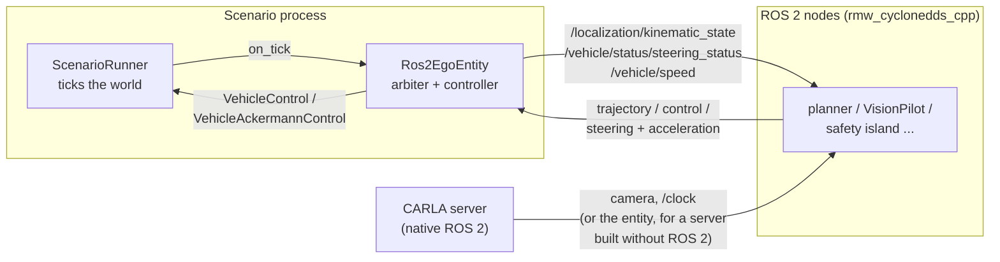

# ROS 2 over DDS

`ego.entity=ros2` hands the ego to ROS 2 nodes **directly over DDS**. The framework
joins the DDS domain itself, through Cyclone DDS's Python binding: no `rclpy`, no ROS 2
installation, no bridge node and no gRPC. It publishes the ego's state on ROS 2
topics, takes commands from them, and applies the one that drives.

It takes the place of the CARLA-to-ROS 2 bridge nodes a ROS 2 stack would otherwise
run beside CARLA: the ego-state and speed publishers, and the arbiter that chooses
between command sources.



## Installing

The DDS binding is the `ros2` extra:

```bash
pip install 'autoware-carla-scenario[ros2]'
```

In this repository the dev group installs it too (`uv sync --dev`).

`cyclonedds` ships wheels for Linux x86_64 on CPython 3.10-3.13 only, and the extra
installs nothing elsewhere; `ego.entity=ros2` then fails at scenario start, saying so.

## Running

```bash
uv run scenario ego.entity=ros2 server.max_tick_rate_hz=20
```

The ROS 2 nodes run with `RMW_IMPLEMENTATION=rmw_cyclonedds_cpp` on the same
`ros2.domain_id`. Cyclone reads `CYCLONEDDS_URI` in the scenario process exactly as
it does in a node, so the same configuration file (interfaces, peers, fragment size)
applies to both.

## Timing

Nothing waits for a command. Every tick the entity publishes the ego's state, takes
the commands that arrived since the previous tick, and applies the one that drives;
the simulation goes at the pace `server.max_tick_rate_hz` sets, and a source that
falls silent goes stale. Set `server.max_tick_rate_hz=20` -- real time at the 0.05 s
step -- when the nodes measure wall-clock deadlines: a lockstep that stopped the
simulation to wait for them would starve exactly the timeouts they are there to
check. This is how a ROS 2 bridge that relays to CARLA behaves (VisionPilot's runs
the world in synchronous mode, paced to wall-clock 10 Hz, without waiting for a
command).

`ego.entity=ros2` without `server.max_tick_rate_hz` logs a warning: unpaced, the
simulation outruns the nodes and their sources look stale. The rate must be a finite
number above 0 or `null`; anything else (`0`, a negative rate, `nan`) is refused
before the run starts.

Published stamps and the freshness of commands are both in simulation time, the time
CARLA's `/clock` carries, which is what nodes with `use_sim_time` read.

## What the ego publishes

| Setting | Type | Contents |
| --- | --- | --- |
| `kinematic_state_topic` (`/localization/kinematic_state`) | `nav_msgs/Odometry` | pose in `frame_id`, twist in `child_frame_id` |
| `steering_status_topic` (`/vehicle/status/steering_status`) | `autoware_vehicle_msgs/SteeringReport` | front tyre angle, positive to the left |
| `speed_topic` (`/vehicle/speed`) | `std_msgs/Float64` | ground speed, m/s |
| `clock_topic` (off) | `rosgraph_msgs/Clock` | for a CARLA server built without ROS 2 |
| `turn_indicators_report_topic` (`/vehicle/status/turn_indicators_status`) | `autoware_vehicle_msgs/TurnIndicatorsReport` | the indicators the ego shows (hazard, both lit, reports as off, as the report has no hazard) |

`null` leaves a topic unpublished. Every topic the settings name -- these, the command
sources' and the cameras' -- is checked as the config is read: a ROS 2 name, absolute
or relative (taken from the root namespace), made of `A-Z`, `a-z`, `0-9`, `_` and `/`,
with no `//`, no trailing `/` and no token starting with a digit. A private name (`~`)
or a substitution (`{node}`) is refused too: a ROS 2 node expands those, and the entity
is not one. The pose is in the right-handed local frame --
CARLA's world with `y` flipped, as CARLA's own ROS 2 interface publishes it -- with
its origin on the rear axle, Autoware's `base_link` (`rear_axle_offset_m`, derived
from the wheels, else the box, when `null`). The run's [trajectory log](trajectory_log.md)
(its `rear_axle` record) and [T4 dataset](t4_dataset.md) put the ego's `base_link`
there too.

Cameras and `/clock` are CARLA's to publish when the server is built with ROS 2. For a
server built without it, the entity publishes them as well:

| Setting | Type | Contents |
| --- | --- | --- |
| `clock_topic` | `rosgraph_msgs/Clock` | the simulation time, every tick |
| `cameras[].topic` | `sensor_msgs/Image` | each frame of a camera on the ego, `bgra8`, stamped with the simulation time it was rendered at |

A camera in `cameras` takes the rendering and mount fields of a
[driver camera](driver_interface.md) (`image_width`, `image_height`, `fov`, `fps`,
`position_x/y/z`, `roll`, `pitch`, `yaw`, in CARLA's convention), plus its `topic` and
`frame_id`, and the same bounds: `image_width` and `image_height` positive whole
numbers (`960`, or `960.0` kept as the int `960`, so CARLA is given
`image_size_x="960"`; not `960.5`, a bool or a string), `fps` positive and
finite, `fov` in (0, 180) degrees, and the mount finite. A camera out of these bounds is
refused as the config is read, not when it attaches after the ego spawned. Its frames go
out from the sensor's own thread as they are rendered, the way CARLA's own interface
publishes them, and under the names a node already subscribes to:

```yaml
ros2:
  clock_topic: /clock
  cameras:
    - logical_id: main_cam
      topic: /carla/hero/main_cam/image
      frame_id: main_cam
      image_width: 1280
      image_height: 720
      fov: 60.0
      fps: 10.0
      position_x: 1.25
      position_z: 1.58
```

## Where commands come from

`ros2.sources` lists the publishers the ego takes commands from:

| `kind` | Topics | Applied by |
| --- | --- | --- |
| `trajectory` | `topic`: `autoware_planning_msgs/Trajectory` | the framework's trajectory follower (pure pursuit + Autoware's PID longitudinal controller on the trajectory's own speeds, through the powertrain model), as for an [external driver policy](driver_interface.md) |
| `control` | `topic`: `autoware_control_msgs/Control` | CARLA's Ackermann controller; Autoware's steering (positive left) is negated into CARLA's (positive right), and its signed velocity is handed over as given, so a negative one -- however small: there is no deadband -- reverses (the controller comes to a stop before it changes direction) |
| `steer_accel` | `steering_topic`, `acceleration_topic`: `std_msgs/Float64` | CARLA's Ackermann controller, as VisionPilot's `carla_control_publisher` hands it: target speed `speed + acceleration * speed_horizon_s`, never below zero (a deceleration past standstill stops the ego rather than reversing it) |

The turn indicators are not a source: whichever source drives, the newest
`autoware_vehicle_msgs/TurnIndicatorsCommand` on `turn_indicators_command_topic`
(`/control/command/turn_indicators_cmd`; `null` turns it off) lights the ego's
indicators, leaving its other lights as they are, until another changes them.
`NO_COMMAND` changes nothing.

A `steer_accel` command pairs the steering and the acceleration of one publisher cycle,
and each value is used once, so a node that publishes one of each per cycle drives once
per cycle. The halves are matched by the DDS source timestamp of each sample (when the
publisher wrote it), not by when a tick happens to read it, so a tick that reads two
cycles at once, or one half of a cycle before the tick and the other after it, still
pairs every cycle with itself. Like `carla_control_publisher`, which turns each
message into its target speed once, the target speed of a command is computed once,
from the speed at the tick it is first applied: re-applying it on later ticks, or
holding it once its source is stale, keeps that target rather than recomputing it
from the ego's current speed. A new command recomputes it, even one with the same
values.

Two halves pair only if they were written at most a window apart. By default the window
is half the publisher's cycle, measured from the timestamps themselves (the median of
the last few write intervals), so no rate or timing is assumed: any publisher that writes
a cycle's two halves closer to each other than to the next cycle's pairs every cycle,
whether it writes them back to back (VisionPilot does) or from two timers 40 ms apart at
10 Hz. A half with no partner in the window is dropped, never paired with another
cycle's: a lost steering or acceleration message costs that one cycle instead of
shifting every later command by a cycle. An unmatched half is held only until the next
sample of either topic shows it has no partner (a newer half of its own topic, or a half
of the other topic written further than the window away).

Dropped halves are logged as a warning (at most every 10 s, with the count and the
window). An occasional drop is a lost message; a steady stream of them means the window
does not fit the publisher. Set `pair_window_s` on the source to fix the window, in
seconds: larger than the gap between a cycle's two halves, and smaller than the cycle
minus that gap. The timestamps are the writers' clocks, so the two topics are expected
to come from one host (or hosts whose clocks agree well within the window).

```yaml
    - name: visionpilot
      kind: steer_accel
      steering_topic: /vehicle/steering_cmd
      acceleration_topic: /vehicle/throttle_cmd
      pair_window_s: 0.03   # optional; null (the default) measures it
```

A trajectory's points are timed by `header.stamp + time_from_start`; one whose
`time_from_start` does not increase (many planners leave it zero) is timed from its
speeds instead.

### Arbitration

Every tick, of the sources whose last command arrived at most `stale_s` ago, the one
with the highest `priority` drives; between equal priorities, the most recent command
(the one read last). Each tick reads the sources in the order `ros2.sources` lists
them, so when equal-priority sources each sent a command since the last tick, the
one listed last wins.
Once every source is stale, `on_stale` decides: `hold` keeps applying the last command
(what a relay node does when its upstream stops), `brake` brakes to a stop. Before any
command has arrived, the ego is held on its brakes.

A command that is not all finite (a NaN or an infinity in a steering angle, a speed,
an acceleration, a jerk, or a trajectory's poses, speeds or accelerations) is
refused, with a warning: the active source's last good command of that kind drives
on, and with none, the ego is held on its brakes.

A `control` command's jerk is signed in Autoware (negative while the deceleration
grows), while CARLA's Ackermann jerk is a limit: a negative one is handed over as its
magnitude, logged once a session. A `control` command that leaves its jerk undefined,
and every `steer_accel` command, takes the source's `jerk_mps3`.

```yaml
ros2:
  domain_id: 0
  on_stale: hold
  sources:
    - name: planner
      kind: trajectory
      topic: /planning/scenario_planning/trajectory
      priority: 0
      stale_s: 0.3
  control: {}     # trajectory-follower gains, as driver.control
```

The settings are checked as the config is read -- by `check_run_config`, before a
batch's first scenario starts, as well as when the entity is built -- and a bad one is
refused naming its key (`ros2: domain_id must be ...`), not once the ego has spawned
and joined the domain:

* `domain_id` is a whole number from 0 to 232, the
  `ROS_DOMAIN_ID` range ROS 2 can use, the bound the docker launcher's
  `ros_domain_ids` share ([autoware.md](autoware.md)).
* A source's `priority` is a whole number.
* A whole number, here as for a camera's size, is an integral value: `7`, or `7.0`,
  which is kept as the int `7`; `7.5`, NaN, infinity, a bool and a quoted `"7"` are
  refused.
* `stale_s`, `pair_window_s`, `steering_sign`, `speed_horizon_s`, `jerk_mps3`,
  `rear_axle_offset_m` and a camera's numeric fields are numbers, an int or a float
  (not a bool or a quoted string), and finite, within the bounds above.
* A source's `speed_horizon_s` is positive: zero would pin a `steer_accel` target
  speed to the current speed, and a negative horizon would turn a request to
  accelerate into braking.
* A source's `jerk_mps3` is not negative. `0` is allowed: it is the jerk
  `carla.VehicleAckermannControl` takes by default.
* A source's `steering_sign` is not zero, which would pin the steering straight. Its
  magnitude scales the steering and a negative value flips it, so both are kept.

## The Open AD Kit safety-island demo

`ros2=visionpilot_safety_island` is the bench side of the Open AD Kit CES 2027 demo
([openadkit#157](https://github.com/autowarefoundation/openadkit/issues/157)):
VisionPilot steers and accelerates, and a fresh command from the safety island (the
CR52, restamped onto domain 1) overrides it.

```bash
uv run scenario ros2=visionpilot_safety_island
```

| Source | Kind | Topics | Priority |
| --- | --- | --- | --- |
| `visionpilot` | `steer_accel` | `/vehicle/steering_cmd`, `/vehicle/throttle_cmd` | 0 |
| `safety_island` | `control` | `/control/trajectory_follower/control_cmd` | 10 |

It selects `ego.entity: ros2` on VisionPilot's vehicle (a Lincoln MKZ), DDS domain 1,
and `server.max_tick_rate_hz: 20`.

## From Python

```python
from autoware_carla_scenario.entity.ros2_entity import Ros2EgoEntity
from autoware_carla_scenario.ros2 import CommandSourceConfig, Ros2EgoConfig

scenario.ego_entity = Ros2EgoEntity(
    Ros2EgoConfig(
        domain_id=1,
        sources=(
            CommandSourceConfig(name="planner", kind="trajectory",
                                topic="/planning/scenario_planning/trajectory"),
        ),
    )
)
```

To test without DDS, pass `transport=FakeRos2Transport(config)` and queue commands
with its `deliver()`.

## How it speaks ROS 2

A node on `rmw_cyclonedds_cpp` publishes a message as a DDS sample of a type named
`<package>::msg::dds_::<Message>_` on the topic `rt/<name>`.
`autoware_carla_scenario.ros2.messages` declares the same structs, field for field from
the `.msg` definitions, so the samples are wire compatible with no ROS 2 type support
installed. They are written in XCDR1, the representation `rmw_cyclonedds_cpp` writes.

## Limitations

* Only `rmw_cyclonedds_cpp` has been tried. Other RMWs speak the same RTPS, but
  matching them is not tested.
* The ego's role name is `Ego`, where VisionPilot subscribes its camera under
  `/carla/hero/...`; whether CARLA's own ROS 2 topics follow the role name has not
  been checked against a server yet. A camera in `cameras` is published under the
  `topic` it names, whatever the role name.
* A camera in `cameras` publishes no `sensor_msgs/CameraInfo`.
* Commands are read in the local frame `frame_id` names; nothing transforms a plan
  published in another frame (a Lanelet2 `map`, say).
* `control` and `steer_accel` hand the acceleration to CARLA's Ackermann controller as
  given, as VisionPilot's relay does; the controller's own settings
  (`AckermannControllerSettings`) are CARLA's defaults.
