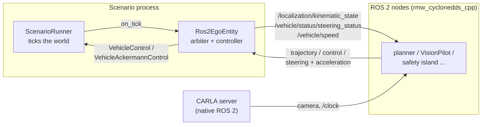

# ROS 2 over DDS

`ego.entity=ros2` hands the ego to ROS 2 nodes **directly over DDS**. The framework
joins the DDS domain itself, through Cyclone DDS's Python binding: no `rclpy`, no ROS 2
installation, no bridge node and no gRPC. It publishes the ego's state on ROS 2
topics, takes commands from them, and applies the one that drives.

It takes the place of the CARLA-to-ROS 2 bridge nodes a ROS 2 stack would otherwise
run beside CARLA: the ego-state and speed publishers, and the arbiter that chooses
between command sources.



## Installing

The DDS binding is the `ros2` extra:

```bash
pip install 'autoware-carla-scenario[ros2]'
```

In this repository the dev group installs it too (`uv sync --dev`).

`cyclonedds` ships wheels for Linux x86_64 on CPython 3.10-3.13 only, and the extra
installs nothing elsewhere; `ego.entity=ros2` then fails at scenario start, saying so.

## Running

```bash
uv run scenario ego.entity=ros2 server.max_tick_rate_hz=20
```

The ROS 2 nodes run with `RMW_IMPLEMENTATION=rmw_cyclonedds_cpp` on the same
`ros2.domain_id`. Cyclone reads `CYCLONEDDS_URI` in the scenario process exactly as
it does in a node, so the same configuration file (interfaces, peers, fragment size)
applies to both.

## Timing

Nothing waits for a command. Every tick the entity publishes the ego's state, takes
the commands that arrived since the previous tick, and applies the one that drives;
the simulation goes at the pace `server.max_tick_rate_hz` sets, and a source that
falls silent goes stale. Set `server.max_tick_rate_hz=20` -- real time at the 0.05 s
step -- when the nodes measure wall-clock deadlines: a lockstep that stopped the
simulation to wait for them would starve exactly the timeouts they are there to
check. This is how a ROS 2 bridge that relays to CARLA behaves (VisionPilot's runs
the world in synchronous mode, paced to wall-clock 10 Hz, without waiting for a
command).

`ego.entity=ros2` without `server.max_tick_rate_hz` logs a warning: unpaced, the
simulation outruns the nodes and their sources look stale.

Published stamps and the freshness of commands are both in simulation time, the time
CARLA's `/clock` carries, which is what nodes with `use_sim_time` read.

## What the ego publishes

| Setting | Type | Contents |
| --- | --- | --- |
| `kinematic_state_topic` (`/localization/kinematic_state`) | `nav_msgs/Odometry` | pose in `frame_id`, twist in `child_frame_id` |
| `steering_status_topic` (`/vehicle/status/steering_status`) | `autoware_vehicle_msgs/SteeringReport` | front tyre angle, positive to the left |
| `speed_topic` (`/vehicle/speed`) | `std_msgs/Float64` | ground speed, m/s |
| `clock_topic` (off) | `rosgraph_msgs/Clock` | for a CARLA server built without ROS 2 |

`null` leaves a topic unpublished. The pose is in the right-handed local frame --
CARLA's world with `y` flipped, as CARLA's own ROS 2 interface publishes it -- with
its origin on the rear axle, Autoware's `base_link` (`rear_axle_offset_m`, derived
from the wheel physics when `null`).

Cameras and `/clock` are not the entity's: CARLA publishes them itself when the
server is built with ROS 2.

## Where commands come from

`ros2.sources` lists the publishers the ego takes commands from:

| `kind` | Topics | Applied by |
| --- | --- | --- |
| `trajectory` | `topic`: `autoware_planning_msgs/Trajectory` | the framework's trajectory follower (pure pursuit + speed PI through the powertrain model), as for an [external driver policy](driver_interface.md) |
| `control` | `topic`: `autoware_control_msgs/Control` | CARLA's Ackermann controller; Autoware's steering (positive left) is negated into CARLA's (positive right) |
| `steer_accel` | `steering_topic`, `acceleration_topic`: `std_msgs/Float64` | CARLA's Ackermann controller, as VisionPilot's `carla_control_publisher` hands it: target speed `speed + acceleration * speed_horizon_s` |

A `steer_accel` command is complete once a fresh value has arrived on both topics, and
each value is used once, so a node that publishes one of each per cycle drives once per
cycle.

A trajectory's points are timed by `header.stamp + time_from_start`; one whose
`time_from_start` does not increase (many planners leave it zero) is timed from its
speeds instead.

### Arbitration

Every tick, of the sources whose last command arrived at most `stale_s` ago, the one
with the highest `priority` drives; between equal priorities, the most recent command.
Once every source is stale, `on_stale` decides: `hold` keeps applying the last command
(what a relay node does when its upstream stops), `brake` brakes to a stop. Before any
command has arrived, the ego is held on its brakes.

```yaml
ros2:
  domain_id: 0
  on_stale: hold
  sources:
    - name: planner
      kind: trajectory
      topic: /planning/scenario_planning/trajectory
      priority: 0
      stale_s: 0.3
  control: {}     # trajectory-follower gains, as driver.control
```

## The Open AD Kit safety-island demo

`ros2=visionpilot_safety_island` is the bench side of the Open AD Kit CES 2027 demo
([openadkit#157](https://github.com/autowarefoundation/openadkit/issues/157)):
VisionPilot steers and accelerates, and a fresh command from the safety island (the
CR52, restamped onto domain 1) overrides it.

```bash
uv run scenario ros2=visionpilot_safety_island
```

| Source | Kind | Topics | Priority |
| --- | --- | --- | --- |
| `visionpilot` | `steer_accel` | `/vehicle/steering_cmd`, `/vehicle/throttle_cmd` | 0 |
| `safety_island` | `control` | `/control/trajectory_follower/control_cmd` | 10 |

It selects `ego.entity: ros2` on VisionPilot's vehicle (a Lincoln MKZ), DDS domain 1,
and `server.max_tick_rate_hz: 20`.

## From Python

```python
from autoware_carla_scenario.entity.ros2_entity import Ros2EgoEntity
from autoware_carla_scenario.ros2 import CommandSourceConfig, Ros2EgoConfig

scenario.ego_entity = Ros2EgoEntity(
    Ros2EgoConfig(
        domain_id=1,
        sources=(
            CommandSourceConfig(name="planner", kind="trajectory",
                                topic="/planning/scenario_planning/trajectory"),
        ),
    )
)
```

To test without DDS, pass `transport=FakeRos2Transport(config)` and queue commands
with its `deliver()`.

## How it speaks ROS 2

A node on `rmw_cyclonedds_cpp` publishes a message as a DDS sample of a type named
`<package>::msg::dds_::<Message>_` on the topic `rt/<name>`.
`autoware_carla_scenario.ros2.messages` declares the same structs, field for field from
the `.msg` definitions, so the samples are wire compatible with no ROS 2 type support
installed. They are written in XCDR1, the representation `rmw_cyclonedds_cpp` writes.

## Limitations

* Only `rmw_cyclonedds_cpp` has been tried. Other RMWs speak the same RTPS, but
  matching them is not tested.
* The ego's role name is `Ego`, where VisionPilot subscribes its camera under
  `/carla/hero/...`; whether CARLA's own ROS 2 topics follow the role name has not
  been checked against a server yet.
* Commands are read in the local frame `frame_id` names; nothing transforms a plan
  published in another frame (a Lanelet2 `map`, say).
* `control` and `steer_accel` hand the acceleration to CARLA's Ackermann controller as
  given, as VisionPilot's relay does; the controller's own settings
  (`AckermannControllerSettings`) are CARLA's defaults.
