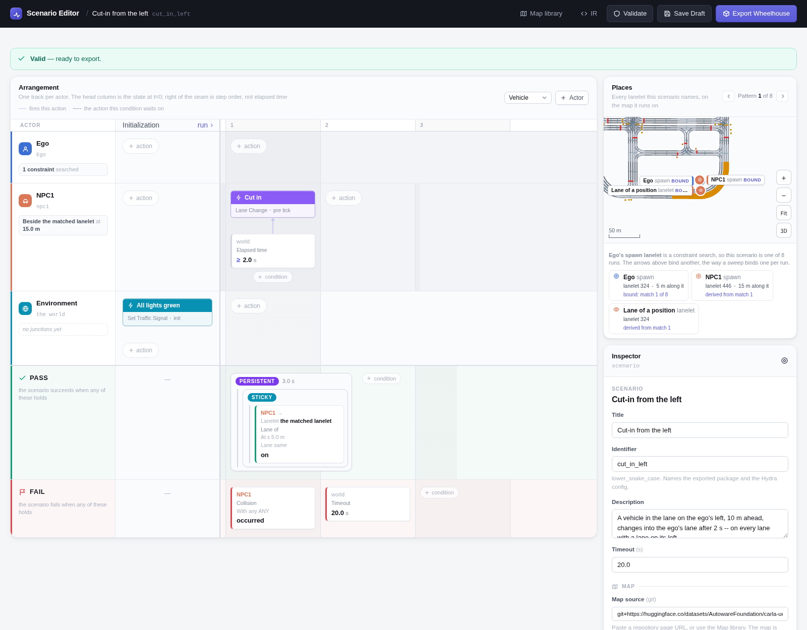

# Cut-in

A vehicle in the next lane, 10 m ahead of the ego, changes into the ego's lane
2 s into the run. The ego must not hit it -- on every lane with a lane on that
side.

```bash
# Every case on the map, one run each
uv run scenario --multirun hydra/sweeper=lanelet_constraint \
    scenario=cut_in/left map=<map>
```

## Scenario

| | |
|---|---|
| **Ego** | Constraint search: a lane with a lane on the cut-in side, not in a junction, at least 60 m long, excluding the map's lanelets with no 3D model. 5 m along it, 30 km/h. |
| **NPC1** | *Beside the matched lanelet*, on the cut-in side: the lane next to the ego's. 15 m along it, 30 km/h. |
| **Initialization** | Every traffic light green. |
| **NPC1, after 2 s** | Change lane towards the ego. |
| **Pass** | 3 s have passed since NPC1 reached the ego's OpenDRIVE lane (*lane of a position*: the matched lanelet at the ego's spawn, the same lane), with no collision. |
| **Fail** | The ego hits NPC1, or 20 s pass. |

## Variants

=== "From the left"

    

    `scenario=cut_in/left` -- a lane on the ego's left; NPC1 changes right.

    <video controls muted playsinline width="100%" src="../media/cut_in_left.mp4"></video>

    *Town10HD_Opt, the first case: the search matched lanelet 324, where the ego starts; NPC1 starts beside it on lanelet 446. Result: PASSED.*

=== "From the right"

    

    `scenario=cut_in/right` -- a lane on the ego's right; NPC1 changes left.

    <video controls muted playsinline width="100%" src="../media/cut_in_right.mp4"></video>

    *Town10HD_Opt, the first case: the search matched lanelet 446, where the ego starts; NPC1 starts beside it on lanelet 324. Result: PASSED.*

## Parameters

| Parameter | Value |
|---|---|
| NPC1 ahead of the ego | 10 m along its lanelet (at s = 15 m): `npc_ahead_m` |
| or, measured | `npc_gap_m`: the gap `vehicle_ahead_gap_m` reads at the start (bumper to bumper, along the ego's lane); NPC1's `s` is solved for so it does. Unset by default; an ODD-sampled sweep sets it, 2-30 m |
| NPC1 and ego initial speed | 30 km/h |
| Cut-in after | 2 s |
| Held in the ego's lane for | 3 s |
| Lanelet at least | 60 m |
| Timeout | 20 s |

## Placing NPC1 by the measured gap

`npc_ahead_m` is a raw setting: NPC1's `s` on its lanelet less the ego's on
its own. It is not the gap the `vehicle_ahead_gap_m` measure reads: the
measure is bumper to bumper -- NPC1's rear bumper less the ego's front bumper
-- along the ego's lane ([Scenario measures](../odd.md#scenario-measures)),
and lanelets side by side are not the same length on a curve (the outer one
is longer), so their `s` do not line up and the difference changes from
place to place.

`npc_gap_m` is that gap itself. When it is set, the scenario places NPC1
with `place_at_vehicle_ahead_gap`: from the ego's spawn pose, it finds the
`s` on NPC1's lanelet at which the measure -- the same code, run on the
poses the two will spawn at -- reads `npc_gap_m`, so the run starts at
exactly that gap wherever it is placed. The bumpers are the vehicles' own:
before either is spawned, one of each blueprint (`ego.vehicle_type`,
`npc_vehicle_type`) is spawned high above the map, its bounding box read and
the vehicle destroyed (`vehicle_bumpers`, once per blueprint), so NPC1 is
spawned once, where the gap reads right, rather than spawned and moved. A
gap the lanelet cannot reach (too short, or curving out of the lanes the
measure counts) fails the setup, saying what gaps it does reach.

On CARLA 0.10 Town04_Opt, with the ego (a Lincoln MKZ) on lanelet 79016 at
`s` = 640 and NPC1 (a Mini) placed on lanelet 77298 beside it, gaps of 2.5,
8, 12, 15, 20, 25 and 30 m were measured back within 0.001 m on the first
tick (within 0.01 m two ticks later). Placed by a calibrated `npc_ahead_m`
offset instead, and measured centre to centre, the same place read 2.2 m
more than drawn.

The scenario's controls draw the gap this way (`target: measure`,
[Controls](../odd.md#controls)), so a sweep's `vehicle_ahead_gap` draws are
the gaps the runs start at:

```bash
uv run scenario scenario=cut_in/left map=<map> scenario.npc_gap_m=15
```

The relative speed needs no solving: `npc_initial_speed_kmh` less the ego's
initial speed is what the `vehicle_ahead_relative_speed_kph` measure reads at
the start, up to the cosine of the small heading difference on a curve.
