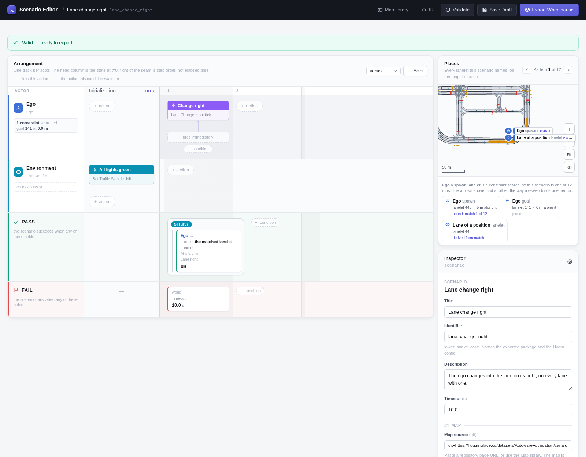
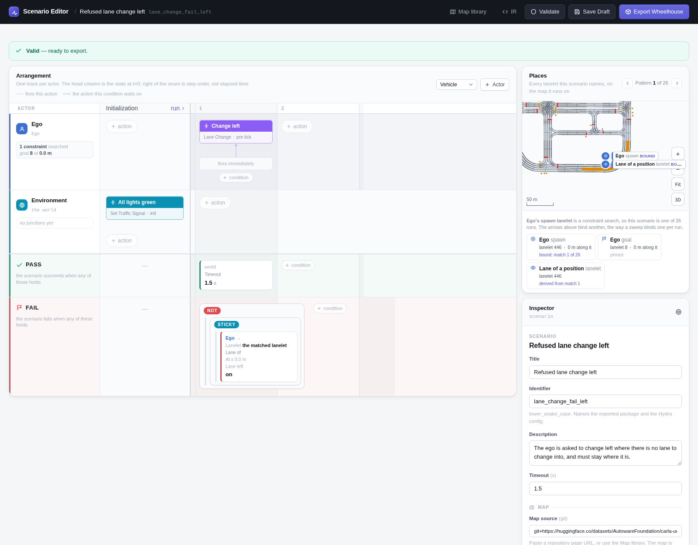
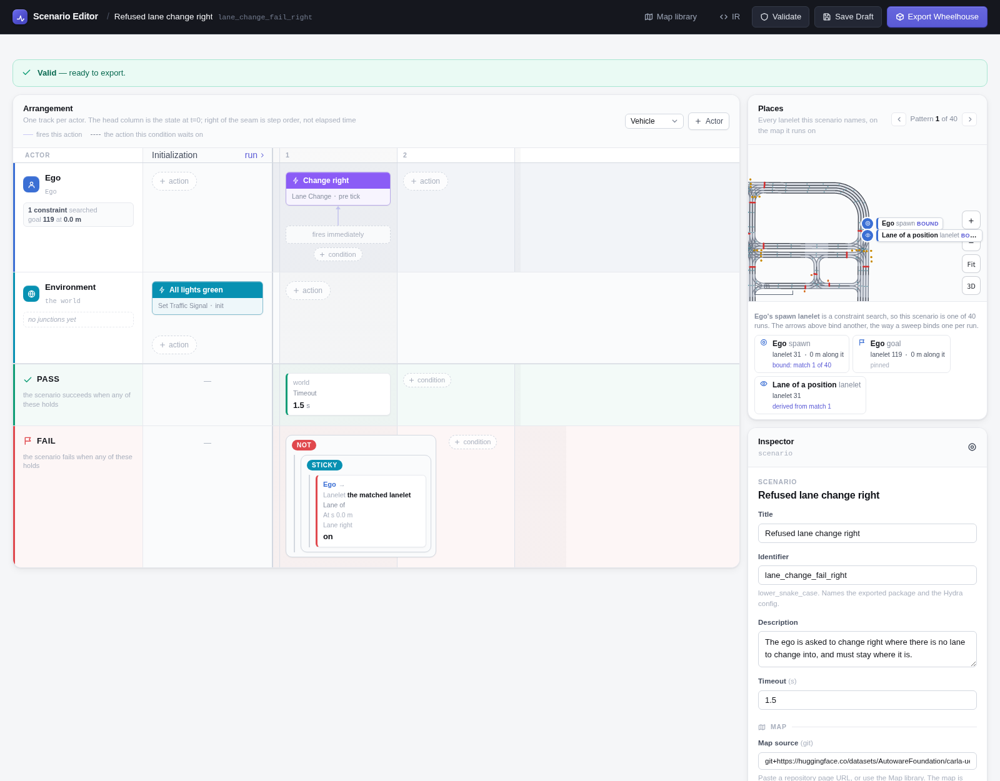

# Lane Change

The ego is told to change lane as soon as the run starts. Where there is a lane
to change into, it has to end up in it; where there is none, it has to stay
where it is.

```bash
# Every case on the map, one run each
uv run scenario --multirun hydra/sweeper=lanelet_constraint \
    scenario=lane_change/left map=<map>
uv run scenario --multirun hydra/sweeper=lanelet_constraint \
    scenario=lane_change_fail/left map=<map>
```

## Scenario

| | |
|---|---|
| **Ego** | Constraint search: a lane that is not in a junction and is long enough, excluding the map's lanelets with no 3D model -- with a lane on that side to change into, or, for the refused change, without one. 1 km/h; 20 km/h for the refused change. Goal *from the search*: the lanelet after the matched one, or the first one past the junction it leads into (along the junction lanelet with the lowest ID where the way forks); a match with no lanelet ahead along that way is skipped. |
| **Initialization** | Every traffic light green. |
| **Ego, from the start** | Change lane, left or right. |
| **Pass** | Changing: the ego has been on the lane beside the one it started on (*lane of a position*: the lanelet to the matched lanelet's left or right, or one ahead of it before the next junction). Refusing: the timeout passes with the ego still in its own lane -- the lanelet it started on, or one that continues it, through junctions. |
| **Fail** | Changing: the timeout. Refusing: the ego reaches that lane, or is off its own lane for 0.2 s (a lane beside across a line, off the road), or the timeout passes with it off its own lane. |

The lane is checked in the Lanelet2 frame: the lanelet beside the spawn
lanelet on that side (`coordinate.lane_beside`) and the lanelets ahead of it
up to the next junction, less any that the spawn lanelet's own lane also
reaches before its junction (a lane beside that merges into the ego's). The
ego has changed lane once its centre is on one of them.

The lanelet beside is the routing graph's `left` / `right` -- the lane a
lane change is allowed into, which `has_adjacent` asks about -- and, failing
that, its `adjacentLeft` / `adjacentRight`: a lane beside in the same
direction behind a line a lane change may not cross. So a refused change
whose search found no `left` / `right` can still have a lane beside: there,
the ego crossing into it fails the run. Only where there is no lanelet beside
on that side at all -- neither kind -- does that check never hold; the
refused change then still has to keep the ego in its own lane: it fails once
the ego has been off the lanelets that continue its spawn lanelet for 0.2 s,
and passes only if the ego is on one of them when the timeout runs out
(#2253). It used to pass on a 1.5 s timeout at 1 km/h, which no lane change
could have beaten, whatever the ego did.

## Variants

=== "Left"

    

    `scenario=lane_change/left` -- a lane on the left, at least 30 m long;
    10 s.

    <video controls muted playsinline width="100%" src="../media/lane_change_left.mp4"></video>

    *Town10HD_Opt, the first case: the search matched lanelet 324, where the ego starts. Result: PASSED.*

=== "Right"

    

    `scenario=lane_change/right` -- a lane on the right, at least 30 m long;
    10 s.

    <video controls muted playsinline width="100%" src="../media/lane_change_right.mp4"></video>

    *Town10HD_Opt, the first case: the search matched lanelet 446, where the ego starts. Result: PASSED.*

=== "Refused, left"

    

    `scenario=lane_change_fail/left` -- no lane on the left, at least 15 m
    long; passes after 10 s in the lane it started in.

    <video controls muted playsinline width="100%" src="../media/lane_change_fail_left.mp4"></video>

    *Town10HD_Opt, the first case: the search matched lanelet 446, where the ego starts. Result: PASSED. Recorded with an 8 s timeout, before the 10 s one and the stay-in-lane check.*

=== "Refused, right"

    

    `scenario=lane_change_fail/right` -- no lane on the right, at least 10 m
    long; passes after 10 s in the lane it started in.

    <video controls muted playsinline width="100%" src="../media/lane_change_fail_right.mp4"></video>

    *Town10HD_Opt, the first case: the search matched lanelet 31, where the ego starts. Result: PASSED. Recorded with an 8 s timeout, before the 10 s one and the stay-in-lane check.*

## Parameters

| Parameter | Left | Right | Refused left | Refused right |
|---|---|---|---|---|
| Lane on that side | yes | yes | no | no |
| Lanelet at least | 30 m | 30 m | 15 m | 10 m |
| Spawn | 5 m along it | 5 m | 5 m | 5 m |
| Ego initial speed | 1 km/h | 1 km/h | 20 km/h | 20 km/h |
| Timeout | 10 s (fail) | 10 s (fail) | 10 s (pass in its own lane) | 10 s (pass in its own lane) |
