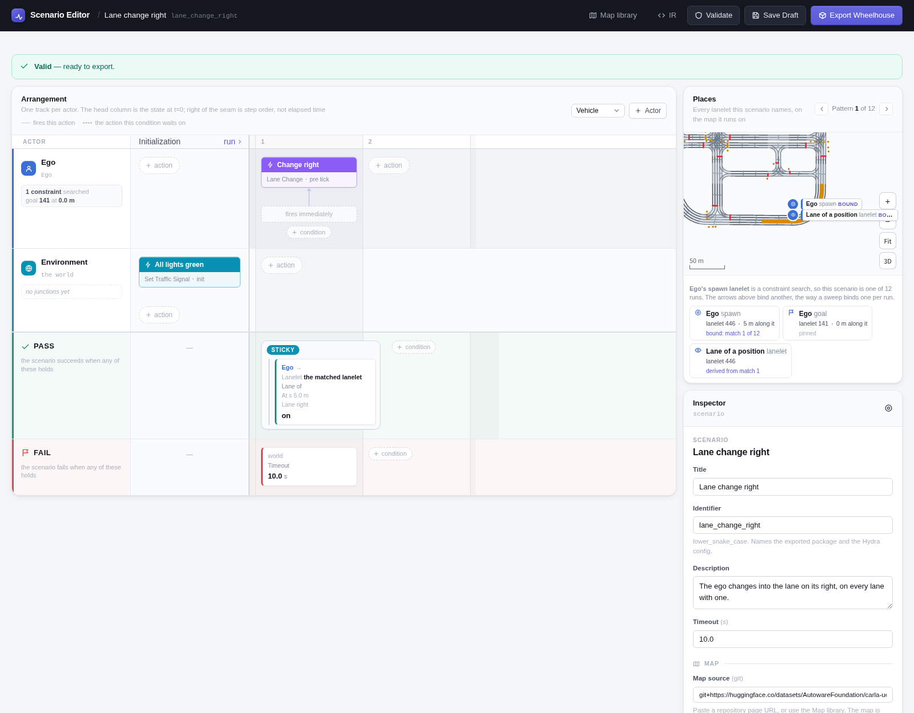
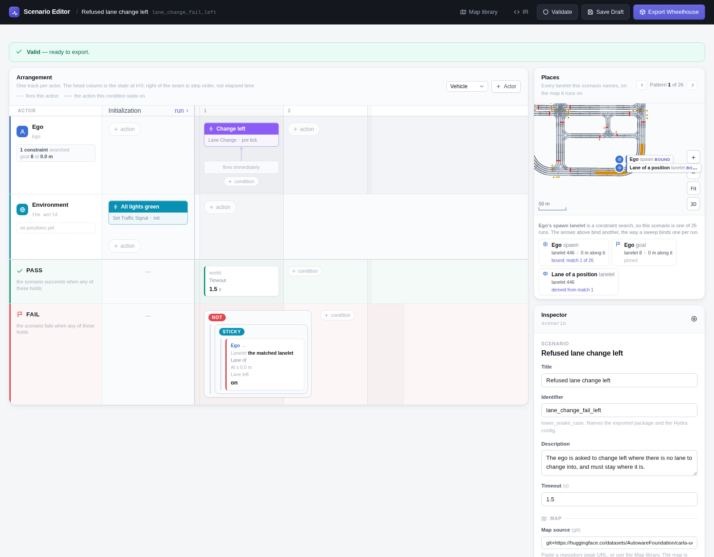
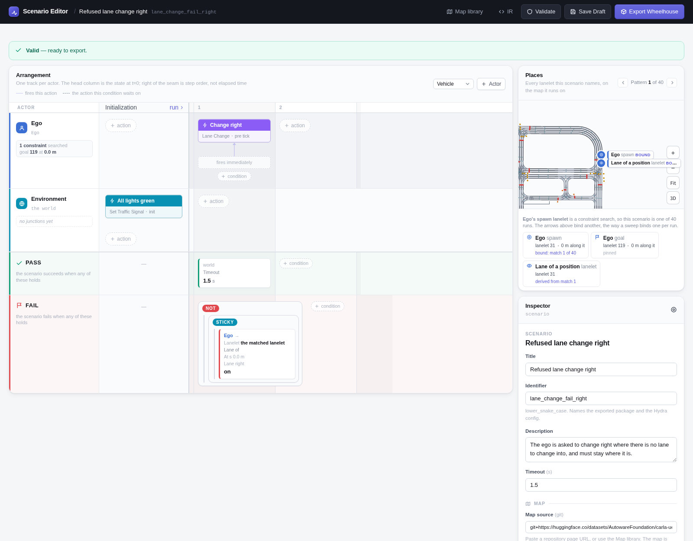

# Lane Change

The ego is told to change lane as soon as the run starts. Where there is a lane
to change into, it has to end up in it; where there is none, it has to stay
where it is.

```bash
# Every case on the map, one run each
uv run scenario --multirun hydra/sweeper=lanelet_constraint \
    scenario=lane_change/left map=<map>
uv run scenario --multirun hydra/sweeper=lanelet_constraint \
    scenario=lane_change_fail/left map=<map>
```

## Scenario

| | |
|---|---|
| **Ego** | Constraint search: a lane that is not in a junction and is long enough, excluding the map's lanelets with no 3D model -- with a lane on that side to change into, or, for the refused change, without one. 1 km/h. Goal *from the search*: the lanelet after the matched one, or the first one past the junction it leads into (along the junction lanelet with the lowest ID where the way forks); a match with no lanelet ahead along that way is skipped. |
| **Initialization** | Every traffic light green. |
| **Ego, from the start** | Change lane, left or right. |
| **Pass** | Changing: the ego has been on the lane beside the one it started on (*lane of a position*: the lanelet to the matched lanelet's left or right, or one ahead of it before the next junction). Refusing: the timeout passes. |
| **Fail** | Changing: the timeout. Refusing: the ego reaches that lane. |

The lane is checked in the Lanelet2 frame: the lanelet beside the spawn
lanelet on that side -- the routing graph's `left` / `right`, the lane
`has_adjacent` asks about -- and the lanelets ahead of it up to the next
junction, less any that the spawn lanelet's own lane also reaches before its
junction (a lane beside that merges into the ego's). The ego has changed lane
once its centre is on one of them. Where there is no lanelet beside on that
side -- every refused change -- the check never holds, so a refused change
passes on its timeout.

## Variants

=== "Left"

    

    `scenario=lane_change/left` -- a lane on the left, at least 30 m long;
    10 s.

    <video controls muted playsinline width="100%" src="../media/lane_change_left.mp4"></video>

    *Town10HD_Opt, the first case: the search matched lanelet 324, where the ego starts. Result: PASSED.*

=== "Right"

    

    `scenario=lane_change/right` -- a lane on the right, at least 30 m long;
    10 s.

    <video controls muted playsinline width="100%" src="../media/lane_change_right.mp4"></video>

    *Town10HD_Opt, the first case: the search matched lanelet 446, where the ego starts. Result: PASSED.*

=== "Refused, left"

    

    `scenario=lane_change_fail/left` -- no lane on the left, at least 15 m
    long; passes after 1.5 s in the lane it started in.

    <video controls muted playsinline width="100%" src="../media/lane_change_fail_left.mp4"></video>

    *Town10HD_Opt, the first case: the search matched lanelet 446, where the ego starts. Result: PASSED. The timeout is 8 s here rather than 1.5 s, so there is something to see.*

=== "Refused, right"

    

    `scenario=lane_change_fail/right` -- no lane on the right, at least 10 m
    long; passes after 1.5 s in the lane it started in.

    <video controls muted playsinline width="100%" src="../media/lane_change_fail_right.mp4"></video>

    *Town10HD_Opt, the first case: the search matched lanelet 31, where the ego starts. Result: PASSED. The timeout is 8 s here rather than 1.5 s, so there is something to see.*

## Parameters

| Parameter | Left | Right | Refused left | Refused right |
|---|---|---|---|---|
| Lane on that side | yes | yes | no | no |
| Lanelet at least | 30 m | 30 m | 15 m | 10 m |
| Spawn | 5 m along it | 5 m | 0 m | 0 m |
| Ego initial speed | 1 km/h | 1 km/h | 1 km/h | 1 km/h |
| Timeout | 10 s (fail) | 10 s (fail) | 1.5 s (pass) | 1.5 s (pass) |
