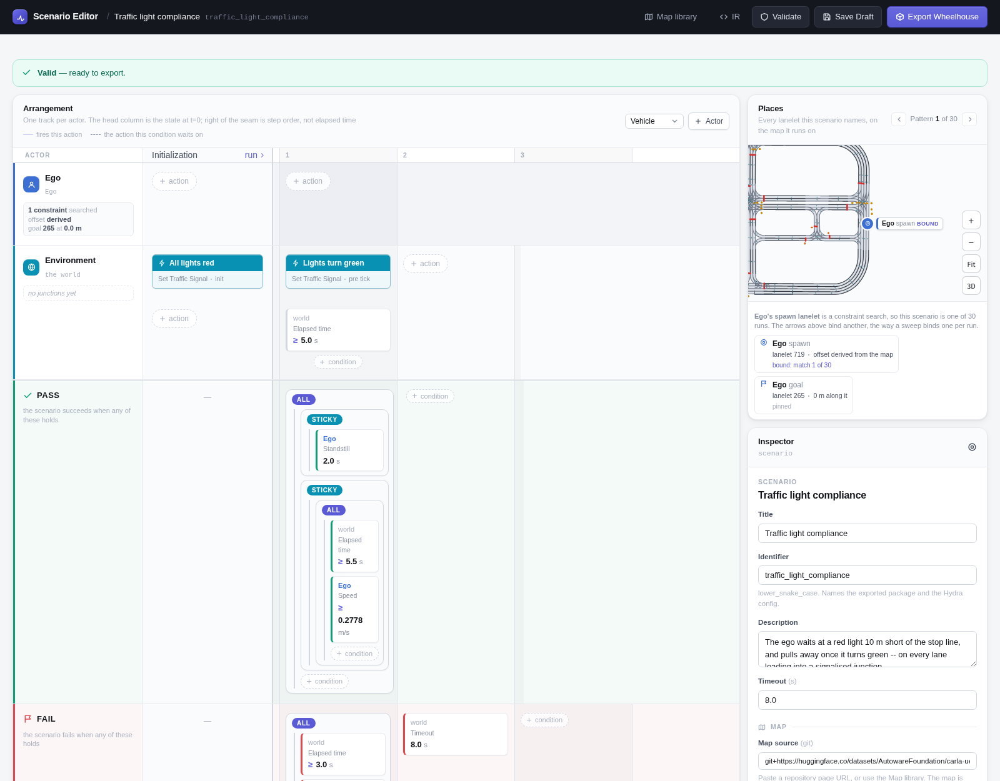

# Traffic Light Compliance

The ego starts at a standstill 10 m short of a signalised stop line with every
light red. It has to drive up to the line and stop with its front bumper in the
stop zone, 0-3 m before it, without crossing it while the light is red; then
pull away once it turns green 5 s in -- on every lane that leads into a
signalised junction.

```bash
# Every case on the map, one run each
uv run scenario --multirun hydra/sweeper=lanelet_constraint \
    scenario=traffic_light_compliance/traffic_light_compliance map=<map>
```

## In the Scenario Editor



## Scenario

| | |
|---|---|
| **Ego** | Constraint search: a lanelet *before* a junction lanelet that has a traffic-light stop line, excluding the map's lanelets with no 3D model. Position *before stop line*: 10 m short of it. Goal: up the road, past the junction. |
| **Initialization** | Every traffic light red. |
| **After 5 s** | Every traffic light green. |
| **Pass** | Both have happened: before the green the ego stood still (0.1 m/s or slower) for 0.5 s with its front bumper 0-3 m before the stop line (the stop zone), *and* after 5.5 s it was moving at 10 km/h or more. |
| **Fail** | Its front bumper crosses the stop line while the light is red ("ran the red"); or at the green it has not stood still in the stop zone -- standing farther back ("stopped N m before the stop line, outside the stop zone"), stopped in the zone too late ("stopped in the stop zone … only X s before the green: less than standstill_seconds") or still rolling towards the line ("had not stopped by the green: still moving"); or 8 s pass. |

Distances are the `stop_line_distance_m` measure's: along the ego's lane, from
its front bumper to the stop line ahead. That measure reads only stop lines
ahead, so the scenario keeps the line the ego started before and carries it on
the ego's own travel once the reading jumps away -- to the next line, or to
nothing -- and a crossing is a negative distance however the measure then
reads. The run's result details carry where the ego stopped
(`stopped_at_stop_line_distance_m`) or when and how far it crossed
(`crossed_at_seconds`, `crossed_by_m`).

Where the measure's reading jumps *beyond* the line the ego had while that
line is still at least 0.5 m ahead -- the other branch's line where the lane
forks, the line of the lane it changed out of -- the reading is the ego's own
line and is taken; so is a reading that jumps nearer (a lane whose line is
staggered nearer). A front bumper up to `stop_line_tolerance_m` past the line
has not crossed it, and counts as at the line (0 m) for the stop zone.

Approaching the line while the light is red is not a failure: an ego that
starts 30 m back may roll up to the zone and stop there. One that starts inside
the zone has to stay there. Having stood still in the zone is latched: if the
ego then rolls back, or creeps on without crossing the line, before the green,
it still passes.

The light turns green before the world steps from 5 s, so the step that ends at
5 s still ran under red (a crossing on it runs the red), and the verdict at the
green is given on the first step driven under green, from where the ego was on
the last red one: a standstill that only completes on the green step does not
count.

## Parameters

| Parameter | Value |
|---|---|
| Light turns green after | 5.0 s |
| Stop zone | 0-3 m before the stop line (`stop_zone_min_m`, `stop_zone_max_m`) |
| May pass the stop line on red by | 0 m (`stop_line_tolerance_m`) |
| Must have stood still in the stop zone for | 0.5 s (`standstill_seconds`) |
| Counts as standing still at | 0.1 m/s or less (`standstill_speed_mps`) |
| Counts as pulling away on green from | 10 km/h |
| Ego initial speed | 0 km/h |
| Spawn | 10 m before the stop line |
| Timeout | 8 s |

!!! note
    On Nishi-Shinjuku the search also leaves out lanelet 222, where CARLA's
    TrafficManager moves the ego onto another lane in the junction.

## Result

<video controls muted playsinline width="100%" src="../media/traffic_light_compliance.mp4"></video>

*Town10HD_Opt, the first case: the search matched lanelet 719, where the ego starts. Result: PASSED. Recorded with `scenario.moving_speed_kmh=15`, from before the green check had a threshold of its own (`departure_speed_kmh`); that run was judged by an earlier rule, under which moving on red at 1 km/h or more (15 km/h with that override) failed the run.*
