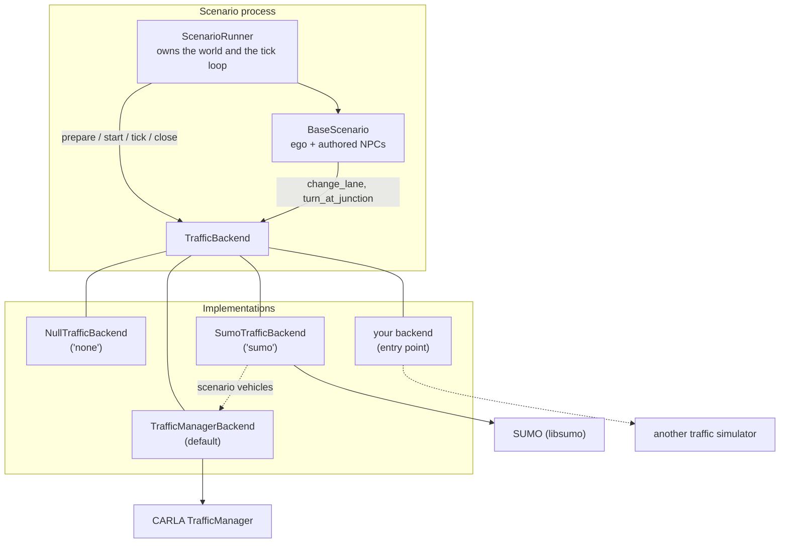

# Traffic Backends

The vehicles in a scenario come from three places, and only two of them are the
scenario's own:

- the **ego**, driven by its entity — see [External Driver Interface](driver_interface.md);
- the **authored NPCs** a scenario spawns in `setup()`;
- the **ambient traffic** that fills the rest of the road network.

A **traffic backend** owns the third kind outright and answers the manoeuvre
intents asked of the second. CARLA's TrafficManager is one such backend and is
the default. This page describes the seam, how to select a backend, and how to
write one — a microscopic traffic simulator such as SUMO, a replay of recorded
traffic, or anything else that can put vehicles on a road.

## Architecture



Two rules hold for every backend:

**One authority per vehicle.** A vehicle a backend owns is not driven by anything
else. `ScenarioRunner` passes the actors that are under external control — an
Autoware ego, a policy-driven ego — to `start()` as `skip_actor_ids`, so the rule
is data the backend is given rather than a special case it has to know about.

**An intent is not a mechanism.** `change_lane` is what the *scenario* means;
`tm.force_lane_change` and `traci.vehicle.changeLane` are what two backends do
about it. Entities ask for the first and never name the second, which is why
actions work unchanged whatever drives the vehicle.

## Selecting a backend

The `traffic` config group chooses one:

```bash
# CARLA's TrafficManager (the default — nothing to pass)
uv run scenario scenario=intersection_passing/left_turn

# No traffic model at all: only the ego and the scenario's own cars move
uv run scenario scenario=intersection_passing/left_turn traffic=none
```

| Backend | Behaviour |
| --- | --- |
| `traffic_manager` (default) | CARLA's TrafficManager drives every vehicle that is not under external control. |
| `none` | Nothing is driven and no ambient vehicle is created. |
| `sumo` | SUMO fills the road with its own traffic, co-simulated on the world's road network; see [The SUMO backend](#the-sumo-backend). Needs the `sumo` extra. |

!!! warning "`traffic=none` and the default ego"

    `ego.entity=autopilot` (the default) means *the traffic backend drives the
    ego*, so under `traffic=none` the ego does not move and the run ends on its
    timeout. Pair `traffic=none` with an ego that drives itself —
    `ego.entity=autoware` or `ego.entity=carla_driver` — or with a scenario that
    steers its vehicles itself. The backend logs how many vehicles it is leaving
    standing, so the log says why nothing moved.

A backend's own settings live under `traffic.options` and are passed to it
verbatim, so a backend from another package needs no change to this package's
config:

```yaml
traffic:
  backend: traffic_manager
  options:
    port: 8100
```

```bash
# 8101 rather than the default 8100: a second TrafficManager, so two runs
# can share one machine without steering each other's traffic.
uv run scenario traffic.options.port=8101
```

`traffic_manager.port` — where the port lived before this group existed, and what
exported scenario packages still set — keeps deciding the port when
`traffic.options.port` is left unset.

## Traffic parameters

How the traffic's road users *behave* is not a backend's own option but two
parameter spaces every backend reads: `traffic.vehicles` (`VehicleParameters`)
for how vehicles drive, and `traffic.pedestrians` (`PedestrianParameters`) for
how pedestrians walk. Every field is `null` by default, which leaves the
backend's own default:

```yaml
traffic:
  backend: sumo
  vehicles:
    speed_factor: 0.9        # 10 % under the speed limit
    min_gap_m: 3.0
    reaction_time_s: 1.5
    follow_visibility: true
  pedestrians:
    walking_speed_mps: 1.2
    red_light_violation_s: 5.0
```

```bash
uv run scenario traffic=sumo traffic.vehicles.reaction_time_s=1.5
uv run scenario traffic.vehicles.ignore_lights=0.1
uv run scenario traffic=sumo traffic.pedestrians.walking_speed_mps=1.0
```

`traffic.vehicles`:

| Field | Meaning | `traffic_manager` | `sumo` |
| --- | --- | --- | --- |
| `speed_factor` | Desired speed as a multiple of the limit | global speed difference | each vehicle's speed factor, scaled |
| `min_gap_m` | Gap to the vehicle ahead when standing, m | distance to leading vehicle | `minGap` |
| `lane_changes` | Change lanes of their own accord | `auto_lane_change` | lane-change mode (route changes kept) |
| `ignore_lights` | Probability (0-1) of running a red light | ✓ | — |
| `ignore_signs` | Probability (0-1) of ignoring a stop sign | ✓ | — |
| `ignore_vehicles` | Probability (0-1) of ignoring vehicles | ✓ | — |
| `ignore_walkers` | Probability (0-1) of ignoring pedestrians | ✓ | — |
| `random_lane_changes` | Probability (0-1) of a lane change for no reason | ✓ | — |
| `accel` | Acceleration, m/s² | — | `accel` |
| `decel` | Braking, m/s² (also the visibility's) | — | `decel` |
| `reaction_time_s` | Reaction time, s (also the visibility's) | — | `tau` |
| `imperfection` | Driver imperfection, 0-1 | — | `sigma` |
| `follow_visibility` | Slow to what the drivers see in the weather | — | ✓ (on by default) |

`traffic.pedestrians` (the TrafficManager drives no pedestrians — a scenario's
own walk as the scenario steers them — so every field is `sumo`'s):

| Field | Meaning | `traffic_manager` | `sumo` |
| --- | --- | --- | --- |
| `walking_speed_mps` | Walking speed, m/s | — | `maxSpeed` |
| `speed_deviation` | Spread of walking speeds between people | — | `speedDev` |
| `min_gap_m` | Gap to the person ahead, m | — | `minGap` |
| `red_light_violation_s` | Cross on red if it has been red for less than this, s | — | `jmDriveAfterRedTime` |

### Parameter reference

Each parameter, with its type, the values it accepts, and what it becomes in
each backend. Unset (`null`) means the backend's own default, which is given
where it is fixed. A value outside the range is refused when the config is
read, before the backend is built.

#### `traffic.vehicles`

**Shared by `traffic_manager` and `sumo`**

- `speed_factor` — float, `> 0`
    - The speed drivers aim for, as a multiple of the speed limit: `1.0` drives at
      the limit, `0.8` 20 % under it, `1.1` 10 % over it.
    - `traffic_manager`: `global_percentage_speed_difference((1 - speed_factor) * 100)`,
      set once when the run is prepared. Unset, the TrafficManager's own default
      (30 % under the limit). A speed set on one vehicle wins over it: a
      background vehicle's spawn speed, or a `SetSpeedAction`.
    - `sumo`: each vehicle's own speed factor, which SUMO draws around 1.0 (spread
      0.1), multiplied by it as the vehicle departs, so the drivers' spread is kept
      and its mean becomes `speed_factor`. Unset, SUMO's draw.

- `min_gap_m` — float, metres, `>= 0`
    - The gap a driver leaves to the vehicle ahead when standing in a queue.
    - `traffic_manager`: `set_global_distance_to_leading_vehicle(min_gap_m)`.
    - `sumo`: `minGap` of each vehicle (SUMO's default 2.5 m).

- `lane_changes` — bool
    - Whether drivers change lanes of their own accord: to overtake, to keep right,
      to make room.
    - `traffic_manager`: `auto_lane_change(vehicle, lane_changes)` on each vehicle
      as it goes on autopilot (default `true`).
    - `sumo`: `false` sets each vehicle's lane-change mode to 1537 — the
      changes its route needs only, still respecting other drivers' gaps — instead
      of SUMO's 1621; `true` leaves SUMO's default. A lane change a scenario asks
      for (`LaneChangeAction`) still happens.

**`traffic_manager` only**

Each is a probability, float in `[0, 1]`, set per vehicle as it goes on
autopilot as the TrafficManager's percentage (`× 100`). Unset, `0`: drivers
obey everything and never change lanes at random.

- `ignore_lights`
    - Chance of driving through a red light (`ignore_lights_percentage`).

- `ignore_signs`
    - Chance of ignoring a stop sign (`ignore_signs_percentage`).

- `ignore_vehicles`
    - Chance of ignoring the vehicles in the way, i.e. of colliding with them
      (`ignore_vehicles_percentage`).

- `ignore_walkers`
    - Chance of ignoring pedestrians (`ignore_walkers_percentage`).

- `random_lane_changes`
    - Chance of a lane change for no reason, to either side
      (`random_left_lanechange_percentage` and `random_right_lanechange_percentage`,
      both set to it).

**`sumo` only**

Set on each vehicle SUMO drives as it departs (`traci.vehicle.set*`), the
scenario's vehicles SUMO drives (`scenario_vehicles=sumo`) included; a vehicle
CARLA's side drives (the ego, and the scenario's vehicles under
`scenario_vehicles=traffic_manager`) is only placed in SUMO and keeps SUMO's
defaults.

- `accel` — float, m/s², `> 0`
    - The acceleration drivers use (`setAccel`; SUMO's default 2.6).

- `decel` — float, m/s², `> 0`
    - The braking drivers use (`setDecel`; SUMO's default 4.5). Also the braking
      `follow_visibility` works the sight speed out from.

- `reaction_time_s` — float, seconds, `>= 0`
    - Drivers' reaction time, SUMO's `tau` (`setTau`; default 1.0), which also
      sets the time headway they keep. Also the reaction time `follow_visibility`
      works the sight speed out from.

- `imperfection` — float in `[0, 1]`
    - Driver imperfection, SUMO's `sigma` (`setImperfection`; default 0.5): how
      much a driver dawdles below the speed it could drive. `0` is a perfect
      driver.

- `follow_visibility` — bool
    - Hold SUMO's own traffic (ambient and background vehicles) to the speed it
      stops from within what its drivers see in the run's weather, `v * tau + v² /
      (2 * decel)` = the visibility, and give each its own speed back when the
      weather lifts. Unset, `true`; `false` ignores the visibility, as the
      TrafficManager does. See **Visibility** under
      [The SUMO backend](#the-sumo-backend).

#### `traffic.pedestrians` (`sumo` only)

SUMO's default pedestrian type is defined with them, in
`<output>/sumo/pedestrian_type.add.xml` loaded before the demand, so they
apply to SUMO's own pedestrians (`traffic.options.pedestrians`) and to a
`route_path` demand's that names no type of its own. On the type, not on each
person: SUMO reads `jmDriveAfterRedTime` off the type only, and TraCI cannot
set it on a person. `traffic.options.pedestrians` says how many SUMO
generates; `traffic.pedestrians` how they walk.

- `walking_speed_mps` — float, m/s, `> 0`
    - The speed people walk at before each one's own factor (SUMO's
      `maxSpeed`; default 1.39).
- `speed_deviation` — float, `>= 0`
    - The spread of each person's speed factor (SUMO's `speedDev`; default
      0.1). `0` has everyone walk at exactly `walking_speed_mps`.
- `min_gap_m` — float, metres, `>= 0`
    - The gap kept to the person ahead (SUMO's `minGap`; default 0.25).
- `red_light_violation_s` — float, seconds, `>= 0`
    - A pedestrian walks onto a crossing whose light has been red for less
      than this (SUMO's junction model `jmDriveAfterRedTime`) when the way is
      free; a large value has people cross on red whenever they can. Unset,
      they wait for green. Measured on a signalled crossroads held red for
      120 s: unset, 1,347 person-steps on a crossing (crossings whose own
      signal SUMO keeps green); `1000`, 29,386.

The TrafficManager drives no pedestrians, so it refuses every field here.

The same in Python, where every field is a keyword of `VehicleParameters` or
`PedestrianParameters`:

```python
from autoware_carla_scenario import PedestrianParameters, VehicleParameters

VehicleParameters(speed_factor=0.9, min_gap_m=3.0, reaction_time_s=1.5)
PedestrianParameters(walking_speed_mps=1.2, red_light_violation_s=5.0)
```

A field set for a backend that cannot honour it fails the run before anything is
spawned, naming the backends it can be used with — a run that asked for drivers
who react in 1.5 s and silently got the TrafficManager's, which has no reaction
time, would test something other than what it says:

```text
TrafficParameterError: The 'traffic_manager' traffic backend does not support
traffic.vehicles.reaction_time_s can only be used with the 'sumo' backend.
Leave the field unset (null) or select a backend that supports it.
```

The TrafficManager sets the speed and the gap globally when the run is
prepared (a speed set on one vehicle, a background vehicle's or a
`SetSpeedAction`'s, wins over it) and the rest on each vehicle as it goes on
autopilot, the scenario's own included. SUMO sets them on each vehicle it
drives as it departs, and hands the shared ones to the TrafficManager driving
the scenario's vehicles under `scenario_vehicles=traffic_manager`. The
visibility is one of them: see **Visibility** under
[The SUMO backend](#the-sumo-backend).

A backend from another package supports none of them until it says so:

```python
class MySimulatorBackend(TrafficBackend):
    def supported_vehicle_parameters(self) -> set[str]:
        return {"speed_factor", "min_gap_m"}

    def supported_pedestrian_parameters(self) -> set[str]:
        return {"walking_speed_mps"}
```

and reads them from `self.vehicle_parameters` and `self.pedestrian_parameters`
in `prepare()`.

## The lifecycle

`ScenarioRunner` calls these at fixed points of a run, beside the ego entity's
own hooks:

| Method | When |
| --- | --- |
| `prepare(context)` | Before `setup()`, nothing spawned yet. Put a simulator in step, seed it, or refuse the run. |
| `adopt(entity)` | As the ego and each authored NPC join the run. The vehicle stays the scenario's. |
| `start(world, skip_actor_ids=…)` | After warm-up and the init phase, immediately before the scenario clock starts. |
| `tick(world, elapsed)` | Once per `world.tick()`. A backend driving a second simulator steps it exactly once here. |
| `release(entity, world)` | When an action takes a vehicle over (a `FollowTrajectoryAction`). Stop driving it; may come before or after `start`. |
| `resume(entity, world)` | When an action that took a vehicle over hands it back (an adversarial manoeuvre is over). Drive it again from where it is; undoes `release`, may come before or after `start`. |
| `close()` | During teardown, while the world is still alive. Called even when the run failed. |

One backend serves a whole queue: `ScenarioQueue` builds one runner, so over a
batch the real sequence is `prepare … close, prepare … close`, with a different
scenario — and possibly a different map — each time. `close()` is the end of a
*run*, not the end of the object: forget every vehicle created and every entity
adopted, and be ready to `prepare()` again.

`TrafficContext`, handed to `prepare()`, carries the CARLA client and world, the
map name, the OpenDRIVE the run installed, the simulation step, the scenario's
random seed and the run's output directory — everything a second simulator needs
to line itself up with the CARLA one.

Two promises matter:

- `prepare()` is the place to **fail loudly**. Raise `TrafficBackendUnavailable`
  when the simulator behind the backend is not installed, naming the extra that
  installs it; nothing has been spawned yet, so the run costs nothing.
- `tick()` and the manoeuvres must **never raise**. A traffic model that cannot
  do something logs a warning; an exception there would end a scenario that is
  otherwise perfectly valid. The base class's defaults already behave this way.

## Writing a backend

Subclass `TrafficBackend`, override what you actually do, and register a factory
under a name:

```python
from typing import Any, Collection, Mapping

from autoware_carla_scenario import TrafficBackend, TrafficContext, register_backend


class MySimulatorBackend(TrafficBackend):
    name = "my_simulator"

    def __init__(self, options: Mapping[str, Any]) -> None:
        self._address = options.get("address", "localhost:9999")

    def prepare(self, context: TrafficContext) -> None:
        # Match the simulation step so the two clocks cannot drift, and derive
        # the road network from the OpenDRIVE the CARLA world is running.
        # The map of the run: `xodr_path` is the OpenDRIVE CARLA is running, and Phase B
        # adds `lanelet2_path` for a backend whose own network is built from Lanelet2.
        self._connect(context.fixed_delta_seconds, context.xodr_path, context.random_seed)

    def start(self, world: Any, *, skip_actor_ids: Collection[int] = ()) -> None:
        self._externally_driven = set(skip_actor_ids)

    def tick(self, world: Any, elapsed: float) -> None:
        self._publish_carla_vehicles(world)   # so my traffic reacts to the ego
        self._step_once()                      # exactly one step per world tick
        self._mirror_into_carla(world)

    def close(self) -> None:
        self._disconnect()


def register() -> None:
    register_backend("my_simulator", MySimulatorBackend)
```

From your own package, advertise it so `traffic.backend=my_simulator` resolves
without an import anywhere in this repository:

```toml
[project.entry-points."autoware_carla_scenario.traffic_backends"]
my_simulator = "my_package:register"
```

### Answering manoeuvre intents

A backend that can steer the vehicles it drives overrides the three intent
methods. They receive the entity, so a backend can read the actor and record its
own bookkeeping on the vehicle rather than in a table of its own:

```python
    def change_lane(self, entity, world, direction) -> None: ...
    def lane_change_finished(self, entity, world) -> bool: ...
    def turn_at_junction(self, entity, world, direction, **kwargs) -> None: ...
```

`direction` is `LaneChangeDirection` or `TurnDirection` — intents, not CARLA
values. A backend that has no answer for one simply does not override it: the
base class logs that the intent is unavailable and the vehicle keeps doing what
it was doing, which is also what `LaneChangeAction` sees when it asks whether the
manoeuvre finished.

### Handing a vehicle back

`release(entity, world)` is the one-authority-per-vehicle rule of
`skip_actor_ids`, applied during the run: an action that drives a vehicle
itself -- `FollowTrajectoryAction` places it on a trajectory every tick -- asks
the backend to stop driving it first. The TrafficManager takes it off autopilot
(and never puts it on, if `start` has not run yet); SUMO keeps it in its own
simulation but publishes it from CARLA, as it does the ego. The base class does
nothing, which is right for a backend that never drives the scenario's vehicles.

`resume(entity, world)` undoes it, for an action that hands the vehicle back
when it is done (`entity.resume_traffic(world)`; `FollowTrajectoryAction`
leaves its vehicle where the trajectory ends and does not): the TrafficManager
puts it back on autopilot, keeping the desired speed and lane-change settings
it had; SUMO drives it again from the pose it was published at, with the speed
and lane-change modes and the desired speed it had before. A vehicle never
released, or driven elsewhere from the start (an ego: `ExternallyDrivenEgo`
refuses `resume_traffic`, and both backends ignore it), is left as it is, and
saying it twice is harmless.

### Simulating far traffic mesoscopically

A backend may simulate the vehicles far from anything that matters at a
coarser level than the ones near it: nobody sees the difference there, and the
run is cheaper for it. The seam names two levels, `SimulationFidelity`:

| Level | What is simulated | In CARLA |
| --- | --- | --- |
| `MICROSCOPIC` | each vehicle on its lane: car-following, lane changes | an actor |
| `MESOSCOPIC` | a place in a queue on a road: when it gets to the end, not where it is on the way | nothing |

Every vehicle entity carries its level as `entity.simulation_fidelity`
(`MICROSCOPIC` by default, and always under a backend with one level), so a
scenario or a condition can tell a vehicle that is far away and out of the
world from one that is gone. Three rules keep the flag honest:

- **Only the backend writes it**, through `TrafficBackend._mark_fidelity`, and
  only once a change is complete: an entity reading `MESOSCOPIC` has no actor
  (`entity.actor is None`), one reading `MICROSCOPIC` has one.
- **An entity leaves the world only if it agrees to.** The backend asks
  `entity._replace_actor(None)`, and later hands it the actor it spawned where
  its model has the vehicle with `entity._replace_actor(actor)`. A
  `VehicleEntity` agrees; an ego, and anything that owns its actor in a way a
  backend cannot see, does not, and stays microscopic.
- **Whatever needs the actor asks for it**: `entity.require_microscopic(world)`
  (`backend.require_microscopic(entity, world)`) brings the vehicle back at once
  and keeps it for the rest of the run. A backend's `release()` does it too,
  since whatever takes a vehicle over drives it in CARLA.

`backend.fidelity_census()` counts the vehicles a backend simulates at each
level. A run's result (`<output>/<scenario>_result.json`) records it under
`traffic.fidelity`, read when the run ends, beside the backend's `describe()`
(for SUMO, how many vehicles changed level during the run). A condition that
looks an entity up by role name while it is mesoscopic finds no actor, and the
log says why, once each time the entity becomes mesoscopic. The parts that are the same for every backend are reusable:

- `traffic.fidelity.MesoscopicConfig` is the policy: the radii around the
  *focus points* (the ego and every vehicle CARLA drives) inside which traffic
  is microscopic, with hysteresis between them, how often to decide, and
  whether the scenario's own vehicles may leave the world.
  `plan_fidelity(config, candidates, focus)` returns which vehicles change level,
  the ones that matter most first.
- `traffic.mesoscopic.MesoscopicTraffic` is a queue model -- SUMO's own
  mesoscopic model, cut down: a road lets a vehicle out once it has driven the
  road's length, first in first out, one per headway per lane, when the road
  ahead has room and the junction (an optional gate, a red light) lets it
  through. It knows no simulator: a backend builds it from its own roads
  (`MesoLink`), moves a vehicle in when it becomes mesoscopic and reads where
  it is to decide when to bring it back.

## Using a backend from Python

A scenario run built in code takes the backend the same way it takes the ego:

```python
from autoware_carla_scenario import NullTrafficBackend, ScenarioQueue

queue = ScenarioQueue(map_name="Town10HD_Opt", traffic_backend=NullTrafficBackend())
```

and its [parameters](#traffic-parameters) in the backend's constructor, or by
name through the registry:

```python
from autoware_carla_scenario import (
    PedestrianParameters,
    TrafficManagerBackend,
    VehicleParameters,
)
from autoware_carla_scenario.traffic import build_backend

backend = TrafficManagerBackend(vehicles=VehicleParameters(speed_factor=0.8))
backend = build_backend(
    "sumo",
    {},
    vehicles=VehicleParameters(reaction_time_s=1.5),
    pedestrians=PedestrianParameters(walking_speed_mps=1.2),
)
```

`ScenarioQueue` passes it to the `ScenarioRunner` it builds, and one backend
serves every scenario in the queue — the same way one CARLA server does.

## Background traffic

Vehicles no scenario entity stands for are created and removed by two actions
modelled on OpenSCENARIO's `TrafficSourceAction` and `TrafficSinkAction`. Where
OpenSCENARIO gives a source or sink a position and a radius, these take
**lanelet constraints** -- the vocabulary a sweep picks its cases with -- so the
same action means "every lane outside a junction" on any map:

```python
from autoware_carla_scenario import ElapsedTimeCondition, TrafficSinkAction, TrafficSourceAction

not_in_junction = [{"type": "not", "constraint": {"type": "is_junction"}}]

# Placed during initialization, then no more: register_init runs once.
self.register_init(TrafficSourceAction(not_in_junction, initial_vehicles=20))

# Six a minute during the first 30 s of the run, at most 30 on the road.
self.register_pre_tick(
    TrafficSourceAction(
        not_in_junction,
        vehicles_per_minute=6.0,
        max_vehicles=30,
        until=ElapsedTimeCondition(30.0, label="first_30s"),
    )
)

# Removed at the ends of the map's roads for the whole run.
self.register_pre_tick(
    TrafficSinkAction(
        [{"type": "not", "constraint": {"type": "previous_of",
          "constraints": [{"type": "lanelet_length", "value": 0.0}]}}]
    )
)
```

- **When they act** is the trigger (`condition`) and the end condition
  (`until`), as for every action. With no `until` a source or sink runs until
  the scenario ends, as OpenSCENARIO's do; with one, it stops on the first tick
  `until` fires. Registered with `register_init`, a source places its
  `initial_vehicles` once, during initialization, and never again.
- **Who drives them** is the backend: `spawn_background`, `background_vehicles`
  and `remove_background` on `TrafficBackend`. Under `traffic=sumo` they are
  SUMO vehicles that wander the network (a random way out at each junction) and
  are mirrored into CARLA like the rest of SUMO's traffic; ones placed during
  initialization have SUMO's warm-up to spread out. Under
  `traffic=traffic_manager` they are CARLA vehicles on autopilot. `none` creates
  none, with a warning.
- **`speed_kmh`** is the speed they drive at, at most. **`max_vehicles`** counts
  every background vehicle on the road, whichever source made it.

The examples take all of this from the config, for any scenario:

```bash
uv run scenario scenario=intersection_passing/left_turn map=town10hd_opt \
  traffic=sumo background_traffic.enabled=true
# Only what initialization places:
uv run scenario ... background_traffic.enabled=true background_traffic.source.vehicles_per_minute=0
# Keep adding for the first 20 s only:
uv run scenario ... background_traffic.enabled=true background_traffic.source.stop_after_seconds=20
```

`background_traffic` (in `examples/conf/config.yaml`) is off by default, and the
SUMO backend's own `ambient` randomTrips demand is off in
`conf/traffic/sumo.yaml`, so an example runs with no traffic but its own unless
asked.

## Why this exists

CARLA's TrafficManager is a good default for a handful of scripted NPCs and the
wrong tool for dense, demand-driven flow. Microscopic traffic simulators model
car-following, gap acceptance and route choice in ways it does not, and "does the
stack merge into a saturated flow at this intersection?" is a question about
traffic rather than about three scripted cars. The seam is what makes answering
it possible without a second scenario framework: the same map, the same scenario
document, the same conditions and the same result format, with the traffic model
swapped.

## The SUMO backend

`traffic=sumo` co-simulates [SUMO](https://eclipse.dev/sumo/) with the CARLA
world. It needs the `sumo` extra (`autoware-carla-scenario[sumo]`: SUMO,
libsumo and roadgen, all wheels); without it the run is refused in `prepare()`,
before anything is spawned.

```bash
uv run scenario scenario=lane_change/left map=town10hd_opt traffic=sumo
uv run scenario ... traffic=sumo traffic.options.ambient.vehicles_per_hour=1800
uv run scenario ... traffic=sumo traffic.options.scenario_vehicles=sumo
uv run scenario ... traffic=sumo traffic.options.fcd_output=true   # <output>/sumo/fcd.xml
```

**The network** is the world's own road network. The backend takes the
OpenDRIVE the world runs (the file the run installed, or
`world.get_map().to_opendrive()`), converts it with
[roadgen](https://github.com/hakuturu583/hdmap_generator) into netconvert's
plain-XML input and builds it with netconvert. The result is cached under
`~/.cache/autoware_carla_scenario/sumo/`, keyed by the OpenDRIVE and the tool
versions, so a map is converted once. roadgen writes the network without offset
normalisation, so SUMO's x/y are OpenDRIVE's and CARLA's are the same with y
mirrored. `traffic.options.net_path` runs on an existing `.net.xml` instead.

!!! note
    CARLA's maps bend the OpenDRIVE schema in a few places roadgen's strict
    parser refuses (`<userData>` without `code`, `<roadMark>` without `color`,
    objects of type `-1`, `<cornerLocal>` without `height`); the backend
    strips or fills those before converting. An OpenDRIVE whose junctions name
    connections to roads they do not list (the Nishishinjuku map's) is refused
    by roadgen's validation.

**Ownership** follows the seam's rule: the scenario owns what it authored.

| Vehicle | Driven by | In SUMO |
| --- | --- | --- |
| Ego (`autoware`, `carla_driver`) | its entity | published: moved to its CARLA pose every tick |
| Scenario NPCs, autopilot ego | the TrafficManager (`scenario_vehicles=traffic_manager`, default), or SUMO (`scenario_vehicles=sumo`) | published, or driven |
| Ambient traffic (`randomTrips.py`) | SUMO | native; mirrored into CARLA |
| Pedestrians (`walker.pedestrian.*`, e.g. `WalkStraightAction`) | CARLA | published as SUMO persons (`publish_walkers`, on by default) |
| SUMO's pedestrians (`randomTrips.py --pedestrians`, `pedestrians.enabled`) | SUMO | native; mirrored into CARLA as walkers near the ego |

A published vehicle has SUMO's speed and lane-change control switched off, so
SUMO traffic sees it where CARLA has it and reacts to it. With the default the
scenario's NPCs behave exactly as under the `traffic_manager` backend, while
SUMO fills the rest of the road.

A published pedestrian is a SUMO person moved to its CARLA pose every tick
with `moveToXY` and `keepRoute` 6: placed exactly there, on whichever lane is
there, footway or road. A SUMO vehicle brakes for a person on its lane, on a
crossing or anywhere else, or changes lanes round it. A person has to be added
on an edge with a footway -- SUMO aborts the whole simulation when one is moved
off an edge without -- so a pedestrian with no footway within 50 m (or on a
network with none) is left out, with a warning.

**SUMO's own pedestrians** (`pedestrians`, off by default) walk the network's
footways (`randomTrips.py --pedestrians`, unweighted, up to `max_distance_m`
each) and are mirrored into CARLA as walkers (`blueprint`, with the role name
`sumo:<id>`) while they are near the ego or a vehicle CARLA drives: within
`radius_m`, kept until 1.25 times as far, at most `max_persons` of them, the
nearest first. With `radius_m: null` the radii are `mesoscopic`'s when that is
enabled; otherwise every one is mirrored. The rest walk on in SUMO only, where
SUMO's traffic still sees them. A walker is put where its person was at the
start of the step and walked at its speed (`WalkerControl`), so CARLA animates
it; it is never published back into SUMO as one of CARLA's pedestrians. How
they walk is `traffic.pedestrians` ([Traffic parameters](#traffic-parameters)).

**Pedestrian crossings** (`pedestrian_crossings`, on by default): the network
is built with a crossing across each road at a junction where footways meet it,
and walking areas joining footways and crossings (netconvert's
`--crossings.guess`), so pedestrians cross roads on crossings — where SUMO's
vehicles yield to them — instead of jumping between footways. At a signalised
junction netconvert appends the crossings' links after the vehicle links, so the
vehicle links keep the indices CARLA's lights are matched to. With
`traffic_light_authority=carla` a crossing is green while every vehicle link
into or out of a road it crosses is red, and red otherwise; with `sumo`, SUMO's
own program (which netconvert gives a pedestrian phase) drives it. A network
given as `net_path` is used as it is.

```bash
uv run scenario ... traffic=sumo traffic.options.pedestrians.enabled=true \
    traffic.options.pedestrians.radius_m=80
```

**Stepping**: one SUMO step per CARLA tick, with the step length set to the
world's `fixed_delta_seconds` and the seed to the scenario's. CARLA poses are
published before SUMO steps; SUMO's result is applied to the actors after it.
How a CARLA vehicle follows its SUMO vehicle is `vehicle_control`:

- `physics` (default) drives it with CARLA's vehicle physics, as TeraSim's
  `ackermann_physics` mode does. SUMO plans; each tick the car is steered towards
  a point 4-10 m ahead on SUMO's lanes (pure pursuit, offset by SUMO's lateral
  position mid lane change), and a PI throttle/brake controller with SUMO's
  acceleration as feedforward drives it at SUMO's speed, corrected by how far it
  is behind or ahead. Two CARLA 0.10 quirks are handled: its Ackermann
  controller's speed loop oscillates (so speed is controlled here and sent as
  throttle and brake), and its steering input maps onto the wheels roughly as
  51° × steer² rather than linearly (so the steer command inverts that and
  closes a loop on the car's measured curvature). A car further than
  `resync_distance_m` from its SUMO vehicle is put back on it. By default SUMO
  does not see where physics actually put the car, so gaps SUMO keeps are kept
  to within the tracking error -- on Town10 p95 1.1 m. `feedback_distance_m`
  (off by default) moves a SUMO vehicle to its car when the two are further
  apart than that, with SUMO's own `moveTo`, which takes effect at once and
  leaves SUMO planning the next step (TeraSim patches SUMO for an XY variant
  of it); inside junctions nothing is corrected. On Town10 it did not reduce
  contacts: a SUMO vehicle moved back to a lagging car is re-planned from a
  state its own model would not have reached.
  SUMO's car-following models read no curvature, so a vehicle takes a bend at
  the speed limit -- on Town10 up to ~10 m/s² sideways, more than a car under
  physics can follow. `curve_lateral_acceleration` (3.0 m/s² by default) has
  roadgen cut each edge at its bends and give every piece, and every path
  across a junction, the speed `sqrt(a / curvature)` its sharpest point allows;
  SUMO's vehicles then brake for a bend before they reach it. The pieces keep
  the edge's id on the first and `<edge>.p1`, `<edge>.p2`, … after it, and
  roadgen's trace has every one.
- `teleport` places it where its SUMO vehicle was at the start of the step and
  gives it SUMO's speed as a constant velocity (`enable_constant_velocity`),
  which carries it to where SUMO is at the end of it: exact, but the car is not
  driven by its physics. The poses of a tick go to CARLA in one batch, and a
  speed only when it is not the one the car already has (a standing car, in a
  queue at a light say, is given its zero once).

**Visibility** (`traffic.vehicles.follow_visibility`, on by default): SUMO's traffic sees only
as far as the run's weather lets a driver see. The TrafficManager has no
notion of sight -- its vehicles know where every actor is whatever the fog --
so night, rain and fog change nothing about how it drives: the
`traffic_manager` backend logs each visibility a run sets, with the speed
SUMO's default car would be held to, and does nothing else. An
`EnvironmentAction` that sets the fog, the rain or the sun records how far
drivers see in the weather it leaves
([Visibility follows the weather](odd.md#visibility-follows-the-weather)),
and the backend holds each of SUMO's own vehicles (ambient and background)
to the speed it stops from within that distance: `v * tau + v² / (2 *
decel)`, with the vehicle's own `tau` as its reaction time and its `decel` as
its braking (`traffic.vehicles.reaction_time_s` and `decel` when set) -- a default car in 50 m of fog drives at most about 62 km/h, at
night under a dipped beam (50 m) the same. A vehicle that departs later is
held as it departs, and when the weather lifts each gets its own maximum speed
back. The scenario's own vehicles, driven by SUMO or not, are left to the
scenario. `traffic.vehicles.follow_visibility=false` ignores the visibility,
as the TrafficManager does; set for the `traffic_manager` backend, the field is
refused. It used to be `traffic.options.follow_visibility`, which is now an
error pointing here.

**Traffic lights** (`traffic_light_authority`): `carla` (default) gives SUMO's
signals the states of CARLA's lights every step, so a scenario that sets the
lights sets them for SUMO's traffic too; `sumo` drives CARLA's lights from
SUMO's programs; `none` leaves each alone. CARLA's lights are applied while
SUMO warms up too, so the queues it starts with are the ones they would build.

Which SUMO signal links a CARLA light switches is read off roadgen's traces,
written beside the network when it is built: the light is the OpenDRIVE signal
of its `get_opendrive_id()`, roadgen records which map element that signal
became when it reads the OpenDRIVE (`map.xodr.trace.json`), and which SUMO links
of the junction's program that element became when it writes the network
(`network.sumo.trace.json`). A light whose signal reached no link is named in a
warning, and SUMO keeps its own program there. A network given as `net_path`
has no traces, and its links are matched geometrically instead: a light's stop
waypoints to the SUMO lane there.

On Town10HD_Opt all 15 lights match, 56 links between them; SUMO's only other
signal links are on emergency-only shoulder lanes.

**Far traffic** (`mesoscopic`, off by default) leaves SUMO for the queue model
above, and CARLA with it, once it is further than `meso_radius_m` from every
vehicle CARLA drives (the ego, and the scenario's vehicles under
`scenario_vehicles=traffic_manager` or an action), and comes back -- into SUMO
on the best lane for its route, and into CARLA -- when it is within
`micro_radius_m` of one again. SUMO then steps only the traffic near what CARLA
drives, and CARLA holds an actor only for that, so a large demand costs what
the traffic around the ego costs.

```bash
uv run scenario ... traffic=sumo traffic.options.mesoscopic.enabled=true \
    traffic.options.mesoscopic.micro_radius_m=150
```

| Option | Default | |
| --- | --- | --- |
| `micro_radius_m` | `200` | a mesoscopic vehicle this close to a focus point comes back |
| `meso_radius_m` | `1.25 × micro_radius_m` | a microscopic one further than this from all of them leaves |
| `update_interval_s` | `1.0` | simulated seconds between two decisions; the queue model steps every tick |
| `scenario_vehicles` | `false` | let the scenario's vehicles SUMO drives (`scenario_vehicles=sumo`) leave CARLA too |
| `headway_s`, `jam_spacing_m` | `1.5`, `7.5` | the queue model's capacity per lane, and the road a queued vehicle takes up |
| `junction_control` | `true` | hold a mesoscopic vehicle at a red SUMO signal |

A vehicle leaves only from a normal edge, never from inside a junction, and
comes back with its route, its type, length, width and top speed, and a speed
it was told to keep. A scenario's vehicle that is mesoscopic takes
`set_desired_speed` and `turn_at_junction` in the queue model; it cannot change
lanes there, and says so. `scenario_vehicles` is off by default because such a
vehicle has no actor while it is far: a scenario that reads it -- a condition
on its speed -- should check `entity.simulation_fidelity`, or call
`entity.require_microscopic(world)` first. SUMO's FCD output records the
microscopic vehicles only.

**Manoeuvres** of SUMO-driven vehicles become TraCI calls: `change_lane` →
`changeLane` (SUMO obeys a solid line, and says so), `set_desired_speed` →
`setSpeed`, `turn_at_junction` → a route onto the junction's outgoing edge in
that direction. With the default, they go to the TrafficManager.

The coupling follows [TeraSim](https://github.com/autowarefoundation/TeraSim)'s
CARLA co-simulation; its adversarial behaviour generation is left to scenarios.
