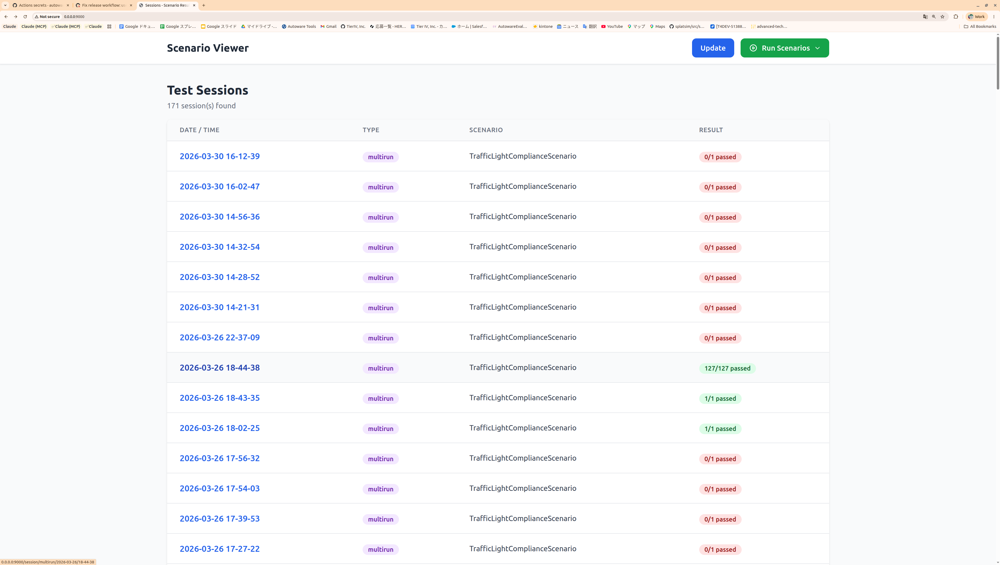
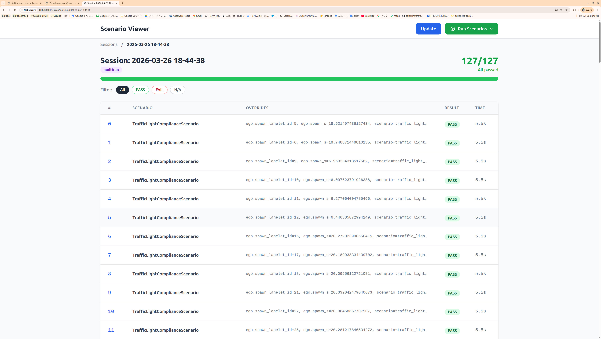
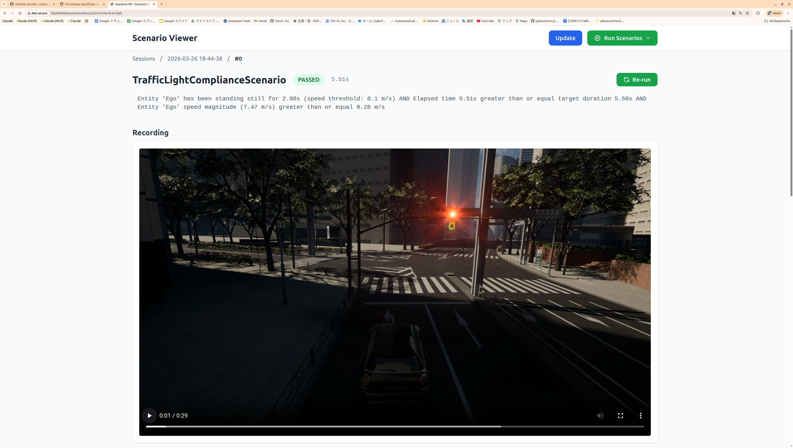
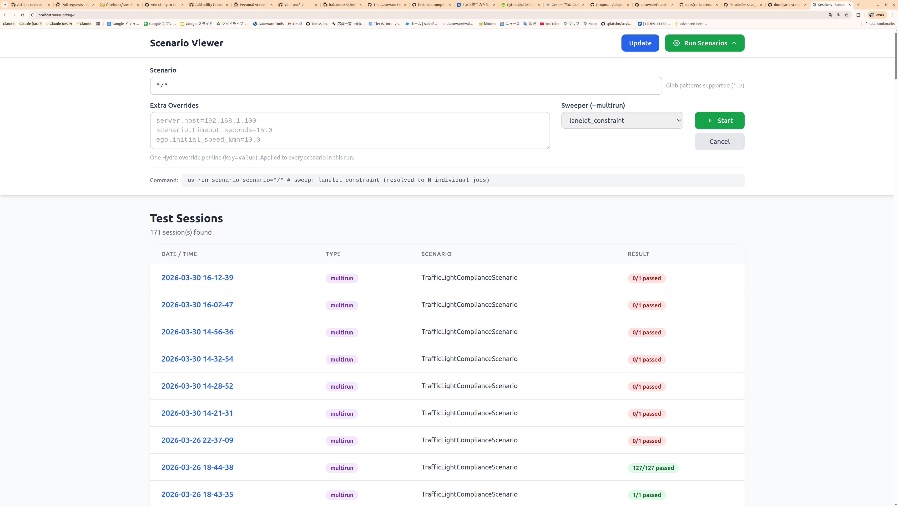

# Tutorial: Writing Your First Scenario

This tutorial shows two paths to creating a scenario:

1. **Quick Start (recommended)** — Use the bundled Claude Code plugin.
   Describe what you want in plain text and let Claude generate all files.
2. **Manual walkthrough** — Understand every file by building one yourself.

---

## Quick Start with Claude Code Plugin

This repository ships a **`write-scenario` plugin** inside
`.claude/local-marketplace/`. It is pre-enabled in `.claude/settings.json`
— **no extra setup is needed**. Just open Claude Code in the repository root
and the plugin is ready to use.

### How It Works

Type `/write-scenario` followed by a natural-language description of the
test you want. Claude walks you through a 7-stage workflow automatically:

| Stage | What Claude does |
|---|---|
| 1. Understand | Parses your description, asks clarifying questions |
| 2. Discover | Scans the codebase for available Conditions, Actions, Constraints, and Bindings |
| 3. Write | Generates all four files: Python class, config dataclass, YAML, and `run.py` registration |
| 4. Debug | Runs the scenario in CARLA, reads logs, fixes failures iteratively |
| 5. Review | Analyzes parameter orthogonality and sweeper compatibility |
| 6. Sweep | Adds `sweep.constraints` / `bindings` to the YAML for parametric testing |
| 7. Multirun | Provides the exact command to execute the logical scenario across the map |

### Example

```
> /write-scenario I want to test that the ego stops at a stop sign,
  waits 3 seconds, then proceeds through the intersection.
```

Claude will:

1. Identify `StandstillCondition` and `TimeoutCondition` from the codebase
2. Generate `my_scenario.py`, update `configs.py`, create YAML, register in `run.py`
3. Run the scenario, analyze the result, and iterate until it passes
4. Propose sweep constraints so the test generalizes to every stop sign on the map

You do not need to memorize the framework API — the plugin discovers
everything dynamically.

### Other Plugin Commands

| Command | When to use |
|---|---|
| `/write-scenario` | Create a new scenario from scratch |
| `/debug-concrete-scenario` | An existing scenario fails — analyze logs and fix |
| `/review-scenario` | Before adding sweep — check parameter design |

---

The rest of this page explains the manual process. Read on if you want to
understand what the plugin generates under the hood.

---

## Key Concepts

| Term | What it is | File type |
|---|---|---|
| **Abstract scenario** | Reusable Python class that defines *what to test* (conditions, actions, entities). | `*.py` |
| **Config dataclass** | Typed parameters the scenario accepts (timeout, speed, lanelet IDs, ...). | `*.py` |
| **Concrete scenario** | YAML file that binds an abstract scenario to *specific* parameter values. | `*.yaml` |

One abstract scenario can have many concrete variants (straight, left turn, right turn, etc.).

---

## Step 1 — Create the Config Dataclass

Add your config to `src/autoware_carla_scenario/examples/configs.py`:

```python
@dataclass
class MyScenarioConfig:
    """Parameters for my custom scenario."""

    name: str = "my_scenario"

    #: Lanelet IDs the ego should visit.
    expected_lanelet_ids: list[int] = field(default_factory=lambda: [460])

    #: Fail-safe timeout in seconds.
    timeout_seconds: float = 10.0
```

Every field becomes overridable from the YAML side via Hydra.

---

## Step 2 — Create the Abstract Scenario

Create `src/autoware_carla_scenario/examples/my_scenario.py`:

```python
from __future__ import annotations

from autoware_carla_scenario import (
    EGO_ROLE_NAME,
    AndCondition,
    BaseScenario,
    EgoConfig,
    EntityLanePositionCondition,
    GroundProjectionConfig,
    Lanelet2Pose,
    StickyCondition,
    TimeoutCondition,
)

from .configs import MyScenarioConfig


class MyScenario(BaseScenario):
    """Verify the ego visits every expected road."""

    def __init__(
        self,
        ego_config: EgoConfig,
        spawn_pose: Lanelet2Pose,
        config: MyScenarioConfig | None = None,
        ground_projection: GroundProjectionConfig | None = None,
    ) -> None:
        super().__init__(
            ego_config, spawn_pose=spawn_pose,
            ground_projection=ground_projection,
        )
        self._config = config or MyScenarioConfig()

    def setup(self) -> None:
        # 1. Snap ego spawn to CARLA road surface
        self._setup_ego_spawn()

        cfg = self._config

        # 2. Build pass condition — "ego visited all expected roads"
        stickies = []
        for ll_id in cfg.expected_lanelet_ids:
            stickies.append(
                StickyCondition(
                    EntityLanePositionCondition(
                        EGO_ROLE_NAME,
                        Lanelet2Pose(lanelet_id=ll_id, s=0.0),
                        label=f"ego_on_lanelet_{ll_id}",
                    )
                )
            )
        self.register_pass_condition(AndCondition(stickies))

        # 3. Fail-safe timeout
        self.register_fail_condition(
            TimeoutCondition(cfg.timeout_seconds, label="timeout")
        )

    def is_done(self) -> bool:
        return False
```

### Anatomy of `setup()`

Every scenario follows the same structure:

1. **Spawn** — call `self._setup_ego_spawn()` (snaps the Lanelet2 pose to the
   CARLA road surface).
2. **Pass conditions** — register one or more conditions via
   `self.register_pass_condition()`. The scenario passes as soon as **any**
   pass condition fires (returns a result), not when all of them have. To
   require several things, combine them in one `AndCondition`, wrapping each
   state that only has to be visited once in a `StickyCondition`, as the
   example above does.
3. **Fail conditions** — register via `self.register_fail_condition()`.
   If any fail condition fires, the scenario fails. On each tick the pass
   conditions are checked before the fail conditions, so a pass and a fail on
   the same tick ends the run as a pass.
4. **Actions** (optional) — e.g. `TurnAction`, `TrafficSignalAction`.

!!! tip "Discovering available Conditions and Actions"
    Run `grep -r "class.*Condition" src/autoware_carla_scenario/conditions/` and
    `grep -r "class.*Action" src/autoware_carla_scenario/actions/` to see
    everything the framework provides.

---

## Step 3 — Register the Scenario

In `src/autoware_carla_scenario/examples/run.py`, add the import and
registration:

```python
from .my_scenario import MyScenario
from .configs import MyScenarioConfig

register_scenario("my_scenario", MyScenario, MyScenarioConfig)
```

The first argument (`"my_scenario"`) is the name referenced in YAML's
`scenario.name` field.

!!! tip "Prefer a separate package for reusable scenarios"
    `register_scenario` (and `register_conf_dir`) are part of the public API:
    `from autoware_carla_scenario import register_scenario`. If your scenario is
    not meant to ship inside the framework, put it in its own package instead of
    editing `run.py` — see
    [Packaging Scenarios in a Separate Package](#packaging-scenarios-in-a-separate-package).

---

## Step 4 — Write a Concrete Scenario (YAML)

Create `src/autoware_carla_scenario/examples/conf/scenario/my_scenario/default.yaml`:

```yaml
# @package _global_
scenario:
  name: my_scenario
  expected_lanelet_ids: [460, 265]
  timeout_seconds: 8.0

ego:
  initial_speed_kmh: 5.0
  spawn_lanelet_id: 242
  spawn_s: 25.0
```

!!! note "`# @package _global_`"
    This Hydra directive is **required** on the first line. It tells Hydra to
    merge the file into the root config, not into a nested key.

### Minimal checklist

- [x] `scenario.name` matches the registered name (`"my_scenario"`)
- [x] `ego.spawn_lanelet_id` is a valid lanelet ID in the target map
- [x] `ego.spawn_s` is within the lanelet length

---

## Step 5 — Run It

```bash
# Single run
uv run scenario scenario=my_scenario/default

# Batch — run all variants under my_scenario/
uv run scenario scenario='my_scenario/*'

# Override a parameter on the fly
uv run scenario scenario=my_scenario/default scenario.timeout_seconds=20.0
```

---

## Step 6 — Check Results in the Viewer

```bash
# Start the viewer (defaults to port 9000)
uv run viewer

# Or scan another project: the directory containing outputs/ and multirun/
uv run viewer --base-path /path/to/project
```

Open <http://localhost:9000> in your browser. The viewer has three levels of
navigation:

### 1. Session list

The top page lists every test session with its timestamp, run type
(`multirun` / single), scenario name, and overall result.



Each row is color-coded: green for all-passed, red if any scenario failed.
Click a session to drill down.

### 2. Session detail

Inside a session you see every concrete scenario that was executed.
For multirun (sweep) sessions, this can be hundreds of rows — each with its
parameter overrides, individual PASS/FAIL badge, and execution time.



The progress bar and counter at the top (e.g. **127/127 All passed**) give an
at-a-glance summary. Use the **PASS** / **FAIL** / **N/A** filter buttons to
narrow the list.

### 3. Concrete scenario detail

Click any row to open the detail view for a single concrete scenario. Here you
can see:

- **Pass/Fail status** and elapsed time
- **Condition tree** — the evaluated condition expression showing exactly which
  sub-conditions were met
- **Trajectory log** — the path of the run's `trajectory.jsonl`, which the
  `autoware_carla_scenario_rerun` package (`convert`) turns into a Rerun
  recording to watch the
  run in the Rerun viewer ([Seeing a run](usage.md#seeing-a-run)); the
  screenshot below predates 15.0.0, when this was a video



The **Re-run** button in the top-right corner lets you re-execute the same
scenario directly from the viewer.

### 4. Running scenarios from the viewer

You can also launch scenario runs directly from the browser without using the
CLI. Click the **Run Scenarios** dropdown in the top-right corner to open the
run form.



The form lets you configure:

- **Scenario** — a glob pattern to select which scenarios to run (e.g. `*/*`
  for all scenarios)
- **Extra Overrides** — Hydra overrides applied to every scenario in the run
  (one `key=value` per line, e.g. `server.host=192.168.1.100`)
- **Sweeper** — select `lanelet_constraint` to run a multirun sweep across
  matching lanelets

Click **Start** to begin execution. The generated command is shown at the
bottom of the form for reference. Results appear in the session list below
once the run completes — click **Update** to refresh.

### Additional notes

- The viewer scans `outputs/` (single/batch runs) and `multirun/` (sweep runs)
  for `*_result.json` files. Click **Update** if you ran a scenario while the
  viewer was open.

---

## Adding Sweep (Parametric Testing)

To test the same scenario across many lanelets automatically, add a `sweep`
section to the YAML:

```yaml
# @package _global_
scenario:
  name: my_scenario
  expected_lanelet_ids: [460, 265]
  timeout_seconds: 8.0

ego:
  initial_speed_kmh: 5.0
  spawn_lanelet_id: 242
  spawn_s: 25.0

sweep:
  constraints:
    ego.spawn_lanelet_id:
      - type: and
        constraints:
          - type: lanelet_length
            rule: greater_than_or_equal
            value: 10.0
          - type: not
            constraint:
              type: is_junction
```

Run as a multirun:

```bash
uv run scenario --multirun scenario=my_scenario/default \
  hydra/sweeper=lanelet_constraint
```

The sweeper evaluates constraints against the Lanelet2 map and generates one
job per matching lanelet. Results appear under `multirun/` in the viewer.

---

## Packaging Scenarios in a Separate Package

The manual walkthrough above adds scenarios *inside* `autoware_carla_scenario`
(`examples/configs.py`, `examples/my_scenario.py`, `examples/run.py`,
`conf/scenario/...`). That is fine for scenarios shipped with the framework, but
for **your own** scenarios it is often better to keep them — and their config
`dataclass`es — in a **separate, installable package** that depends on the
framework. This keeps your scenarios reusable and versioned independently, with
no fork of `autoware_carla_scenario`.

A ready-to-copy template lives at
[`examples/scenario_package_template/`](https://github.com/autowarefoundation/autoware_carla_scenario/tree/master/examples/scenario_package_template).

### Quickest path — generate one with `scenario-new`

Instead of copying the template by hand, generate a fresh package (the files
below are rendered from Jinja2 templates):

```bash
# scenario-new <package-name> [--scenario NAME] [--output-dir DIR] [--force]
uv run scenario-new reach_goal_pkg --scenario reach_goal
```

This writes a ready-to-install package:

```
reach_goal_pkg/
├── pyproject.toml                     # name + entry point filled in
└── src/reach_goal_pkg/
    ├── __init__.py                    # register() wired up
    ├── reach_goal.py                  # ReachGoalScenario
    ├── configs.py                     # ReachGoalConfig
    └── conf/scenario/reach_goal/default.yaml
```

Its `ReachGoalConfig` has the template's `__post_init__`: it refuses a
`timeout_seconds` that is not finite and positive (0, `nan`), naming
`scenario.timeout_seconds`, when the config is built -- before anything
starts, since a run builds it in `check_batch_configs`.

`scenario-new` refuses a package directory that already exists. With
`--force` (`force=True` in the Python API) it replaces the whole directory, as
the scenario editor's package export (`export_package(..., force=True)`) does:
nothing under it is
kept, neither the files of a scenario generated there before (which would
still be registered through `register_conf_dir` but no longer import) nor files
added by hand. The package is written into a temporary directory beside the
target and moved into place once complete, so a run that fails (a read-only
directory, an `--output-dir` that is a file) leaves nothing half-written, and
under `--force` the earlier package as it was; `scenario-new` prints
`Error: ...` and exits with 1.

The scenario module sits beside `__init__.py`, `configs.py` and `conf/`, and
importing it binds its name in `__init__.py`, so `configs`, `conf` and the
names `__init__.py` defines (`register`, `register_scenario`,
`register_conf_dir`) cannot be scenario names; `scenario-new` refuses them
(including when they come from the package name, as in `configs_package`).

Nor can a scenario take the name of a module the generated package imports:
`math` and `dataclasses` (`configs.py`), `logging` (`scenario.py`), `pathlib`
(`__init__.py`), `autoware_carla_scenario`, and `enum`, which the static
check's prelude (`typecheck.transform.PRELUDE`) imports into every module it
compiles. Codon resolves an import to a module beside the importing one first,
so a scenario module `math.py` would
replace the standard library's `math` in `configs.py`, and the package would
fail its own static check (`cannot import name 'isfinite' from
'<pkg>.math'`). `scenario-new -s math` is refused with `Error: scenario name
'math' is reserved: the generated package imports the module 'math' ...`. The
list is read off the rendered templates and the prelude, so it follows them; other
standard-library names (`signal`, `queue`, ...) are fine as scenario names.

Nor can a scenario take the name of a built-in scenario (`adversity`,
`cut_in`, `intersection_passing`, `lane_change`, `pedestrian_dart_out`,
`temporary_stop`, `traffic_light_compliance`): once installed, the package's
`register()` would replace the built-in, while Hydra still finds the
built-in's configs first, so `scenario=lane_change/left` would hand
`LaneChangeConfig`'s keys to the package's scenario and fail.
`scenario-new --scenario lane_change` (or a package name such as
`lane_change_pkg`) is refused with `Error: scenario name 'lane_change' is
reserved: it names a built-in scenario ...`. The list is
`autoware_carla_scenario.scaffold.names.BUILTIN_SCENARIO_NAMES`, a plain
constant so that `scenario-new` need not import the runner or CARLA; a test
checks it against what the runner registers.

Nor can it take the name of a built-in scenario config group, a directory of
the framework's `conf/scenario/` (such as `lane_change_fail`, whose configs
reuse the `lane_change` builder): the package's configs would land in the
same Hydra group, so `scenario='lane_change_fail/*'` would also run the
built-in `left` and `right`, and a package config named `left.yaml` would be
shadowed by the built-in one. `scenario-new` reads the groups from the conf
tree the framework ships, and refuses them with `Error: scenario name
'lane_change_fail' is reserved: it names a built-in scenario config group ...`.

The scenario name, after it is snake-cased (`-s MyScenario` becomes
`my_scenario`, `-s cut-in.v2` becomes `cut_in_v2`), must be a lower-case ASCII
letter followed by lower-case ASCII letters, digits and `_`
(`^[a-z][a-z0-9_]*$`, `scaffold.names.SCENARIO_NAME_PATTERN`, the rule the
Scenario Editor holds an id to). Hydra's override grammar allows only ASCII
letters in an id, so no override could select `café`'s configs (`token
recognition error at: 'é'`) even though `café` is a Python identifier:
`scenario-new my_pkg -s café` is refused with
`Error: scenario name 'café' must match ^[a-z][a-z0-9_]*$ ...: Hydra's override
grammar could not select it ...` and writes nothing (#1858).

The package name is the import name and, hyphenated, the distribution name of
what gets installed, so `scenario-new` also refuses one that would clash once
installed: the framework's own (`autoware_carla_scenario` /
`autoware-carla-scenario`, in any spelling that normalises to it), which would
make the package depend on itself and replace the framework on
`uv pip install -e`; another top-level module the framework ships
(`hydra_plugins`, a namespace package: a regular package of that name hides
the framework's Hydra searchpath plugin and sweeper once installed); a
standard-library module (`json`, `typing`, ...); and the
import name of one of the framework's run-time dependencies (`openodd`,
`lanelet2`, `typesafe_carla`, `hydra`, `numpy`, ...). A name that only contains
one of them, such as `openodd_scenarios_pkg`, is fine.

A `--description` goes into `pyproject.toml` on one line: its line breaks
(`\n`, `\r`, U+2028, ...) are folded into spaces, since `project.description`
must be a single line and `uv build` refuses the package otherwise. The
package's docstring keeps it as given. The Scenario Editor's package export
folds a scenario's description the same way.

```bash
uv pip install -e reach_goal_pkg
uv run scenario scenario=reach_goal/default map=nishishinjuku

# Static check, before CARLA starts: only this package's scenarios.
uv run scenario-check scenario='reach_goal/*'
```

`scenario-check` compiles the scenario with Codon and reports a type error, a
misspelled config key or a bad value at its line; see [Static check](typecheck.md).
The generated package has a `tests/test_typecheck.py` that runs it under pytest.

The same generator is available programmatically:

```python
from autoware_carla_scenario.scaffold import create_scenario_package

create_scenario_package("reach_goal_pkg", scenario_name="reach_goal",
                        output_dir="~/pkgs")
```

The rest of this section explains what the generated files contain.

### What a scenario package needs

| Piece | Where | API used |
|---|---|---|
| Scenario class | your package `*.py` | subclass `BaseScenario` |
| Config dataclass | your package `configs.py` | plain `@dataclass` |
| Concrete YAML | your package `conf/scenario/<name>/*.yaml` | Hydra |
| Registration | your package `__init__.py` | `register_scenario`, `register_conf_dir` |
| Discovery | your `pyproject.toml` | `autoware_carla_scenario.scenarios` entry point |

### Register at import time

Everything you need is part of the framework's **public API** — import it from
the top-level package, not from `examples`:

```python
# my_scenario_package/__init__.py
from pathlib import Path

from autoware_carla_scenario import register_conf_dir, register_scenario

from .configs import MyScenarioConfig
from .my_scenario import MyScenario


def register() -> None:
    register_scenario("my_scenario", MyScenario, MyScenarioConfig)
    register_conf_dir(Path(__file__).parent / "conf")
```

Shared parameters (`ego`, `map`, `server`, `entity`, ...) are also public, so
your config module reuses them instead of redefining them:

```python
from autoware_carla_scenario import EgoVehicleConfig, MapConfig, ServerConfig
```

### Advertise the entry point

In your package's `pyproject.toml`, declare the entry point so the `scenario`
CLI discovers your `register()` automatically when the package is installed:

```toml
[project.entry-points."autoware_carla_scenario.scenarios"]
my_scenario_package = "my_scenario_package:register"
```

### Run it — no framework edits required

```bash
uv pip install -e path/to/my_scenario_package

# Your scenario is discoverable by name, exactly like a built-in:
uv run scenario scenario=my_scenario/default map=nishishinjuku
uv run scenario scenario='my_scenario/*' map=nishishinjuku
```

At start-up the runner calls `load_scenario_plugins()`, which loads every
installed `autoware_carla_scenario.scenarios` entry point (registering your
scenarios and `conf/` directory). A bundled Hydra `SearchPathPlugin` then adds
every registered `conf/` directory to Hydra's search path. The `map`, `ego`,
`server`, and `entity` config groups still come from the framework's built-in
`conf/`, so your package only ships the `scenario/` group it actually owns.
The result viewer (`uv run viewer`) loads the packages the same way: its Run
panel lists your scenarios, matches them in globs such as `my_scenario/*`,
and expands their sweeps.

Scenario names share one registry, so give yours a name nothing else uses.
Entry points load in a fixed order, sorted by distribution name (normalised,
so `my-pkg` and `my_pkg` sort together) and then entry-point name, and every
`conf/` directory joins Hydra's search path in that order, behind the
framework's own, which `load_scenario_plugins()` registers before any of
them. Hydra composes a config path such as
`scenario/my_scenario/default.yaml` from the first directory that has it.
What happens to a name that is already taken depends on who took it:

- **A built-in scenario**, or one registered explicitly before the plugins
  load (a package whose `register()` a custom runner calls itself, as in the
  "No entry point?" tip below, counts as a built-in here): the plugin
  replaces it, and `load_scenario_plugins()` logs a warning
  naming the entry point and every scenario name it replaced. The built-in
  configs are still composed from the framework's `conf/`, so
  `scenario=lane_change/left` would hand `LaneChangeConfig`'s keys to the
  plugin's class, which is why `scenario-new` refuses built-in names (#1802):

  ```
  WARNING ... The scenario plugin 'my_scenario_package'
  (my_scenario_package:register) replaced 'lane_change', registered before
  the plugins loaded ...
  ```

  This holds whether or not the runner (`examples.run`, which registers the
  built-ins when it is imported) was imported before the plugins loaded: the
  viewer and `scenario-expand` load them first. The built-in names are known
  without importing it, and a built-in registered after the plugins does not
  take its name back from the plugin that replaced it.

- **Another installed package**: the package loaded first keeps the name,
  and the later one is not loaded at all. Everything it registered with the
  scenario registry while loading -- every scenario it added or changed, a
  document included -- and every `conf/` directory it registered are undone,
  so none of its configs is on Hydra's search path and a run never mixes one
  package's class with the other's YAML. The warning names both entry points
  (#2034):

  ```
  WARNING ... The scenario plugin 'pkgb' (pkgb:register) was not loaded: it
  registers scenario(s) an earlier plugin of the walk already registered
  ('dup' from 'pkga' (pkga:register)) ...
  ```

  Only what the refused package registered itself is undone: a built-in that
  its `register()` registered as a side effect (importing anything under
  `autoware_carla_scenario.examples`, such as `examples.configs` to subclass a
  built-in config, imports the runner) stays, and so does the framework's
  `conf/`. Nor is what it registered elsewhere when it was imported (traffic
  backends, ODD builders, authoring specs, ...). Rename the scenario in one of
  the packages to install both.

Config paths are checked as well, in every group (`scenario/`, `map/`,
`ego/`, ...): registering a `conf/` directory that ships a path an earlier
directory -- the framework's own, or another package's -- already provides
logs a warning naming both directories and the one Hydra uses, since the later
copy is never read. Only the new directory is scanned (what the earlier ones
provide is indexed), so registering hundreds of packages stays cheap. A package's `conf/scenario/lane_change/left.yaml` is
shadowed by the built-in one, for example:

```
WARNING ... The config directory /.../my_pkg/conf ships 1 config path(s) already
provided by /.../autoware_carla_scenario/examples/conf, which comes earlier on
Hydra's search path: scenario/lane_change/left.yaml. Hydra composes these from
the earlier directory and never reads the copies here ...
```

!!! tip "No entry point? Register explicitly."
    If you prefer not to rely on entry-point discovery (e.g. from a custom
    runner script), just call your `register()` — or `register_scenario` /
    `register_conf_dir` directly — before invoking the runner. The entry point
    is only what lets the stock `scenario` CLI find you automatically.
